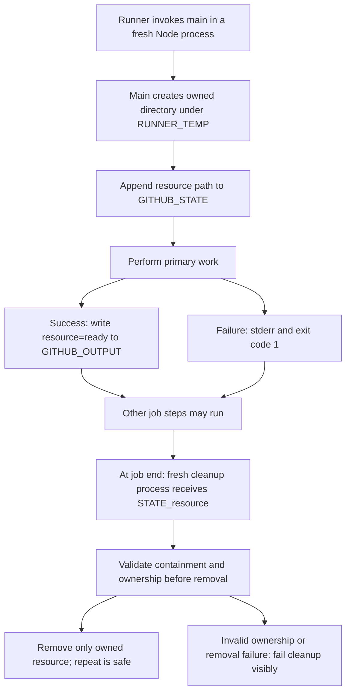

# 0023 · Action lifecycle hooks, state files, and cleanup

!!! note "Authored reference lesson"
    `labs/0023/` creates only owned temporary directories, runs main and cleanup as separate Node processes, and removes its exercise files. Its harness models one action's state exchange; it is not a GitHub runner. Written content and author-run checks do not establish learner mastery.

## Prerequisites and goal

Read [0022 · Truthful failure contracts](0022-output-contracts-and-mocked-github-api.md). Recall that a successful intermediate operation does not make the whole action successful and that a variable belongs to one process.

Develop setup, primary-work, and cleanup responsibilities around a disposable resource. Success means you can explain what must survive the process boundary, clean up after partial work, and preserve the primary failure even when cleanup succeeds.

## A lifecycle hook is another process

An action's **lifecycle** includes work before, during, or after its primary entrypoint. JavaScript metadata supports `pre`, `main`, and `post` entrypoint paths. The runner executes those files in the declared Node runtime. They do not share JavaScript local variables or a module cache.

The [metadata reference](https://docs.github.com/en/actions/reference/workflows-and-actions/metadata-syntax), checked **2026-10-30**, defines two important scheduling details: a `pre` script runs at job startup, and a `post` script runs at job end after the action's main phase. `post` is not simply the next ordinary workflow step immediately after `main`. Later steps in the job can run before cleanup.

!!! warning "Local actions do not support runs.pre"
    GitHub documents `runs.pre` as unsupported for local `uses: ./...` actions. The runnable lab deliberately performs setup inside `main` and declares only `main` and `post`. The full three-hook example below is a reference for an action consumed remotely; do not add its `pre` field to this local lab and assume it ran.

```yaml title="Remote-action lifecycle reference — not the local lab's metadata"
runs:
  using: node24
  pre: setup.cjs
  main: index.cjs
  post: cleanup.cjs
  post-if: always() # (1)!
```

1. `post-if` defaults to `always()` when omitted. Its status functions evaluate the job's status, not just this action's own main result. `pre-if` has the corresponding job-status behavior; previous-step output context is unavailable at job startup.

The actual `labs/0023/action.yml` is:

```yaml title="Runnable local action metadata"
name: Module 4 disposable resource
description: Create an owned temporary resource in main and clean it in post
outputs:
  resource:
    description: The literal ready only after primary work succeeds
runs:
  using: node24
  main: index.cjs
  post: cleanup.cjs
  post-if: always()
```

`setup.cjs` in the remote reference is a conceptual filename, not a file claimed to exist in the lab. The lab's setup implementation is the `setup` function in `resource.cjs`.



## Choose the correct exchange channel

The runner-provided **state file**, `GITHUB_STATE`, lets phases of the **same action invocation** exchange values. A value saved as `resource` is supplied to later phases as `STATE_resource`. It is not a way to set a local variable in the current process or send a value to an unrelated action instance.

| Channel | Intended reader | Example here |
| --- | --- | --- |
| Local variable | Current Node process | The directory returned from setup |
| `GITHUB_STATE` then `STATE_resource` | Another phase of this action invocation | Private resource path for cleanup |
| `GITHUB_OUTPUT` | Workflow consumer through a step output | Public `resource=ready` result |
| `GITHUB_ENV` | Later ordinary steps in the job | A deliberate job-wide environment setting |

The lab saves only the locator cleanup requires, not a token or a serialized process object. The path is single-line and the file is UTF-8. A resource path with a newline would need a different encoding/protocol; the setup function rejects it rather than corrupting state records. See the [state-file command reference](https://docs.github.com/en/actions/reference/workflows-and-actions/workflow-commands#sending-values-to-the-pre-and-post-actions).

Toolkit provides the equivalent interfaces, but it is absent from the installed workspace:

```javascript title="Toolkit reference only"
core.saveState('resource', directory);
// In a later lifecycle process for this action invocation:
const directory = core.getState('resource');
```

Those helpers transport a string. They do not verify that the path is owned, guarantee cleanup runs after a hard kill, or make it safe to delete arbitrary locations.

## Design allocation and cleanup as one contract

`setup(env)` in `resource.cjs` requires `RUNNER_TEMP` and `GITHUB_STATE`, then creates a unique `actions-learn-...` directory below the real temporary root. It writes a fixed ownership marker, appends the directory path to state, and creates a disposable payload.

```javascript title="State handoff excerpt"
const directory = fs.mkdtempSync(path.join(root, 'actions-learn-'));
fs.writeFileSync(path.join(directory, '.owner'), 'actions-learn-0023\n', 'utf8');
fs.appendFileSync(env.GITHUB_STATE, `resource=${directory}\n`, 'utf8'); // (1)!
```

1. Persist the cleanup locator before later primary work that may fail. The complete implementation rolls back the new directory immediately if the marker or state write fails.

The deliberate partial-setup failure happens **after** state is saved and **before** the payload is created. Cleanup therefore cannot require that the payload exists. It only requires valid ownership of the directory.

`cleanup(env)` applies this policy:

1. No `STATE_resource`: report a safe no-op. Setup may never have completed.
2. A path outside the real `RUNNER_TEMP`, or a name outside the lab's resource prefix: reject removal.
3. Already removed resource: report completion successfully. Cleanup is **idempotent**: repeating it has the same acceptable final effect.
4. Existing resource: reject symlinks, non-directories, or a mismatched ownership marker, then remove the owned directory.
5. A removal error: report it and exit nonzero rather than hiding it behind a primary-work success message.

This is a small ownership check for disposable local resources, not a sandbox against a hostile process racing filesystem changes. Remote resources need an explicit owner ID, scoped API permissions, and a reconciliation strategy.

## Predict and observe a successful lifecycle

Run from the repository root:

```bash
node labs/0023/lifecycle.cjs success
```

The harness creates temporary state/output files under this lab and launches **two separate child processes**. After main exits, it reads the one supported `resource=` state record and supplies `STATE_resource` to cleanup. It launches cleanup a second time to check repeatability.

Expected fields:

```json
{
  "main": { "status": 0, "stdout": "primary work succeeded", "stderr": "" },
  "post": { "status": 0, "stdout": "cleanup removed owned resource", "stderr": "" },
  "repeat": { "status": 0, "stdout": "cleanup already complete", "stderr": "" },
  "output": "resource=ready\n",
  "resourceRemaining": false,
  "combinedStatus": 0
}
```

The harness trims displayed log endings. Its own exit status remains zero after it displays a scenario; child and combined statuses are data that tests assert. `combinedStatus` is the harness's explicit “main or post failed” policy, not a claim that it implements all runner job conclusions.

!!! tip "Predict the failure boundaries"
    If main fails after saving state, should cleanup run? If cleanup succeeds, should the original failure disappear? If main succeeds but cleanup fails, should the caller see an entirely clean success?

## Fail after allocation, then repair state handling

```bash
node labs/0023/lifecycle.cjs main-failure
node labs/0023/lifecycle.cjs partial-setup
node labs/0023/lifecycle.cjs missing-state
```

For both failure cases, expected main status is **1**, cleanup status **0**, empty action output, `resourceRemaining: false`, and `combinedStatus: 1`. Their main diagnostics distinguish `primary work failed deliberately` from `setup failed after state persisted`. Missing state skips main and produces cleanup status **0** with `cleanup skipped: no resource state`.

??? tip "Worked explanation"
    Persisted state identifies the directory even though main did not complete. Cleanup needs the directory's ownership marker, not successful payload creation. A successful cleanup repairs resource lifetime; it does not make the failed primary work succeed. Missing state cannot identify a resource safely, so cleanup must not guess a path and delete it.

Now reproduce a lost-state defect:

```bash
node labs/0023/lifecycle.cjs lost-state
```

Expected: main succeeds, post says `cleanup skipped: no resource state`, and **`resourceRemaining` is true** before harness teardown. The harness intentionally omits forwarding `STATE_resource`. It removes the leftover at the end so the experiment leaves no resource behind.

??? tip "Diagnosis and repair"
    A main-process local variable cannot cross into cleanup. In a real runner invocation, write the locator through `GITHUB_STATE` and read the resulting `STATE_resource` in post, or use Toolkit's state helpers. In the harness, restore the explicit forwarding of the saved key. The positive scenario verifies the repair. A zero cleanup exit does not alone prove no resource leaked: assert resource absence as well.

## Cleanup failure is its own evidence

```bash
node labs/0023/lifecycle.cjs cleanup-failure
```

Expected: main status **0**, post status **1**, `resourceRemaining: true`, and `combinedStatus: 1`. Main has already published `resource=ready`; cleanup cannot retract that output. A downstream workflow should consider job/step status and the resource lifecycle, not treat a previously written success value as a complete final health signal.

The normal `cleanup.cjs` catches cleanup errors, prints the error, and sets `process.exitCode = 1`. A nonzero post action can affect the job result. The exact runner conclusion, log presentation, and scheduling still need a real workflow check; the local harness only asserts its documented combined policy.

Run all focused cases:

```bash
node --test labs/0023/lifecycle.test.cjs
```

Expected: **8 tests pass**. Tests cover success and repeated cleanup, primary failure, partial setup, missing state, the deliberate lost-state leak, visible cleanup failure, rollback when state persistence fails, and refusal to remove an unowned/outside/symlink target.

## Cancellation and ordering limits

`post-if: always()` requests cleanup regardless of ordinary job success/failure. It does not guarantee execution after runner loss, machine power-off, forced process termination, or every cancellation path. For a resource that outlives the runner, also design bounded leases, expiration, and an external reconciler if the domain requires them. See [0006 · Cancellation](0006-matrices-dependencies-and-cancellation.md) and the [workflow cancellation reference](https://docs.github.com/en/actions/reference/workflows-and-actions/workflow-cancellation).

Because post runs at job end, do not use it for a value the very next ordinary step must receive. Use main outputs for that result. Keep cleanup independent of another action's private state or a guessed ordering between unrelated cleanup scripts. For a short local scope, a function-level `try/finally` can release a resource before main exits; post is useful when resource lifetime intentionally spans later job steps.

## Transfer and retrieval

Design an action that starts a disposable local service for later job steps. Specify the minimal saved state, cleanup checks, missing-state policy, and what should happen after main fails halfway through startup. Avoid using a raw process ID as the only ownership proof: IDs can be reused.

??? tip "Worked transfer"
    Save a resource identifier plus an ownership token or managed handle that can be verified later. Ensure partial startup records enough information to stop what actually started, and roll back immediately if the state handoff fails. Cleanup should handle an already stopped service and reject a mismatched owner. A remote service should also have a lease/TTL or reconciliation path for runner loss. No sensitive token should be written to workflow outputs.

Answer without reopening the example:

1. Why is setup inside main for this local action?
2. Who turns a state record into `STATE_resource`?
3. What does repeated cleanup need to tolerate?
4. Can a successful main output establish that job-end cleanup succeeded?

??? tip "Retrieval check"
    Local actions do not support `runs.pre`. The runner supplies saved state to later lifecycle processes; the harness explicitly simulates that one exchange. Repeated cleanup must tolerate an already absent owned resource. Main outputs precede post, so final status and cleanup evidence remain necessary.

## Verification limits and next session

The lab proves actual process isolation, its explicit state-record handoff, filesystem ownership checks, and failure/cleanup examples on this host. It does not execute runner hooks, conditions, cancellation, job-end ordering, or a remote service. The inactive `labs/0019/module4-contracts.yml` references the local main/post action, but has not been run on GitHub or `act`. Source checks dated **2026-10-30** and all executed commands are recorded in the module handoff through the [curated references](../references/resources.md).

Continue to [0024](0024-cross-platform-actions-and-versioned-releases.md) for portability and release compatibility.

| Previous Lesson | All Lessons | Next Lesson |
| --- | --- | --- |
| [0022 · Output files, failure status, and mocked GitHub API responses](0022-output-contracts-and-mocked-github-api.md) | [Curriculum](index.md) | [0024 · Cross-platform action behavior, dependency updates, and release versions](0024-cross-platform-actions-and-versioned-releases.md) |
