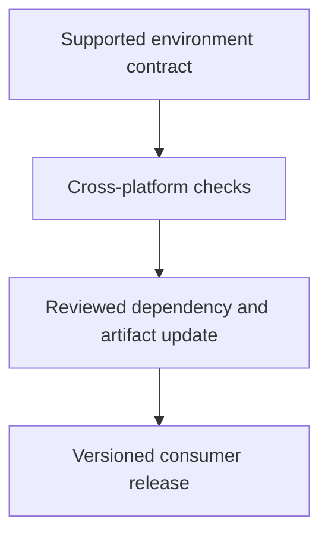

# 0024 · Cross-platform action behavior, dependency updates, and release versions

!!! note "Placeholder for a future teaching thread"
    This page is a teaching brief. Expand it into a full interactive lesson in its own thread. The planned exercises and outcomes have not been completed or demonstrated.

**Level:** Intermediate.

## Prerequisites

- [0023 · Action lifecycle hooks, state files, and cleanup](0023-javascript-action-lifecycle-and-state.md)

## What you will learn to do

- Identify OS-dependent assumptions in an action.
- Plan a versioned release and compatibility matrix with clear consumer expectations.

## Explain the Actions behavior

Start from the prerequisite workflow or action behavior and introduce these concepts with focused examples:

1. A Node runtime does not guarantee that every path, shell command, or native dependency is portable.
2. A release reference defines which executable artifact consumers receive.
3. Runtime and dependency updates need compatibility evidence rather than a version-string edit alone.

Explain the relevant workflow YAML, expressions, and action code in context. Follow the [shared teaching guide](teaching-guide.md) for pacing, expected output, and progression toward independent design.

## Planned local lab

Create an isolated exercise under `labs/0024/` when the lesson is developed. Explain setup and expected output before each command; reuse installed tools rather than reinstalling them on every step.

1. Review path construction, line endings, shell invocation, and installed binary assumptions.
2. Design Linux, macOS, and Windows cases for the actual intended support matrix.
3. Prepare a release diff with source, dist, dependency updates, and behavior changes described to a new consumer.

## Break it and diagnose it

Use a Unix-specific command from a supposedly portable Node action. Identify the actual dependency and document or remove it.

Ask for a prediction first. Capture the smallest reproducer, the actual result, and the corrected behavior. State which remaining claim requires a real GitHub or external-service check.

## Planning diagram



When expanding this lesson, refine the diagram to show the actual processes, branches, data exchange, and trust boundaries being taught.

## Retrieval questions

1. Which operating systems are truly supported by the implementation?
2. What does a release reference promise to a consumer?
3. What evidence is required before upgrading an action runtime?

## Evidence to capture in the teaching thread

- A working learner-produced example and an explanation of why it works.
- A reproduced failure, a reasoned repair, and the smallest check that verifies it.
- A short account of remaining limits, unresolved questions, and readiness for the next lesson.

Use [primary references](../references/resources.md) to verify current syntax, runtime support, and tool behavior. Add learning records only for real statements or demonstrated understanding; a placeholder or generated page does not establish mastery.

## Start this lesson in a new thread

```text
/teach 0024

Expand docs/lessons/0024-cross-platform-actions-and-versioned-releases.md in place using docs/lessons/teaching-guide.md.
Read docs/mission.md, NOTES.md, and the prerequisite lesson pages first.
Begin with a short check of the Actions prerequisites. Explain relevant YAML,
expressions, and action contracts, one concept at a time. Let me predict and
try each exercise before revealing its answer. Keep feedback local where possible.
Finish with retrieval questions and a truthful handoff for the next thread.
```

| Previous | All lessons | Next |
| --- | --- | --- |
| [0023 · Action lifecycle hooks, state files, and cleanup](0023-javascript-action-lifecycle-and-state.md) | [Curriculum](index.md) | [0025 · Composite action structure, step IDs, and output mapping](0025-composite-action-inputs-and-outputs.md) |
