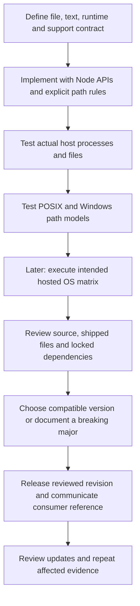

# 0024 · Cross-platform action behavior, dependency updates, and release versions

!!! note "Authored reference lesson"
    `labs/0024/` develops a portable Node file operation, host tests, an inactive OS-matrix recipe, and a release plan. No hosted matrix, tag, release, push, or publication has been executed. Authored material does not establish learner mastery or untested platform support.

## Prerequisites and goal

Read [0023 · Lifecycle and cleanup](0023-javascript-action-lifecycle-and-state.md) and retrieve the source/artifact distinction from [0021](0021-typescript-bundling-and-dist-drift.md). Recall that declaring Node 24 does not install arbitrary external binaries.

Build a line-count action with explicit text/path semantics, then prepare a compatibility and versioning decision for consumers. Success means you can identify an OS assumption, verify the portable alternative locally, and state which evidence is still required before promising Linux, macOS, and Windows support.

## Node compatibility has several boundaries

A **cross-platform contract** states which operating systems, architectures, runner versions, path formats, and behaviors an action supports. “Written in JavaScript” does not settle all of those questions. A Node action can still call a Unix binary, use a hardcoded path separator, load a native addon, or depend on a particular runner image.

The [JavaScript action tutorial](https://docs.github.com/en/actions/tutorials/create-actions/create-a-javascript-action) recommends pure JavaScript without external binary dependencies when targeting all hosted operating systems. The lab follows that principle with Node filesystem and path APIs. It does not claim those APIs erase filesystem case rules, permissions, or runner differences.



The diagram includes future release gates; only the host/model/static checks described below were executed during authoring. No arrow implies that a deferred hosted gate has already passed.

## Define the result before choosing an implementation

`labs/0024/action.yml` declares a required `file` input and one string `count` output. The file must exist relative to `GITHUB_WORKSPACE`. The implementation defines a **logical line** as follows:

- Empty file: zero lines.
- LF, CRLF, and lone CR all separate lines.
- A final line terminator ends the last line and adds no extra line.
- An unterminated final line still counts.
- Blank lines count, so `a\n\n` represents two lines.

This policy avoids inheriting the incidental behavior of a platform command. It is appropriate for small UTF-8 text fixtures read into memory. Huge or binary files would need a separately designed streaming/encoding contract.

```javascript title="labs/0024/lines.cjs — text rule"
function lineCount(text) {
  if (typeof text !== 'string') throw new Error('text must be a string');
  if (!text) return 0;
  const normalized = text.replace(/\r\n?/gu, '\n'); // (1)!
  const content = normalized.endsWith('\n') ? normalized.slice(0, -1) : normalized;
  return content.split('\n').length;
}
```

1. Normalize CRLF as a pair before treating lone CR as a separator. The removed final separator is optional; an unterminated final line is preserved.

!!! tip "Predict the boundary cases"
    How many lines are in an empty string, `a\nb`, `a\r\nb\r\n`, and `a\n\n`? Would `wc -l` necessarily return the same answer for an unterminated final line?

??? tip "Worked prediction"
    The results are 0, 2, 2, and 2 under this documented rule. `wc -l` counts newline characters rather than implementing this logical-line policy, so an unterminated final line exposes a semantic difference even on a machine where the binary exists. Portability includes a stable meaning, not only executable availability.

## Treat paths as data, not shell fragments

The adapter resolves the input against `GITHUB_WORKSPACE` and rejects blank, newline-bearing, absolute, and escaping paths. It uses native `node:path` operations rather than concatenating `workspace + '/' + input`. It then resolves filesystem links and checks containment again before reading the file. This stops the tested simple path escapes; it is not a complete sandbox against another process racing the filesystem.

The lab's fixture is named `fixtures/report with spaces-रोहित.txt`. Spaces and Unicode are ordinary path characters. The action never inserts the path into a shell command. Relative input uses the caller's workspace, while the Node module's `__dirname` identifies its own action directory. Confusing those locations commonly works in a local checkout and fails when the action is fetched separately.

```javascript title="Real adapter excerpt"
const candidate = workspaceFile(process.env.GITHUB_WORKSPACE, process.env.INPUT_FILE ?? '');
const root = fs.realpathSync(process.env.GITHUB_WORKSPACE);
const actual = fs.realpathSync(candidate);
workspaceFile(root, path.relative(root, actual)); // (1)!
const count = lineCount(fs.readFileSync(actual, 'utf8'));
fs.appendFileSync(process.env.GITHUB_OUTPUT, `count=${count}\n`, 'utf8');
```

1. The complete adapter validates the output path before writing and catches failures with stderr plus exit 1. The second containment check follows links to the actual file and rejects an outside target. It is separate from basic input-string normalization.

`node:path` uses host conventions by default. `path.posix` and `path.win32` let tests exercise both lexical models on one machine. The [Node path reference](https://nodejs.org/api/path.html) explains those model differences. A Windows path-model assertion on macOS does not open a file on NTFS or verify PowerShell execution.

## Run the host contract and a deliberate binary failure

From the repository root:

```bash
node --test labs/0024/portable.test.cjs
```

Expected: **8 tests pass**. The suite checks defined line endings, both path models, a real file with spaces/Unicode, missing/escaping input, a real CRLF file, rejection of a link outside the workspace, and a deliberately missing external executable. The actual process returns stdout `lines=2`, output file `count=2`, empty stderr, and status 0 for the checked-in fixture.

The broken implementation uses:

```javascript title="Deliberate dependency in labs/0024/broken.cjs"
execFileSync('wc', ['-l', file], { encoding: 'utf8' });
```

`execFileSync` with an argument array avoids shell interpolation, but it still requires `wc` to exist. The final regression test launches this broken adapter with `PATH` pointing only to the fixture directory, which contains no `wc`. Node itself is started by its absolute executable path.

??? tip "Diagnosis and repair"
    The broken child exits 1 with `ENOENT`, exposing executable lookup as the failed boundary. Quoting the path or changing action metadata cannot install the missing binary. The repaired child uses Node's own file read and `lineCount`, succeeds with the same restricted `PATH`, and returns `count=2`. This is a deterministic missing-binary experiment on the current host, not a claim that a Windows runner was executed.

The authoring host was **macOS ARM64, Node 24.21.0**. No dependency installation or external shell utility is required by the repaired action. A `.cjs` entrypoint removes ambiguity about the module format, but does not by itself guarantee compatibility with every Node version.

## Prepare the intended hosted matrix

`labs/0024/module4-platforms.yml` is a complete inactive workflow recipe. It uses the existing reviewed checkout commit and calls the local action after checkout:

```yaml title="OS-matrix excerpt"
strategy:
  fail-fast: false # (1)!
  matrix:
    os: [ubuntu-latest, macos-latest, windows-latest]
runs-on: ${{ matrix.os }}
timeout-minutes: 5
steps:
  # The complete recipe performs pinned checkout here.
  - id: count
    uses: ./labs/0024
    with:
      file: labs/0024/fixtures/report with spaces-रोहित.txt
  - name: Check runner-consumed output
    env:
      COUNT: ${{ steps.count.outputs.count }}
    run: node -e "require('node:assert/strict').equal(process.env.COUNT, '2')" # (2)!
```

1. Each OS case can report its own result even if another fails. This matrix expands to three jobs if later executed.
2. The assertion is a Node command accepted by the intended default shells, avoiding a Bash-only `test` command. The complete recipe also runs the host test file using the image's Node executable. That executable is separate from the runner-managed `node24` action runtime; record its version when gathering hosted evidence.

Static-check the recipe without dispatching it:

```bash
.tools/bin/actionlint -color labs/0024/module4-platforms.yml
```

Expected: no diagnostics and exit 0. A second inactive recipe, `labs/0019/module4-contracts.yml`, statically connects all six Module 4 action interfaces. It can be checked with the same command.

Future hosted use requires a deliberate decision to copy a recipe into `.github/workflows/`, review the selected revision, and manually dispatch it. That is not part of this authoring task. The matrix has not been run, and `-latest` labels also move over time. Passing a single current runner image would not establish every self-hosted installation, architecture, or future image.

`act` can exercise selected Linux wiring if an engine is available, but it does not turn Linux containers into macOS or Windows VMs. This module did not require or attempt container execution. See the [local/hosted guide](../cheatsheet/local-testing.md) and [0012 · Coverage boundaries](0012-local-hosted-coverage-and-usage-budget.md).

## Version the contract a consumer receives

A release reference selects a repository revision containing metadata and executable files. A major tag such as `v1` commonly moves to a later compatible release; a full commit SHA selects fixed source content. An ordinary version-looking tag is still a Git ref unless protected by an appropriate release policy. Do not confuse “looks like a version” with immutability.

GitHub's [release-maintenance guide](https://docs.github.com/en/actions/how-tos/create-and-publish-actions/release-and-maintain-actions) describes semantic release tags and compatible major/minor aliases. With [immutable releases](https://docs.github.com/en/actions/how-tos/create-and-publish-actions/using-immutable-releases-and-tags-to-manage-your-actions-releases), release-linked tags cannot simply be force-moved; manage moving aliases separately according to that feature's documented policy. The [secure-use reference](https://docs.github.com/en/actions/reference/security/secure-use) recommends reviewing and pinning full-length commit references for stable content selection. A pin still needs a maintenance process to receive reviewed fixes.

`labs/0024/release-plan.json` is a local review artifact, not a release. It lists `v1.1.0` as a **candidate requiring compatibility review**, records `hostedMatrixExecuted: false`, and explicitly says no publication occurred. Do not replace that flag with a claimed pass based on path-model tests.

Consider the contract before deciding the version:

- A new optional output with unchanged existing behavior may fit a compatible feature release.
- Changing whether an unterminated final line counts can change a downstream gate's result. If previous consumers relied on the old behavior, it needs a breaking-change decision and migration guidance.
- Raising the Node runtime may exclude older self-hosted runners even when the input/output schema stays identical. Include runner prerequisites and runtime evidence in the compatibility decision.

The plan therefore does not certify that `v1.1.0` is appropriate. The correct version depends on the previous public contract, not the size of the source diff.

## Dependency updates and distribution review

For a bundled action like 0021, a dependency update changes the source supply chain and potentially shipped code. Review the package/lock diff, maintainer release notes, runtime support, license changes, and the regenerated distribution together. Then run type checks, pure/process tests, drift comparison, and the affected OS/runner cases. A changed version string alone is insufficient evidence.

This workspace's dependency manifests and lockfiles are shared. The lab adds no packages and performs no upgrades. The release-plan exercise records the required review instead. In a real standalone repository, include all runtime-required modules/assets at the selected revision; consumers should not need to install your authoring toolchain to run the action.

No Git tags or releases are needed to practice the decision. Inspect the plan locally:

```bash
node -e "const p=require('./labs/0024/release-plan.json'); console.log(p.candidate, p.hostedMatrixExecuted, p.publication)"
```

Expected:

```text
v1.1.0 false plan only; no tags, pushes, releases, or Marketplace writes
```

## Transfer exercise and retrieval

A consumer pins an action to a full commit and reports that an upstream `v1` update did not fix their workflow. Explain what must change. Then design evidence for replacing a native compression addon with a pure JavaScript dependency while promising the same archive output.

??? tip "Worked transfer"
    The pin intentionally keeps the old revision. Review the new release and update the consumer to its verified full commit; moving `v1` does not change an existing SHA pin. For compression, compare public archive behavior and error cases, review dependency/licensing and bundle changes, test actual emitted files with an independent reader, and execute the intended OS/architecture matrix. Removing native installation requirements is useful, but does not prove byte equivalence or performance. Record any changed format or runtime requirements in the release contract.

Retrieve without looking:

1. Which assertions actually opened files on Windows during this authoring session?
2. What does a portable path model leave untested?
3. Why can a one-character counting change require a major version?
4. What evidence links the reviewed source to what a consumer executes?

??? tip "Retrieval check"
    None: actual file execution was on macOS; Windows assertions used a lexical model. Filesystem behavior, runner images, shells, installed tools, and native dependencies require target-platform evidence. A small implementation change can break a documented result used by callers. Metadata, fresh shipped bytes, artifact tests, and the exact reviewed release revision together connect authored source to consumer execution.

## Verification limits and handoff

Local tests and actionlint pass for the cases recorded in the Module 4 handoff. Hosted OS/architecture runs, older-runner compatibility, release-reference resolution, dependency upgrades, and publication remain unexecuted. Sources were checked on **2026-10-30** using the [curated library](../references/resources.md) and its linked maintainer documentation. Documentation validation is deferred to the coordinator's combined authoring pass.

During teaching, record the learner's portability diagnosis and versioning rationale. Continue sequentially to [0025 · Composite structure and output mapping](0025-composite-action-inputs-and-outputs.md), the start of Module 5.

## Start this lesson in a new thread

```text
/teach 0024

Use docs/lessons/0024-cross-platform-actions-and-versioned-releases.md and labs/0024/.
Read docs/mission.md, NOTES.md, docs/lessons/teaching-guide.md, and lesson 0023.
Ask me to predict line endings and the hidden wc dependency before tests.
Pause before portability, release-version, and transfer solutions.
Keep host/path-model evidence separate from unexecuted hosted support.
Record actual evidence and hand off to exact file
docs/lessons/0025-composite-action-inputs-and-outputs.md.
```

| Previous Lesson | All Lessons | Next Lesson |
| --- | --- | --- |
| [0023 · Action lifecycle hooks, state files, and cleanup](0023-javascript-action-lifecycle-and-state.md) | [Curriculum](index.md) | [0025 · Composite action structure, step IDs, and output mapping](0025-composite-action-inputs-and-outputs.md) |
