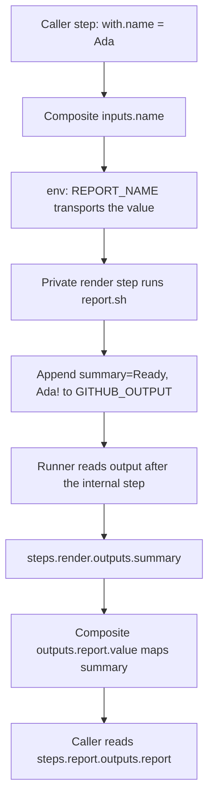

# 0025 · Composite action structure, step IDs, and output mapping

Trace an input through the action in `labs/0025/` and back out through its public output. Predict each result before opening the worked solution.

## Put a step interface around existing work

A **composite action** packages a sequence of `run` or `uses` steps for invocation as one step of a caller's job. Its steps share that job's runner. The caller owns runner selection and job permissions. Start with a small domain operation; maintained checkout and runtime actions remain responsible for their existing platform operations.

The lab's interface is deliberately small:

| Interface | Meaning |
| --- | --- |
| Input `name` | A nonblank single line, at most 160 Bash characters; default `Ada` |
| Public output `report` | `Ready, <name>!`, a string for later caller expressions |
| Internal step `render` | An implementation reference, used inside this action |
| Internal output `summary` | The record the script publishes for that step |
| Failure | Nonzero status, diagnostic on stderr, no new success output |

The public output and internal output deliberately have different names. Their relationship is explicit, rather than a naming convention.



The diagram includes runner processing. A direct shell invocation reaches the file-write boundary and does not execute the later expression mappings.

## Read the complete action metadata

```yaml title="labs/0025/action/action.yml"
name: Ready report
description: Render a bounded report through a public output.
inputs:
  name:
    description: Nonblank single-line report recipient.
    default: Ada
outputs:
  report:
    description: Ready report for the caller.
    value: ${{ steps.render.outputs.summary }} # (1)!
runs:
  using: composite
  steps:
    - id: render # (2)!
      shell: bash
      env:
        REPORT_NAME: ${{ inputs.name }} # (3)!
        ACTION_DIR: ${{ github.action_path }}
      run: bash "$ACTION_DIR/report.sh"
```

1. `value` exports the private result through the action's public `report` name.
2. `id` supplies the expression reference. A human-readable `name` would not replace it. The caller has its own `id: report`, in a different scope.
3. Composite inputs are read through `inputs`; they do not automatically become `INPUT_NAME`. This explicit environment mapping is part of the adapter.

GitHub's [composite tutorial](https://docs.github.com/en/actions/tutorials/create-actions/create-a-composite-action) and [metadata reference](https://docs.github.com/en/actions/reference/workflows-and-actions/metadata-syntax) define these boundaries. Declaring an action input `required: true` is not a replacement for validation in the action implementation. This example uses a default and validates the actual value before publishing a result.

## Keep the script contract visible

The real `report.sh` checks missing, blank, CR/LF-bearing, and overlong names. It requires `GITHUB_OUTPUT`, then appends:

```bash title="Successful branch of labs/0025/action/report.sh"
printf 'summary=Ready, %s!\n' "$name" >> "$GITHUB_OUTPUT" # (1)!
printf '%s\n' 'report rendered'
```

1. A fixed format string and quoted value preserve literal text and the output path. The script rejects line endings so this single-line protocol cannot acquire another record from the name.

The second line is only a log. The first line writes the result the runner can later consume. The script does not print the recipient; this also avoids letting arbitrary label text resemble workflow commands in logs.

Run every command from the repository root, using installed tools. This direct observation supplies the environment explicitly; the runner has not applied a metadata default:

```bash
report_output="$(mktemp)"
REPORT_NAME=Ada GITHUB_OUTPUT="$report_output" bash labs/0025/action/report.sh
cat "$report_output"
rm "$report_output"
```

Expected, exit **0**:

```text
report rendered
summary=Ready, Ada!
```

The first line comes from script stdout and the second from `cat`. A direct invocation with no `REPORT_NAME` fails; the default `Ada` belongs to `action.yml`, not to this shell script.

!!! tip "Prediction"
    If you change only `outputs.report.value` to an empty string, will this direct command fail? What will a caller reading the public output receive?

??? tip "Worked prediction"
    The script still writes `summary=Ready, Ada!` and exits zero. The command never reads metadata. A runner executing the composite will export the empty public value instead. The caller-visible assertion is the check that can expose this defect.

## Exercise the real process, including failure

```bash
.venv/bin/python labs/0025/test_contract.py
```

Expected: **3 unittest methods pass**, containing five valid-name cases, six invalid-name cases, and a missing-output-path case. The tests launch Bash with real temporary files whose paths contain spaces. They compare bytes, status, stdout, and stderr separately, and verify that existing output records survive both appends and invalid input.

Now deliberately fail before output publication:

```bash
report_output="$(mktemp)"
REPORT_NAME=$'Ada\nready=true' GITHUB_OUTPUT="$report_output" bash labs/0025/action/report.sh
wc -c < "$report_output"
rm "$report_output"
```

Expected: the Bash command exits **1**, stderr says `name must be a nonblank single line of at most 160 characters`, and `wc` reports **0** bytes. Run the lines individually to observe the script's status; the later cleanup command has its own status. The test script expects the child to fail. The test passes when the child returns the required status, diagnostic, and empty output.

??? tip "Diagnosis and repair"
    The name contains an LF followed by text shaped like an extra output record. Rejecting it preserves the single-line interface. Repair the input to `Ada` and repeat the first command. If multiline data is a legitimate requirement, design an encoding or multiline protocol instead of removing this check without changing the contract; lesson 0027 uses JSON encoding.

## Read the caller and locate a wiring failure

`labs/0025/consumer.yml` is an inactive workflow recipe. Its complete job performs pinned checkout first, then:

```yaml title="Caller excerpt"
- id: report
  uses: ./labs/0025/action
  with:
    name: Ada
- shell: bash
  env:
    ACTUAL: ${{ steps.report.outputs.report }}
  run: test "$ACTUAL" = 'Ready, Ada!'
```

Checkout makes the repository-local action directory available. `uses: ./labs/0025/action` resolves from the workspace root, not beside the caller YAML. The `ACTUAL` environment value consumes the public result after the action step completes.

For a refactoring exercise, copy the lab to a disposable directory, rename private `id: render` to `id: format`, and leave the output mapping unchanged. Predict the missing public value. The old mapping no longer names the producer. A runner may report the invalid reference or leave the value unavailable. Update it to `steps.format.outputs.summary`. Keep public `report` unchanged so consumers need no edits.

The directly runnable invalid-input case above establishes process failure. This metadata-refactoring prediction requires actual metadata execution for runtime evidence; a script test cannot establish its exact runner diagnostic.

Static-check the inactive consumer without running it:

```bash
.tools/bin/actionlint -no-color labs/0025/consumer.yml
```

Expected: exit **0**, no diagnostics. Actionlint inspects workflow structure and known interfaces; it cannot prove every shell-generated output value. [0028](0028-composite-script-tests-and-workflow-wiring.md) provides positive and deliberately broken caller-level smoke recipes.

## Transfer exercise and retrieval

A team wants an action output `package-version`; its internal step writes `version=1.2.3`. Design the metadata mapping, a direct process assertion, and a caller-level assertion. Then rename the internal step without changing the consumer.

??? tip "Worked transfer"
    Give the private step an ID such as `read`, map `outputs.package-version.value` to `steps.read.outputs.version`, and assert the actual output file contains `version=1.2.3`. The consumer identifies its action invocation and asserts `steps.package.outputs.package-version == '1.2.3'` through environment transport. Renaming private `read` to `inspect` requires updating the composite mapping; public `package-version` stays stable. Only the caller check observes the complete public mapping.

Retrieve without looking:

1. Which of `report`, `render`, and `summary` is the caller's interface?
2. Why does a direct script need an explicit `REPORT_NAME=Ada`?
3. What does a correct stdout message leave unproven?
4. Which test changes when you change only metadata?

??? tip "Retrieval check"
    `report` is public. The runner normally supplies the metadata default and environment mapping; Bash alone does neither. Logs leave output publication and mapping unproven. Metadata needs static inspection and a selected caller-level execution check; keep the fast adapter tests too.

## Local and hosted boundaries

These host exercises validate Bash processes and output-file bytes. With a compatible engine, a selected act run can expand the composite and check how its caller reads the public output. Real GitHub output processing, action acquisition policy, and runner compatibility remain separate evidence. See the [local testing guide](../cheatsheet/local-testing.md).

Primary syntax references linked above were checked on **2026-10-30**, starting from the [curated library](../references/resources.md). Continue to [0026](0026-composite-shells-paths-and-portability.md) to separate action-owned code paths from caller-owned data.

| Previous lesson | All lessons | Next lesson |
| --- | --- | --- |
| [0024 · Cross-platform action behavior, dependency updates, and release versions](0024-cross-platform-actions-and-versioned-releases.md) | [Curriculum](index.md) | [0026 · Explicit shells, action paths, paths with spaces, and portability](0026-composite-shells-paths-and-portability.md) |
