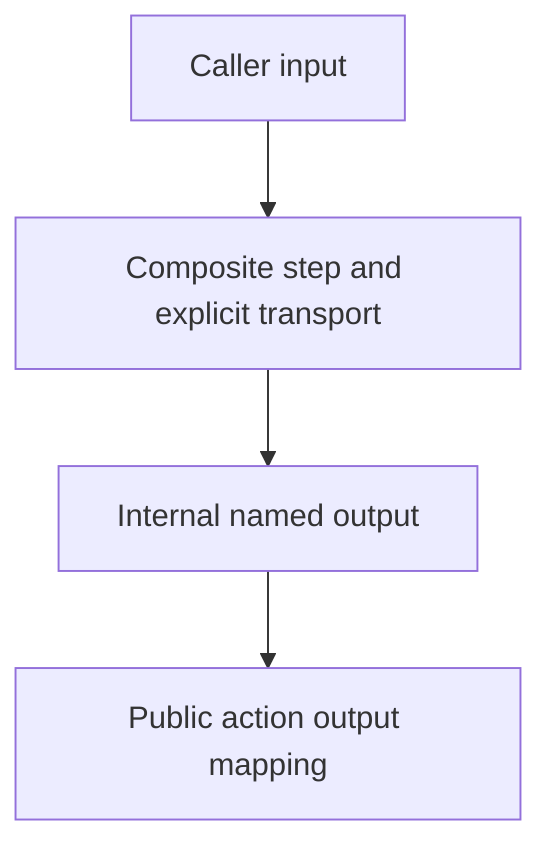

# 0025 · Composite action structure, step IDs, and output mapping

!!! note "Placeholder for a future teaching thread"
    This page is a teaching brief. Expand it into a full interactive lesson in its own thread. The planned exercises and outcomes have not been completed or demonstrated.

**Level:** Intermediate to advanced.

## Prerequisites

- [0024 · Cross-platform action behavior, dependency updates, and release versions](0024-cross-platform-actions-and-versioned-releases.md)
- [0005 · Environment files and step, job, and workflow output contracts](0005-environment-files-and-output-contracts.md)
- [0011 · Run one event and one job with act](0011-act-targeted-workflow-smoke-tests.md)

## What you will learn to do

- Trace an input through a composite script and back to the caller.
- Distinguish script behavior from metadata mapping behavior.

## Explain the Actions behavior

Start from the prerequisite workflow or action behavior and introduce these concepts with focused examples:

1. A composite action presents a step-level interface around multiple internal steps.
2. Inputs and outputs must be transported and mapped explicitly.
3. The caller observes the action output, not every private internal step value.

Explain the relevant workflow YAML, expressions, and action code in context. Follow the [shared teaching guide](teaching-guide.md) for pacing, expected output, and progression toward independent design.

## Planned local lab

Create an isolated exercise under `labs/0025/` when the lesson is developed. Explain setup and expected output before each command; reuse installed tools rather than reinstalling them on every step.

1. Read the starter composite action and explain each metadata field.
2. Run its extracted script directly with a temporary output file.
3. Exercise the caller-visible output through the selected smoke workflow when a compatible engine is available.

## Break it and diagnose it

Change the internal step ID without updating the action output mapping. Diagnose the mismatch at the wiring boundary.

Ask for a prediction first. Capture the smallest reproducer, the actual result, and the corrected behavior. State which remaining claim requires a real GitHub or external-service check.

## Planning diagram



When expanding this lesson, refine the diagram to show the actual processes, branches, data exchange, and trust boundaries being taught.

## Retrieval questions

1. Which output is public to the caller?
2. Why can a valid script still produce an empty action output?
3. What should be a stable part of a composite interface?

## Evidence to capture in the teaching thread

- A working learner-produced example and an explanation of why it works.
- A reproduced failure, a reasoned repair, and the smallest check that verifies it.
- A short account of remaining limits, unresolved questions, and readiness for the next lesson.

Use [primary references](../references/resources.md) to verify current syntax, runtime support, and tool behavior. Add learning records only for real statements or demonstrated understanding; a placeholder or generated page does not establish mastery.

## Start this lesson in a new thread

```text
/teach 0025

Expand docs/lessons/0025-composite-action-inputs-and-outputs.md in place using docs/lessons/teaching-guide.md.
Read docs/mission.md, NOTES.md, and the prerequisite lesson pages first.
Begin with a short check of the Actions prerequisites. Explain relevant YAML,
expressions, and action contracts, one concept at a time. Let me predict and
try each exercise before revealing its answer. Keep feedback local where possible.
Finish with retrieval questions and a truthful handoff for the next thread.
```

| Previous | All lessons | Next |
| --- | --- | --- |
| [0024 · Cross-platform action behavior, dependency updates, and release versions](0024-cross-platform-actions-and-versioned-releases.md) | [Curriculum](index.md) | [0026 · Explicit shells, action paths, paths with spaces, and portability](0026-composite-shells-paths-and-portability.md) |
