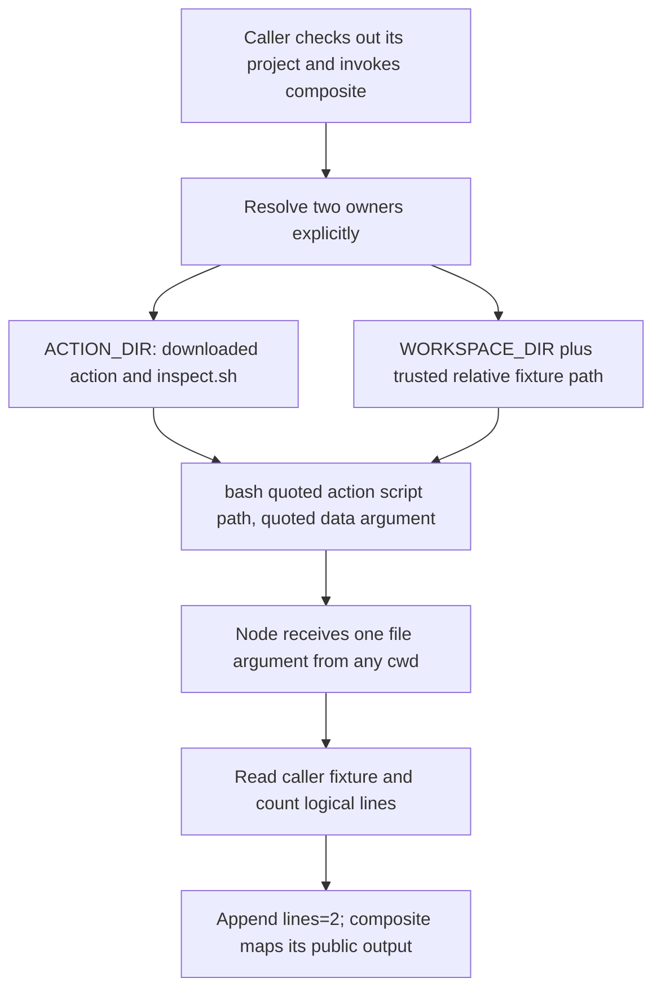

# 0026 · Explicit shells, action paths, paths with spaces, and portability

`labs/0026/` puts action code, caller data, and the working directory in separate locations. Its disposable copies expose path assumptions that disappear when everything lives in one directory.

## Name the owner of each path

Three locations often happen to coincide in a small checkout. They are different contracts:

| Location | Owner and purpose |
| --- | --- |
| `github.action_path` / `GITHUB_ACTION_PATH` | Directory containing the executing composite action and its bundled helpers |
| `github.workspace` / `GITHUB_WORKSPACE` | Caller workspace, normally containing checked-out project files |
| Current working directory | Directory against which the running process resolves relative paths |

A remote action may be installed outside the caller checkout. A successful `bash inspect.sh` from your development directory does not prove a consumer can locate that file. Conversely, locating a caller's input fixture inside the action directory gives the action the wrong data owner.

GitHub's [composite tutorial](https://docs.github.com/en/actions/tutorials/create-actions/create-a-composite-action) demonstrates the action path; the [contexts reference](https://docs.github.com/en/actions/reference/workflows-and-actions/contexts) describes the workspace and context availability. Prefer explicit environment mapping when a context path is needed inside shell source.



## Make the shell and tool contract explicit

Every composite `run` step needs a `shell`. This lab requires Bash and Node 24; declaring `shell: bash` selects a shell but does not install Node. The inactive consumer uses maintained setup-node before the local composite. Its runtime selection is distinct from the Node runtime the setup action itself uses.

```yaml title="labs/0026/action/action.yml, internal step"
- id: inspect
  shell: bash # (1)!
  env:
    ACTION_DIR: ${{ github.action_path }}
    WORKSPACE_DIR: ${{ github.workspace }}
    REPORT_FILE: ${{ inputs.file }}
  run: bash "$ACTION_DIR/inspect.sh" "$WORKSPACE_DIR/$REPORT_FILE" # (2)!
```

1. Bash syntax includes `[[ ... ]]` and the strict-mode behavior used by the scripts. A shebang in a file does not choose the interpreter for an inline YAML `run` block.
2. The code path belongs to the action; the data path belongs to the caller. Both arguments are quoted after environment expansion, preserving spaces.

`inspect.sh` checks that it received exactly one argument, then calls its bundled Node helper:

```bash title="Invocation inside labs/0026/action/inspect.sh"
node "$ACTION_DIR/inspect.cjs" "$1" # (1)!
```

1. Node opens the file directly. It does not construct another shell command containing the filename.

The helper counts logical lines after normalizing CRLF and lone CR to LF. Empty content counts zero; a final terminator ends a line without adding another. The checked-in fixture has `alpha` and `beta`, so it produces two. Its stdout is JSON containing the received path and count, so the test can check the exact path the helper received. A zero exit alone would not prove that path was correct.

!!! note "Path lookup is not a filesystem sandbox"
    The `file` input in this exercise is a trusted relative fixture path. Concatenating a workspace path does not reject `..`, symlinks, or races, and quoting does not make an arbitrary input path safe to read. For an untrusted file selector, define and test a containment policy before granting access. Lesson 0024 demonstrates additional path validation.

## Reproduce the failures and the repair locally

Run from the repository root:

```bash
.venv/bin/python labs/0026/paths.py
```

The test script creates three directories under one temporary root: `downloaded action`, `caller workspace`, and `unrelated working directory`. It copies code and the file `input with spaces.txt`, uses a temporary output path, and runs all commands from the unrelated directory. It removes the entire fixture afterward.

Expected, exit **0**:

```text
relative script: EXPECTED FAILURE (inspect.sh absent from cwd)
unquoted action path: EXPECTED FAILURE (space splits script path)
quoted action path + workspace file: PASS (one argument, lines=2)
```

The test script exits zero after observing both intended failures and the repaired child's success. The broken child commands still fail.

!!! tip "Predict each invocation"
    From the unrelated directory, which path does `bash inspect.sh "$file"` use? What changes if you write `bash $ACTION_DIR/inspect.sh "$file"`? Does quoting only the data filename fix both problems?

??? tip "Worked diagnosis"
    The first command looks for `inspect.sh` in the current directory and fails because the code is elsewhere. The second expands an unquoted action path containing a space into multiple shell words, so Bash receives a truncated script path. The repaired command is `bash "$ACTION_DIR/inspect.sh" "$file"`. The code location and argument boundary are independent problems; fix both.

The final assertion checks JSON `argument` equals the exact fixture path and the output file contains precisely `lines=2` plus LF. The test does not use the shell's printed command line as proof of `argv`.

## Inspect the complete inactive consumer

`labs/0026/consumer.yml` checks out the caller repository, sets Node, calls the composite, and asserts the public string output:

```yaml title="Runtime setup and invocation excerpt"
- uses: actions/setup-node@949feb2413d6458794dcd2491c4babbbce0c15c1 # v7.1.0
  with:
    node-version: '24'
    package-manager-cache: false # (1)!
- id: fixture
  uses: ./labs/0026/action
- shell: bash
  env:
    LINES: ${{ steps.fixture.outputs.lines }}
  run: test "$LINES" = 2
```

1. The fixture uses Node built-ins and installs no project packages. Disabling automatic package-manager caching avoids introducing a cache/lockfile contract that this exercise does not need.

The `file` input defaults to `labs/0026/fixtures/input with spaces.txt`. It is a scalar value in YAML and stays a single argument through quoted shell expansion. Quote YAML when its own syntax requires it; YAML quoting and shell quoting act at different stages.

Static-check this exact consumer:

```bash
.tools/bin/actionlint -no-color labs/0026/consumer.yml
```

Expected: exit **0**, no diagnostics. This does not execute setup-node, open the fixture through the composite runner, or test another OS.

## Supporting platforms is an evidence decision

The runnable contract targets a Unix-style Bash/Node environment, with the inactive workflow choosing `ubuntu-latest`. The host test script also runs on the recorded macOS system. Do not infer a Windows support promise from Bash being available on one Windows installation, or from a filename test on macOS.

A PowerShell implementation would use its own variable syntax, argument rules, encoding choices, and native path handling. Replacing `shell: bash` with `shell: pwsh` leaves Bash source invalid. The job selects the runner. Adding `runs-on` inside composite metadata cannot change it. If consumers need different runner families, expose that policy at a workflow/job boundary and execute representative runner cases.

For repository project commands that intentionally depend on a working directory, use an explicit `working-directory` on the appropriate `run` step. Do not rely on `defaults.run` to locate bundled action code. Keep action-owned helper paths anchored to the action directory even if the caller changes where it runs project commands.

## Transfer exercise and retrieval

A remote composite packages `scripts/report.cjs`, but reads the consumer's `config/build rules.json`. Sketch the invocation. The caller sometimes checks out its repository into `source/` under the workspace. What must the interface specify?

??? tip "Worked transfer"
    Anchor the helper to an environment value mapped from `github.action_path`, and resolve the data path from the documented caller root. If checkout uses `path: source`, the input could be explicitly workspace-relative `source/config/build rules.json`, or the interface could accept a separately validated project-root value. `GITHUB_WORKSPACE` itself does not become the checkout subdirectory just because checkout uses that path. Quote each argument and test from an unrelated cwd with spaces in both roots.

Retrieve without looking:

1. Which root contains code from a remote composite?
2. Why does selecting Bash not provide a Node executable?
3. Which failure survives quoting the data path correctly?
4. Does the path exercise prove containment or Windows execution?

??? tip "Retrieval check"
    Look for bundled code in the action installation directory. Runtime setup is a separate operation. A relative or split script path still fails even with a correct data argument. This test script checks paths on the host where it runs. It does not isolate the filesystem or run an OS matrix.

## Verification boundary and sources

The deterministic host exercise tests real files and processes. An engine-backed selected caller checks runner expansion and mappings, while intended OS images and GitHub action acquisition need separate execution evidence. Keep [0012 · Coverage boundaries](0012-local-hosted-coverage-and-usage-budget.md) available when describing support.

Sources checked **2026-10-30**: the linked GitHub composite and contexts references, the [metadata shell contract](https://docs.github.com/en/actions/reference/workflows-and-actions/metadata-syntax#runsstepsshell), and the pinned [setup-node metadata](https://raw.githubusercontent.com/actions/setup-node/949feb2413d6458794dcd2491c4babbbce0c15c1/action.yml). Continue to [0027](0027-untrusted-input-and-shell-quoting.md) for untrusted text transport.

| Previous lesson | All lessons | Next lesson |
| --- | --- | --- |
| [0025 · Composite action structure, step IDs, and output mapping](0025-composite-action-inputs-and-outputs.md) | [Curriculum](index.md) | [0027 · Transport inputs safely through environment variables and quoted arguments](0027-untrusted-input-and-shell-quoting.md) |
