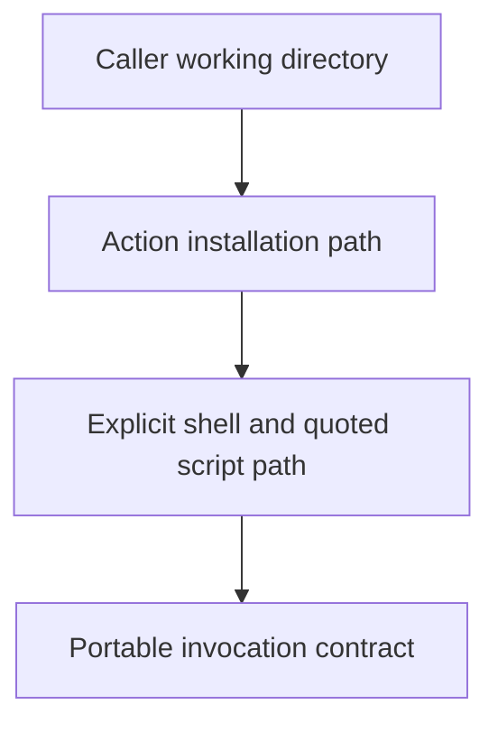

# 0026 · Explicit shells, action paths, paths with spaces, and portability

!!! note "Placeholder for a future teaching thread"
    This page is a teaching brief. Expand it into a full interactive lesson in its own thread. The planned exercises and outcomes have not been completed or demonstrated.

**Level:** Intermediate to advanced.

## Prerequisites

- [0025 · Composite action structure, step IDs, and output mapping](0025-composite-action-inputs-and-outputs.md)

## What you will learn to do

- Resolve a script belonging to the action regardless of the caller working directory.
- Explain shell and platform requirements as part of the action contract.

## Explain the Actions behavior

Start from the prerequisite workflow or action behavior and introduce these concepts with focused examples:

1. The caller workspace and the action installation directory are different locations.
2. A shell choice determines syntax and available process behavior.
3. Quoting and path construction must preserve actual file names across environments.

Explain the relevant workflow YAML, expressions, and action code in context. Follow the [shared teaching guide](teaching-guide.md) for pacing, expected output, and progression toward independent design.

## Planned local lab

Create an isolated exercise under `labs/0026/` when the lesson is developed. Explain setup and expected output before each command; reuse installed tools rather than reinstalling them on every step.

1. Run the composite script from a working directory unrelated to its own source.
2. Repeat using a directory name with spaces and inspect the resulting argument list.
3. Use the action-path context deliberately and state the supported shell/OS assumptions.

## Break it and diagnose it

Resolve a bundled script relative to the caller workspace. Reproduce the failure from a different directory and fix the ownership of the path.

Ask for a prediction first. Capture the smallest reproducer, the actual result, and the corrected behavior. State which remaining claim requires a real GitHub or external-service check.

## Planning diagram



When expanding this lesson, refine the diagram to show the actual processes, branches, data exchange, and trust boundaries being taught.

## Retrieval questions

1. Who owns the file being located: the caller or the action?
2. What syntax depends on the selected shell?
3. How would a caller discover unsupported platform assumptions?

## Evidence to capture in the teaching thread

- A working learner-produced example and an explanation of why it works.
- A reproduced failure, a reasoned repair, and the smallest check that verifies it.
- A short account of remaining limits, unresolved questions, and readiness for the next lesson.

Use [primary references](../references/resources.md) to verify current syntax, runtime support, and tool behavior. Add learning records only for real statements or demonstrated understanding; a placeholder or generated page does not establish mastery.

## Start this lesson in a new thread

```text
/teach 0026

Expand docs/lessons/0026-composite-shells-paths-and-portability.md in place using docs/lessons/teaching-guide.md.
Read docs/mission.md, NOTES.md, and the prerequisite lesson pages first.
Begin with a short check of the Actions prerequisites. Explain relevant YAML,
expressions, and action contracts, one concept at a time. Let me predict and
try each exercise before revealing its answer. Keep feedback local where possible.
Finish with retrieval questions and a truthful handoff for the next thread.
```

| Previous Lesson | All Lessons | Next Lesson |
| --- | --- | --- |
| [0025 · Composite action structure, step IDs, and output mapping](0025-composite-action-inputs-and-outputs.md) | [Curriculum](index.md) | [0027 · Transport inputs safely through environment variables and quoted arguments](0027-untrusted-input-and-shell-quoting.md) |
