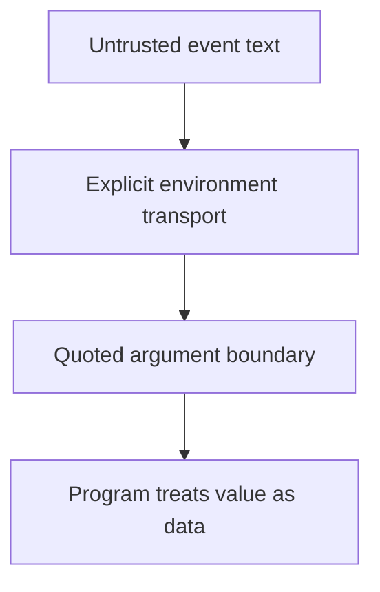

# 0027 · Transport inputs safely through environment variables and quoted arguments

!!! note "Placeholder for a future teaching thread"
    This page is a teaching brief. Expand it into a full interactive lesson in its own thread. The planned exercises and outcomes have not been completed or demonstrated.

**Level:** Intermediate to advanced.

## Prerequisites

- [0026 · Explicit shells, action paths, paths with spaces, and portability](0026-composite-shells-paths-and-portability.md)
- [0004 · Contexts, expressions, conditions, status, and input types](0004-contexts-expressions-and-conditions.md)

## What you will learn to do

- Trace how an event string reaches a shell process.
- Construct a test that proves shell-like input remains literal data.

## Explain the Actions behavior

Start from the prerequisite workflow or action behavior and introduce these concepts with focused examples:

1. Workflow expression substitution and shell evaluation happen at different stages.
2. Untrusted event text should remain data when passed into a program.
3. Quoting protects argument boundaries but does not make intentional evaluation of text safe.

Explain the relevant workflow YAML, expressions, and action code in context. Follow the [shared teaching guide](teaching-guide.md) for pacing, expected output, and progression toward independent design.

## Planned local lab

Create an isolated exercise under `labs/0027/` when the lesson is developed. Explain setup and expected output before each command; reuse installed tools rather than reinstalling them on every step.

1. Compare direct interpolation into a script with explicit environment transport in a disposable example.
2. Pass names containing spaces, dollar signs, quotes, and command-like text without using eval.
3. Assert exact output and verify that an unrelated marker file was never created.

## Break it and diagnose it

Turn untrusted text into generated shell code in a controlled lab. Explain the evaluation stage and repair the data boundary.

Ask for a prediction first. Capture the smallest reproducer, the actual result, and the corrected behavior. State which remaining claim requires a real GitHub or external-service check.

## Planning diagram



When expanding this lesson, refine the diagram to show the actual processes, branches, data exchange, and trust boundaries being taught.

## Retrieval questions

1. At which stage could a value become executable code?
2. Why is validation still useful after quoting?
3. How would a regression test prove that an injection-shaped value stayed data?

## Evidence to capture in the teaching thread

- A working learner-produced example and an explanation of why it works.
- A reproduced failure, a reasoned repair, and the smallest check that verifies it.
- A short account of remaining limits, unresolved questions, and readiness for the next lesson.

Use [primary references](../references/resources.md) to verify current syntax, runtime support, and tool behavior. Add learning records only for real statements or demonstrated understanding; a placeholder or generated page does not establish mastery.

## Start this lesson in a new thread

```text
/teach 0027

Expand docs/lessons/0027-untrusted-input-and-shell-quoting.md in place using docs/lessons/teaching-guide.md.
Read docs/mission.md, NOTES.md, and the prerequisite lesson pages first.
Begin with a short check of the Actions prerequisites. Explain relevant YAML,
expressions, and action contracts, one concept at a time. Let me predict and
try each exercise before revealing its answer. Keep feedback local where possible.
Finish with retrieval questions and a truthful handoff for the next thread.
```

| Previous Lesson | All Lessons | Next Lesson |
| --- | --- | --- |
| [0026 · Explicit shells, action paths, paths with spaces, and portability](0026-composite-shells-paths-and-portability.md) | [Curriculum](index.md) | [0028 · Test composite scripts and then their workflow wiring](0028-composite-script-tests-and-workflow-wiring.md) |
