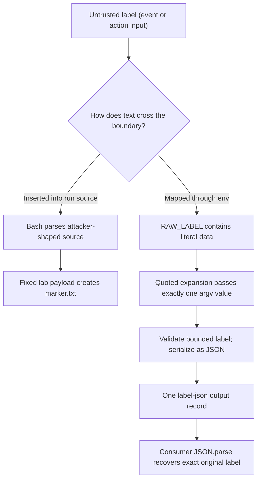

# 0027 · Transport inputs safely through environment variables and quoted arguments

!!! note "Reference lesson"
    `labs/0027/` contains a fixed synthetic injection demonstration and a repaired adapter. All marker writes stay in an automatically removed temporary directory. Read the prediction before running the exercise.

## Prerequisites and observable goal

Read [0026 · Shell and path boundaries](0026-composite-shells-paths-and-portability.md) and retrieve [0004 · Expressions and types](0004-contexts-expressions-and-conditions.md). Identify which evaluator handles `${{ ... }}` and which expands `$VALUE`.

Pass spaces, quotes, dollar signs, command-shaped text, and an embedded newline through a composite without turning them into code or extra output records. Success means exact round-trip equality and an absent marker file for the repaired path, plus a reasoned explanation of the deliberately unsafe path.

## Separate source generation from data transport

An expression in `run` can become part of the temporary shell script **before Bash parses it**. Ordinary shell quotes around that expression are not a general defense: the substituted value may itself contain shell syntax.

```yaml title="Unsafe illustration only; do not execute with real event data"
- shell: bash
  run: printf '%s\n' "${{ github.event.pull_request.title }}" # (1)!
```

1. An attacker-controlled title could contain command substitution or quotes. The shell sees the resulting source, not an immutable title argument.

A value passed through an environment variable is expanded later as data. Quoted variable expansion is not recursively reparsed as command substitution:

```yaml title="Data transport pattern"
- shell: bash
  env:
    RAW_LABEL: ${{ github.event.pull_request.title }} # (1)!
  run: node path/to/label-program.cjs "$RAW_LABEL" # (2)!
```

1. Actions supplies a process environment value rather than inserting the title into shell source.
2. The fixed command receives one argument. This is an illustrative path; the runnable action below anchors its real helper to `github.action_path`.

GitHub's [secure-use reference](https://docs.github.com/en/actions/reference/security/secure-use#good-practices-for-mitigating-script-injection-attacks) recommends intermediate environment transport for inline scripts. It does not remove the need to validate domain values or review the program that receives them.



## Keep the boundary intact through the action

The runnable composite uses `inputs.label`, because a composite should accept data without assuming it was called by a PR workflow:

```yaml title="labs/0027/action/action.yml — transport excerpt"
- id: accept
  shell: bash
  env:
    RAW_LABEL: ${{ inputs.label }}
    ACTION_DIR: ${{ github.action_path }}
  run: bash "$ACTION_DIR/accept.sh"
```

Its script contains only fixed command source:

```bash title="labs/0027/action/accept.sh"
#!/usr/bin/env bash
set -euo pipefail
node "$ACTION_DIR/accept.cjs" "${RAW_LABEL-}" # (1)!
```

1. An absent label becomes the empty string and is rejected by the Node adapter. The action's `required` declaration is not its only validation.

The adapter accepts nonblank labels of at most **160 JavaScript UTF-16 code units**. This is a bounded text example; it is not an arbitrary binary transport. Unlike 0025's single-line recipient, a label can legitimately contain a newline. The adapter therefore serializes a JSON string:

```javascript title="Output branch in labs/0027/action/accept.cjs"
fs.appendFileSync(
  process.env.GITHUB_OUTPUT,
  `label-json=${JSON.stringify(label)}\n` // (1)!
);
console.log('label accepted');
```

1. JSON escapes CR and LF inside the serialized string, keeping this output as one physical record. The public `label-json` mapping exports `steps.accept.outputs.label-json`; a consumer must JSON-decode it to recover the original text.

This is **output-protocol encoding**, separate from shell quoting. A fixed `printf` format also prevents label text such as `%s` or `-n` from becoming a formatting option. The generic stdout message avoids echoing arbitrary workflow-command-shaped text into the runner log. No label is evaluated with `eval`, `bash -c`, `sh -c`, or a shell-enabled process API.

!!! warning "Quoting does not authorize downstream operations"
    A safely quoted filename can still select the wrong file, and a safely quoted argument can still be a dangerous option to another program. Some CLIs need a fixed option terminator `--`; this Node receiver instead reads one string directly. Validate the intended data domain. Never decode a string and then evaluate it as source.

## Predict the bounded marker experiment

The lab uses exactly this harmless synthetic label:

```text
$(printf injected > marker.txt)
```

!!! tip "Prediction"
    If that text is inserted inside the quotes of generated Bash source, will it create the marker? If the same text is stored in `RAW_LABEL` and expanded as `"$RAW_LABEL"`, will Bash run its embedded command substitution?

Run from the repository root:

```bash
.venv/bin/python labs/0027/transport.py
```

Expected, exit **0**:

```text
generated shell source: marker CREATED (expected unsafe demonstration)
env + quoted argv: PASS (4 exact round trips; marker absent)
invalid labels: PASS (3 rejected; prior output preserved)
```

The script creates a fresh temporary cwd and runs the unsafe case with **only the fixed payload above**. It checks the marker contains `injected`, deletes it, and exercises the repaired real Bash/Node adapter with four labels:

- The same command-substitution-shaped payload.
- A combined spaces/quotes/dollar/backtick/glob/semicolon/option/Unicode label.
- `line one` followed by LF and `ready=true`.
- `-n`.

For each case it asserts status zero, empty stderr, one physical output record, exact JSON-decoded equality, the generic log, and marker absence. Empty, whitespace-only, and 161-code-unit labels fail without changing a prior output record. Every child has a five-second timeout; temporary files are removed automatically.

??? tip "Worked diagnosis and repair"
    Generated source is parsed once after the payload is inserted, so `$(...)` executes. Expanding a quoted environment variable does not recursively interpret its contents as command substitutions. The repaired adapter therefore receives the literal payload and writes its JSON representation. The multiline label needs JSON serialization as well: quoting its shell argument alone would not stop raw LF from splitting a `name=value` output record.

Do not extend the unsafe demonstration to user-supplied strings. To practice a new untrusted label, add it only to the repaired path and preserve marker and exact-byte assertions.

## Observe the final consumer contract

`labs/0027/consumer.yml` is inactive and uses a manual string input. It performs checkout and maintained Node setup, invokes the local composite, and independently compares the decoded result:

```yaml title="Consumer assertion excerpt"
- shell: bash
  env:
    LABEL_JSON: ${{ steps.label.outputs.label-json }}
    EXPECTED: ${{ inputs.label }}
  run: node -e 'require("node:assert/strict").equal(JSON.parse(process.env.LABEL_JSON), process.env.EXPECTED)' # (1)!
```

1. Both values arrive as environment data. The JavaScript source is fixed. The expected value comes from the caller input, rather than from the adapter's own serialization routine.

Static-check this exact recipe:

```bash
.tools/bin/actionlint -no-color labs/0027/consumer.yml
```

Expected: exit **0**, no diagnostics. Linting is useful for workflow expressions and interfaces, but a clean result is not a comprehensive injection audit. The process harness is the executable evidence for these particular transport cases. GitHub's [workflow-command reference](https://docs.github.com/en/actions/reference/workflows-and-actions/workflow-commands#setting-an-output-parameter) defines the runner-side output boundary.

## Transfer exercise and retrieval

A composite receives a PR title, a workspace-relative file path, and a test-mode flag. The title may contain newlines; the path must stay within a project directory; the flag enables extra tests. Specify three validation/transport decisions and a failure case for each.

??? tip "Worked transfer"
    Keep the title in env/quoted argv and serialize it if returning through a single-line output. Use an explicit path-containment policy and filesystem checks for the file; quoting only protects the argument boundary. For a composite flag, define a small accepted text set such as `true` and `false` and reject other values; reusable workflows can additionally declare a boolean input. Test a command-shaped title, an escaping path, and `false`/invalid flag text independently. None of these decisions makes privileged execution of untrusted repository code safe.

Retrieve without looking:

1. Why do double quotes around an Actions expression not solve source injection?
2. Why does quoted environment expansion preserve `$()` as literal data?
3. Which layer prevents LF from adding an output record?
4. What must change if you feed the received value to `eval`?
5. Which independent observations make the repaired test meaningful?

??? tip "Retrieval check"
    Expression substitution happens before shell parsing; quoted environment expansion happens as data during execution. JSON serialization protects this single-line output protocol. Calling `eval` destroys the source/data separation, so remove that evaluation and pass validated arguments to a fixed program instead. Assert exact recovery, status, output bytes, and absence of side effects rather than checking only that a friendly log appeared.

## Verification limits and sources

The local exercise reproduces one fixed injection and tests the repaired actual processes. It does not enumerate all malicious strings or prove GitHub masking, authorization, runner parsing, or the trustworthiness of checked-out code. A metadata-level smoke remains a separate check, developed in [0028](0028-composite-script-tests-and-workflow-wiring.md).

Primary secure-use, metadata, and workflow-command references were checked **2026-10-30** through the [curated library](../references/resources.md). The runnable lab installs no dependencies and uses no credentials or external service.

| Previous Lesson | All Lessons | Next Lesson |
| --- | --- | --- |
| [0026 · Explicit shells, action paths, paths with spaces, and portability](0026-composite-shells-paths-and-portability.md) | [Curriculum](index.md) | [0028 · Test composite scripts and then their workflow wiring](0028-composite-script-tests-and-workflow-wiring.md) |
