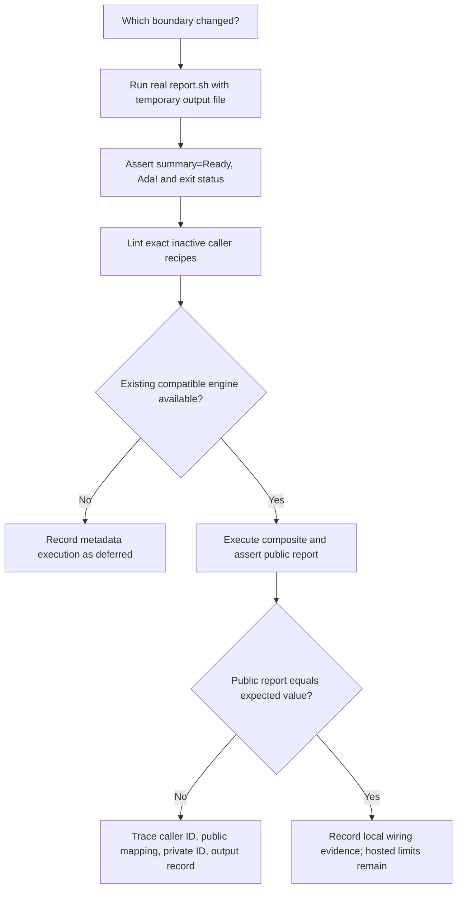

# 0028 · Test composite scripts and then their workflow wiring

The two actions in `labs/0028/` have identical scripts but different metadata. Both script tests can pass. Predict what the caller receives from each action.

## Choose a test for a concrete claim

The composite boundary includes more than the shell program. A caller supplies `with.name`, metadata maps it to `REPORT_NAME`, Bash runs the script, the runner reads its output, metadata exports a public value, and the caller reads it.

| Check | Concrete observation | Important gap |
| --- | --- | --- |
| Direct shell contract | Real argv/env, file bytes, status, stderr | No composite defaults or expression evaluation |
| Workflow actionlint | YAML structure, context availability, known interfaces | Does not compute arbitrary script output values |
| Small caller smoke | Runner-style composite expansion and final public result | Local emulator may differ from GitHub |
| Targeted GitHub integration | Actual platform output processing and policy | Only the selected event, image, and revision |

The smallest check is the one that reaches the changed contract. A private formatting change deserves direct tests; a changed `outputs.value` needs a consumer assertion as well.



## Establish a direct baseline that cannot see metadata

The two packages are:

```text
labs/0028/action/          correct public mapping + real report.sh
labs/0028/broken-action/   empty public mapping + identical report.sh
```

Run from the repository root:

```bash
.venv/bin/python labs/0028/direct.py
```

Expected, exit **0**:

```text
action: PASS direct adapter; public mapping NOT executed
broken-action: PASS direct adapter; public mapping NOT executed
```

The test script sets `REPORT_NAME=Ada`, invokes each Bash script, and checks the temporary output file for `summary=Ready, Ada!` plus LF. It does not invoke the composite, so it cannot assert the public action output.

The validation and file-append cases from 0025 remain useful:

```bash
.venv/bin/python labs/0025/test_contract.py
```

Expected: **3 unittest methods pass**, including invalid input and a missing output path. These tests already use paths with spaces. The separate [0026 path exercise](0026-composite-shells-paths-and-portability.md) tests code installed away from caller data, rather than assuming every path case belongs in a workflow smoke.

!!! tip "Prediction"
    A unit test calls the script and then returns a mocked `report: Ready, Ada!` object. Would it catch an empty `outputs.report.value` in `action.yml`?

??? tip "Worked explanation"
    No. The test manufactures the value it claims to verify. Keep that direct test for the script's own result, but obtain a public action result by invoking the composite in a workflow and reading `steps.<caller-id>.outputs.report` after it completes.

## Break exactly the public mapping

The good metadata maps the script result:

```yaml title="labs/0028/action/action.yml, output excerpt"
outputs:
  report:
    description: Ready report for the caller.
    value: ${{ steps.render.outputs.summary }}
```

The negative package deliberately exports an empty value:

```yaml title="labs/0028/broken-action/action.yml, intentional runtime defect"
outputs:
  report:
    description: Intentional defect; caller receives no summary.
    value: '' # (1)!
```

1. This is a valid scalar and a legal empty public output. It is wrong for this action's promised behavior. Keeping the fixture syntactically valid isolates a runtime contract failure from a YAML error.

Changing a private step ID without updating its mapping is another wiring defect, but some static checks may catch a nonexistent ID. The script succeeds, but the composite returns the wrong public output. The fixture shows why testing the script alone misses the defect.

## Assert what the caller actually receives

Both complete inactive recipes perform pinned checkout and invoke one local composite. `smoke.yml` selects the good package; `broken-smoke.yml` selects the negative package. The assertion is otherwise identical:

```yaml title="Caller-visible assertion"
- id: report
  uses: ./labs/0028/action # (1)!
  with:
    name: Ada
- shell: bash
  env:
    ACTUAL: ${{ steps.report.outputs.report }}
  run: |
    printf 'caller report=%s\n' "$ACTUAL"
    test "$ACTUAL" = 'Ready, Ada!' # (2)!
```

1. The broken recipe instead uses `./labs/0028/broken-action`. The caller ID is still `report`.
2. The expected result is an independent fixture. It is not copied from the value being asserted.

Lint these **two explicit workflow files**, including the syntactically valid runtime-negative recipe:

```bash
.tools/bin/actionlint -no-color labs/0028/smoke.yml labs/0028/broken-smoke.yml
```

Expected: exit **0**, no diagnostics. This clean result does not repair the empty mapping. The [metadata output reference](https://docs.github.com/en/actions/reference/workflows-and-actions/metadata-syntax#outputs-for-composite-actions) defines the expression boundary; [actionlint's checks](https://github.com/rhysd/actionlint/blob/v1.7.12/docs/checks.md) describe its static scope.

## Select the smoke before considering execution

Use the installed CLI help to confirm the selection flags:

```bash
act --version
act --help
act workflow_dispatch \
  -W labs/0028/smoke.yml -j smoke -l \
  --container-architecture linux/amd64 \
  --env-file /dev/null --secret-file /dev/null \
  --var-file /dev/null --input-file /dev/null
```

Expected with act **0.2.89**: one listed job, `smoke`, for `Module 5 public report smoke`. Listing can succeed while warning that no valid Docker connection exists. It does not run steps. The explicit empty files avoid loading default local data files; inspect any existing act configuration too.

Then inspect the existing engine:

```bash
docker info
```

If it cannot connect, stop this execution branch and retain the useful direct/static evidence. Do not start or provision infrastructure as part of this lab. See the [local testing guide](../cheatsheet/local-testing.md) for separately managed engine setup.

Only when a compatible engine is already available, the smallest positive execution is:

```bash
act workflow_dispatch \
  -W labs/0028/smoke.yml -j smoke \
  -P ubuntu-latest=catthehacker/ubuntu:act-latest \
  --container-architecture linux/amd64 \
  --env-file /dev/null --secret-file /dev/null \
  --var-file /dev/null --input-file /dev/null
```

Expected: the script logs `report rendered`, the caller logs `caller report=Ready, Ada!`, and the workflow assertion passes. This path may download action sources and an image. Record its actual image identity and execution result; a job declaration's hosted timeout is not a dependable local act budget.

For the controlled negative case, use the same selection with `-W labs/0028/broken-smoke.yml`. Expected: the script still logs success, the caller logs `caller report=` with an empty value, and the assertion fails with a nonzero act result. These are expected runtime results, not claims established by direct tests or job listing.

## Diagnose the narrowest failing edge

When the consumer receives empty text, trace backward:

1. Does the caller read the output of its identified action invocation?
2. Does the composite declare that public output and map its `value`?
3. Does the mapping name the correct internal step ID and internal output?
4. Did the script append the expected record to the current step's output file?
5. Did the producer fail before the runner could expose a valid result?

??? tip "Repair the negative recipe"
    Select the good package, or change the broken public mapping to `${{ steps.render.outputs.summary }}` in an isolated copy. Repeat the same caller smoke. Changing the script's greeting or increasing token permissions would not fix an empty metadata value. Do not replace the final assertion with a log check or `continue-on-error` merely to make the job green.

## Transfer exercise and retrieval

A composite outputs both `count` and `report-path`. Direct tests verify the count and write the report file, but a later caller step sees an empty path. Design the smallest checks that distinguish an absent file, a bad public mapping, and a caller reading the wrong step ID.

??? tip "Worked transfer"
    Directly assert both the output record and actual file bytes in a temporary workspace. Add a selected workflow that invokes the composite with a controlled fixture, checks its public `report-path`, and then opens that path. Trace the caller ID before changing the package. Check the mapping and the file separately. A script can create the right file while the composite returns the wrong path, or return a path without creating a file. If another job needs the report, use an artifact rather than assuming the same filesystem.

Retrieve without looking:

1. Why can both direct baselines pass?
2. What makes the negative metadata legal but behaviorally wrong?
3. What does listing a job prove?
4. Which assertion must observe the runner-consumed result?
5. Why can green act output not establish permission enforcement?

??? tip "Retrieval check"
    The scripts are identical and metadata is outside those invocations. An empty output can pass a syntax check while violating the promised result. Listing establishes selection, not execution. The caller must assert its public output after the composite completes. Act documents incomplete platform behavior, including ignored job permissions and cancellation differences.

## Remaining verification limits

The [act support limitations](https://nektosact.com/not_supported.html) leave real token scopes, environment protections, hosted artifact services, scheduling/cancellation, and OS parity to GitHub evidence. A local success should be described as the selected local wiring check at its actual tool/image version. Sources linked here were checked **2026-10-30** from the [curated library](../references/resources.md).

Continue to [0029](0029-reusable-workflows-and-permission-interfaces.md): moving reuse to a job boundary adds typed inputs, secrets, token policy, and another output mapping.

| Previous lesson | All lessons | Next lesson |
| --- | --- | --- |
| [0027 · Transport inputs safely through environment variables and quoted arguments](0027-untrusted-input-and-shell-quoting.md) | [Curriculum](index.md) | [0029 · Reusable workflows, typed inputs, explicit secrets, and permissions](0029-reusable-workflows-and-permission-interfaces.md) |
