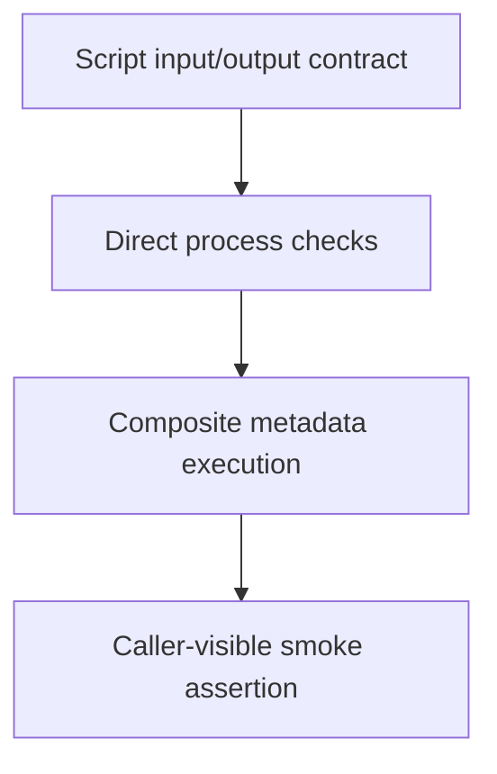

# 0028 · Test composite scripts and then their workflow wiring

!!! note "Placeholder for a future teaching thread"
    This page is a teaching brief. Expand it into a full interactive lesson in its own thread. The planned exercises and outcomes have not been completed or demonstrated.

**Level:** Intermediate to advanced.

## Prerequisites

- [0027 · Transport inputs safely through environment variables and quoted arguments](0027-untrusted-input-and-shell-quoting.md)
- [0009 · Unit tests, event fixtures, and temporary output files](0009-unit-tests-fixtures-and-output-files.md)
- [0011 · Run one event and one job with act](0011-act-targeted-workflow-smoke-tests.md)

## What you will learn to do

- Create complementary script and composite smoke tests.
- Explain a defect that only the caller-visible workflow test detects.

## Explain the Actions behavior

Start from the prerequisite workflow or action behavior and introduce these concepts with focused examples:

1. An extracted script exposes a fast test boundary with real process results.
2. Metadata adds input transport, step IDs, and public output mappings.
3. Tests should preserve failures rather than skip the component that is broken.

Explain the relevant workflow YAML, expressions, and action code in context. Follow the [shared teaching guide](teaching-guide.md) for pacing, expected output, and progression toward independent design.

## Planned local lab

Create an isolated exercise under `labs/0028/` when the lesson is developed. Explain setup and expected output before each command; reuse installed tools rather than reinstalling them on every step.

1. Extend the existing shell adapter tests with invalid input and paths containing spaces.
2. Run the selected composite invocation and assert its public output.
3. Record which defect is caught by static analysis, direct execution, or metadata execution.

## Break it and diagnose it

Mock away the output mapping in a test and miss a real metadata defect. Replace that test with a caller-level assertion.

Ask for a prediction first. Capture the smallest reproducer, the actual result, and the corrected behavior. State which remaining claim requires a real GitHub or external-service check.

## Planning diagram



When expanding this lesson, refine the diagram to show the actual processes, branches, data exchange, and trust boundaries being taught.

## Retrieval questions

1. Which contract is visible to the direct script test?
2. Which behavior requires the composite metadata to execute?
3. Why is a mocked wiring test weaker than a real smoke invocation?

## Evidence to capture in the teaching thread

- A working learner-produced example and an explanation of why it works.
- A reproduced failure, a reasoned repair, and the smallest check that verifies it.
- A short account of remaining limits, unresolved questions, and readiness for the next lesson.

Use [primary references](../references/resources.md) to verify current syntax, runtime support, and tool behavior. Add learning records only for real statements or demonstrated understanding; a placeholder or generated page does not establish mastery.

## Start this lesson in a new thread

```text
/teach 0028

Expand docs/lessons/0028-composite-script-tests-and-workflow-wiring.md in place using docs/lessons/teaching-guide.md.
Read docs/mission.md, NOTES.md, and the prerequisite lesson pages first.
Begin with a short check of the Actions prerequisites. Explain relevant YAML,
expressions, and action contracts, one concept at a time. Let me predict and
try each exercise before revealing its answer. Keep feedback local where possible.
Finish with retrieval questions and a truthful handoff for the next thread.
```

| Previous Lesson | All Lessons | Next Lesson |
| --- | --- | --- |
| [0027 · Transport inputs safely through environment variables and quoted arguments](0027-untrusted-input-and-shell-quoting.md) | [Curriculum](index.md) | [0029 · Reusable workflows, typed inputs, explicit secrets, and permissions](0029-reusable-workflows-and-permission-interfaces.md) |
