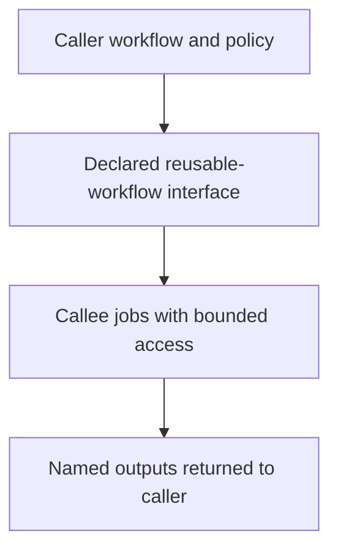

# 0029 · Reusable workflows, typed inputs, explicit secrets, and permissions

!!! note "Placeholder for a future teaching thread"
    This page is a teaching brief. Expand it into a full interactive lesson in its own thread. The planned exercises and outcomes have not been completed or demonstrated.

**Level:** Intermediate to advanced.

## Prerequisites

- [0028 · Test composite scripts and then their workflow wiring](0028-composite-script-tests-and-workflow-wiring.md)
- [0006 · Matrices, job dependencies, cancellation, and failure propagation](0006-matrices-dependencies-and-cancellation.md)

## What you will learn to do

- Design a small workflow_call interface with documented inputs and outputs.
- Explain the intended permission relationship between caller and callee.

## Explain the Actions behavior

Start from the prerequisite workflow or action behavior and introduce these concepts with focused examples:

1. A reusable workflow is a job-level boundary with a declared caller interface.
2. Inputs, secret exchange, outputs, and token permissions need deliberate contracts.
3. The caller and callee participate in a trust boundary that local mocks cannot fully establish.

Explain the relevant workflow YAML, expressions, and action code in context. Follow the [shared teaching guide](teaching-guide.md) for pacing, expected output, and progression toward independent design.

## Planned local lab

Create an isolated exercise under `labs/0029/` when the lesson is developed. Explain setup and expected output before each command; reuse installed tools rather than reinstalling them on every step.

1. Refactor a disposable single-job check into a reusable workflow draft.
2. Declare only the inputs and credentials the callee actually needs.
3. Draw caller/callee permissions and plan representative missing-input, missing-secret, and hosted authorization cases.

## Break it and diagnose it

Assume a reusable callee can silently gain permissions beyond the caller policy. Inspect the actual documented permission model and design a real check.

Ask for a prediction first. Capture the smallest reproducer, the actual result, and the corrected behavior. State which remaining claim requires a real GitHub or external-service check.

## Planning diagram



When expanding this lesson, refine the diagram to show the actual processes, branches, data exchange, and trust boundaries being taught.

## Retrieval questions

1. When is job-level reuse preferable to a composite action?
2. Which inputs should be typed or validated?
3. Which interface decisions prevent accidental credential exposure?

## Evidence to capture in the teaching thread

- A working learner-produced example and an explanation of why it works.
- A reproduced failure, a reasoned repair, and the smallest check that verifies it.
- A short account of remaining limits, unresolved questions, and readiness for the next lesson.

Use [primary references](../references/resources.md) to verify current syntax, runtime support, and tool behavior. Add learning records only for real statements or demonstrated understanding; a placeholder or generated page does not establish mastery.

## Start this lesson in a new thread

```text
/teach 0029

Expand docs/lessons/0029-reusable-workflows-and-permission-interfaces.md in place using docs/lessons/teaching-guide.md.
Read docs/mission.md, NOTES.md, and the prerequisite lesson pages first.
Begin with a short check of the Actions prerequisites. Explain relevant YAML,
expressions, and action contracts, one concept at a time. Let me predict and
try each exercise before revealing its answer. Keep feedback local where possible.
Finish with retrieval questions and a truthful handoff for the next thread.
```

| Previous | All lessons | Next |
| --- | --- | --- |
| [0028 · Test composite scripts and then their workflow wiring](0028-composite-script-tests-and-workflow-wiring.md) | [Curriculum](index.md) | [0030 · Compose setup/build/test steps and reusable job workflows](0030-compose-step-and-job-orchestration.md) |
