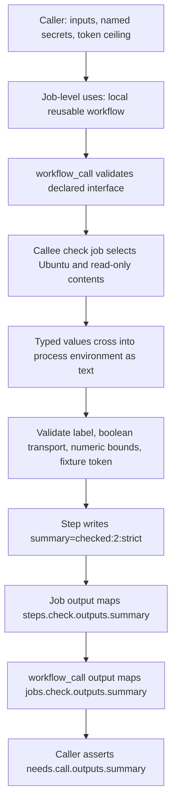

# 0029 · Reusable workflows, typed inputs, explicit secrets, and permissions

The YAML in `labs/0029/` is inactive. Its runnable worker uses synthetic fixtures and the public constant `fixture-only-not-a-credential`. Local tests check the worker contract without exercising GitHub authorization.

## Move reuse to the right boundary

A composite is invoked inside `steps`. A **reusable workflow** admits `workflow_call` and is invoked with `jobs.<id>.uses`. Its jobs can select runners, declare dependencies, and set job policy. A caller's `uses` job does not also contain ordinary `steps` or `runs-on`.

The lab separates:

| File | Responsibility |
| --- | --- |
| `module5-caller.yml` | Supply inputs, explicit secret mapping, and caller token policy; assert returned summary |
| `module5-reusable.yml` | Declare interface, run the bounded worker on a chosen runner, export its output |
| `worker.cjs` | Validate domain data, inspect two local fixture rows, emit a summary |
| `lint_module.py` | Temporarily stage the actual local caller/callee paths for static analysis |

A live reusable workflow must be directly inside `.github/workflows/`; nested workflow directories are unsupported. These drafts stay under `labs/`. The staging helper creates `.github/workflows/` only in a temporary repository and removes it afterward, so linting does not activate any workflow.



## Declare types and meaningful bounds

The callee's actual interface includes:

```yaml title="labs/0029/module5-reusable.yml, workflow_call excerpt"
on:
  workflow_call:
    inputs:
      label:
        description: Nonblank single-line label, max 80 UTF-16 code units.
        required: true
        type: string
      strict:
        type: boolean
        default: true
      max-items:
        description: Integer in range 1 through 3; validated by worker.
        type: number
        default: 2
    secrets:
      FIXTURE_TOKEN:
        description: Synthetic fixture constant; no authorization or external API.
        required: true
    outputs:
      summary:
        description: Bounded worker summary.
        value: ${{ jobs.check.outputs.summary }} # (1)!
```

1. A workflow output maps a **job** output. The full `check` job separately maps `steps.check.outputs.summary` to its own `summary` output.

`workflow_call` input types are `string`, `boolean`, and `number`. Dispatch-only interface types such as `choice` are not a reusable-workflow input type. The caller should pass a boolean `true`, not route it through arbitrary flag text. When inputs become environment variables for a process, the environment representation is text again; the adapter explicitly accepts only `true` or `false` for `STRICT`.

The `number` type allows values outside this action's accepted range. It does not enforce an integer, a maximum of three, or a usage budget. The worker enforces the integer range **1–3**, validates the label, and rejects more fixture rows than the configured bound. With the two checked-in rows, `max-items: 1` is a valid number but an invalid processing bound. In strict mode any failed fixture row rejects the operation; tolerant mode reports its count without making that row pass.

GitHub's [workflow syntax](https://docs.github.com/en/actions/reference/workflows-and-actions/workflow-syntax#onworkflow_callinputs) defines types. Its [reuse guide](https://docs.github.com/en/actions/how-tos/reuse-automations/reuse-workflows) explains declarations and call placement. Domain semantics still belong to your implementation.

## Make the caller concrete

```yaml title="labs/0029/module5-caller.yml, call job"
call:
  uses: ./.github/workflows/module5-reusable.yml # (1)!
  permissions:
    contents: read
  with:
    label: preview
    strict: true
    max-items: 2
  secrets:
    FIXTURE_TOKEN: fixture-only-not-a-credential # (2)!
```

1. The repository-local callee resolves from the caller's commit and has no `@ref` suffix. A cross-repository call instead names `owner/repository/.github/workflows/file.yml@ref`; review and pin the intended revision. This path is resolved by the workflow service, rather than relative to the caller file's location on disk.
2. This is a deliberately public fixture string, not a real credential. The callee checks only that exact constant and never prints it or contacts a service.

The caller's ordinary `verify` job has `needs: call`, selects its own runner, and checks:

```yaml title="Caller output assertion"
- shell: bash
  env:
    SUMMARY: ${{ needs.call.outputs.summary }}
  run: test "$SUMMARY" = 'checked:2:strict'
```

The callee uses pinned checkout and setup-node, then calls the explicit project command `node labs/0029/worker.cjs`. Checkout in a remotely stored reusable workflow normally checks out the **caller** repository. A centrally stored workflow that needs code from its own repository must deliberately acquire that code; it cannot assume its scripts appear in the caller checkout.

## Secrets and token permissions are separate interfaces

A named `workflow_call.secrets` entry communicates credential transport. `permissions` controls the automatic `GITHUB_TOKEN`. Declaring a secret does not increase that token's scopes, and declaring `contents: read` does not provide an unrelated API credential.

This lab explicitly maps one synthetic secret. Avoid `secrets: inherit` when a narrow interface is sufficient; inherited secrets can widen what future callee code can read. In a chain A → B → C, B must deliberately pass relevant secrets onward. Workflow-level caller `env` is also not a substitute for declared callee inputs.

A required secret declaration checks that the caller passes the named secret; it does not guarantee the resolved value is nonempty, valid, or authorized. The worker therefore validates the value it receives. Real environment secrets add environment-specific selection and protection rules; the job that sets an environment participates in that policy. No environment is configured here.

For token policy, treat the caller's grant as the ceiling for the call chain. A callee can keep or reduce the available permissions. It cannot grant itself more. This caller and callee both declare only `contents: read`. A callee requiring `issues: write` cannot manufacture that grant when the caller denies it. Reducing this fixture caller to `permissions: {}` can also make a real private-repository checkout fail even though the host worker still passes.

See GitHub's [reusable configuration reference](https://docs.github.com/en/actions/reference/workflows-and-actions/reusing-workflow-configurations#supported-keywords-for-jobs-that-call-a-reusable-workflow) for caller keywords and permission rules. Repository access settings, token effectiveness, secret resolution, and checkout behavior remain GitHub contracts; local policy diagrams and fake tokens do not establish them.

!!! tip "Prediction"
    Does `strict: false` mean the string `'false'` should be accepted by the pure function? Can a `number` input of `1.5` satisfy the worker? Does `required: true` prove a real credential is usable?

??? tip "Worked prediction"
    The pure function requires an actual boolean; its process adapter deliberately converts only the agreed environment text. A fractional number violates the integer bound even though it is a number. A required secret's presence is separate from nonempty value, validity, identity, and authorization.

## Run the actual worker contracts locally

Run from the repository root:

```bash
node --test labs/0029/worker.test.cjs
```

Expected: **3 tests pass**. They include typed domain cases, strict/tolerant results, invalid labels and bounds, missing/invalid fixture tokens, and real child processes with temporary output files. The success record is `summary=checked:2:strict`; failures return status 1 and preserve any previous output records.

The process test supplies its own environment text and fixture constant. It does not invoke GitHub's typed input resolver, secret store, or token service. It checks that logs do not expose this fixture constant; that is not a test of GitHub secret masking.

For a manual valid process observation:

```bash
worker_output="$(mktemp)"
LABEL=preview STRICT=true MAX_ITEMS=2 \
  FIXTURE_TOKEN=fixture-only-not-a-credential GITHUB_OUTPUT="$worker_output" \
  node labs/0029/worker.cjs
cat "$worker_output"
rm "$worker_output"
```

Expected: stdout `checked:2:strict`, followed by file contents `summary=checked:2:strict`. Repeat with `MAX_ITEMS=1`: the worker exits **1**, reports `fixture rows exceed bound or have invalid passed fields`, and writes no new output. Restore the bound to 2 rather than weakening the fixture assertion.

## Lint the local interface without activating it

```bash
.venv/bin/python labs/0029/lint_module.py
```

Expected: `PASS: 9 explicit Module 5 workflow recipes, including real local call interfaces`. The list includes the two syntactically valid 0028 smoke recipes and both 0030 drafts; the helper explicitly excludes the diagnostic-negative directory. It creates no workflow in the actual repository.

Predict each diagnostic before running:

```bash
.venv/bin/python labs/0029/lint_module.py --negative missing-label
.venv/bin/python labs/0029/lint_module.py --negative missing-secret
.venv/bin/python labs/0029/lint_module.py --negative wrong-boolean
.venv/bin/python labs/0029/lint_module.py --negative wrong-number
```

| Fixture | Installed actionlint 1.7.12 observation |
| --- | --- |
| `missing-label` | Exit 1: required `label` is absent |
| `missing-secret` | Exit 1: required `FIXTURE_TOKEN` mapping is absent |
| `wrong-boolean` | Exit 0: nonboolean text is accepted by this static checker |
| `wrong-number` | Exit 1: `two` cannot be assigned to the number input |

The wrapper itself exits **0** when these observed expectations hold. For `wrong-boolean`, it prints `STATIC GAP` and explicitly makes no execution claim. A clean lint result does not overrule the documented boolean contract. The separate process test rejects invalid `STRICT` text; actual GitHub handling of a malformed call still needs platform evidence. Use static analysis to check the call syntax and process tests to check the worker's validation rules.

??? tip "Diagnose and repair the interface failures"
    Add `label: preview` and the explicitly named fixture secret mapping to repair the missing-field cases. Replace `max-items: two` with numeric `2`. Replace invalid flag text with boolean `true` or `false`, even though this pinned linter misses that particular defect. Rerun the positive staging check and the worker tests. Do not use broader secret inheritance or more token scopes to repair a misspelled or absent input.

## Transfer exercise and retrieval

Design a reusable test workflow for three repositories. It needs a runner family, a maximum test batch, and optionally a reporting credential. Decide which values are inputs, which permission grant is required, and what the caller receives. The reporting path must remain disabled in this exercise.

??? tip "Worked transfer"
    Use documented inputs with explicit type and a bounded allowed runner set; validate that the numeric batch is an integer within an acceptable range. Keep a reporting credential separate from ordinary data and pass it only to a deliberately enabled reporting path. Request only the token scopes needed by actual operations; a no-write fixture path needs no reporting grant. Return small status/count values as outputs and larger evidence as artifacts. Treat cross-repository access and credential authorization as separate future integration cases.

Retrieve without looking:

1. Why is a reusable call a job rather than a step?
2. Which mapping returns a step result to the caller?
3. Why does a `number` type not enforce a cost budget?
4. Can the callee raise the caller's token grant?
5. What did the wrong-boolean fixture actually establish?

??? tip "Retrieval check"
    Job reuse controls its own jobs and runner choices. The result crosses step → job → workflow output and is consumed through caller `needs`. Numeric domain bounds need validation. Permissions can be maintained or reduced along the chain, never elevated by a callee. The boolean fixture established a limitation of the installed static check, not hosted acceptance or successful execution.

## Verification limits and next lesson

Host tests and temporary static staging provide useful process/interface evidence. They do not establish real secret access, private reusable-workflow policy, token authorization, hosted checkout, or runner behavior. Source URLs linked here were checked **2026-10-30**, using the [curated library](../references/resources.md) and pinned [actionlint documentation](https://github.com/rhysd/actionlint/blob/v1.7.12/docs/checks.md).

Continue to [0030](0030-compose-step-and-job-orchestration.md) to fan out two reusable calls and join their explicit evidence without relying on one last-writer output.

| Previous lesson | All lessons | Next lesson |
| --- | --- | --- |
| [0028 · Test composite scripts and then their workflow wiring](0028-composite-script-tests-and-workflow-wiring.md) | [Curriculum](index.md) | [0030 · Compose setup/build/test steps and reusable job workflows](0030-compose-step-and-job-orchestration.md) |
