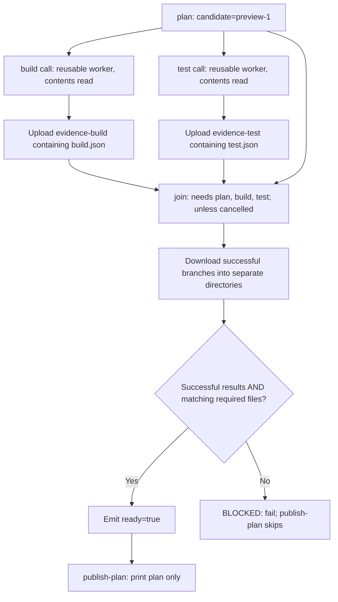

# 0030 · Compose setup/build/test steps and reusable job workflows

`labs/0030/` combines a setup composite, a reusable worker draft, and a caller graph with host tests. The final step prints a plan. It does not release, deploy, write through an API, or call a model.

## Assign each responsibility once

A **worker** performs bounded project work. An **orchestrator** supplies inputs, arranges dependencies, and decides whether required results are complete. A **join policy** states exactly which evidence permits the next stage.

| Boundary | Owned responsibility in this lab |
| --- | --- |
| `setup/action.yml` composite | Reuse maintained setup-node, expose installed version; remain inside the current job |
| `module5-worker.yml` reusable workflow | Runner, timeout, read-only contents policy, one explicit build/test command, evidence upload |
| `module5-orchestrator.yml` caller | Candidate input, two worker calls, dependency graph, join, plan eligibility |
| `gate.cjs` | Require successful statuses and exact candidate/schema/pass evidence |
| `publish-plan` job | Print a synthetic readiness plan, with no external side effect |

A composite cannot set its parent job's `runs-on` or `needs`. Define runner selection, job dependencies, and release policy in the workflow. Put job policy in the caller or reusable job. Keep repository-specific build/test commands visible rather than wrapping them in an installer action.



The two worker calls can become eligible after plan succeeds. Eligibility is not a promise they start simultaneously; runner availability still matters. There are **five job instances** on the default successful path: plan, build's worker, test's worker, join, and publish-plan.

## Reuse setup while keeping project commands explicit

The setup composite contains one maintained setup-node step at the reviewed catalog pin:

```yaml title="labs/0030/setup/action.yml, reuse excerpt"
outputs:
  node-version:
    description: Installed Node version.
    value: ${{ steps.node.outputs.node-version }}
runs:
  using: composite
  steps:
    - id: node
      uses: actions/setup-node@949feb2413d6458794dcd2491c4babbbce0c15c1 # v7.1.0
      with:
        node-version: ${{ inputs.node-version }}
        package-manager-cache: false # (1)!
```

1. The fixture uses Node built-ins and the installed runtime, so it needs no package installation or cache. The `node-version` input defaults to `'24'`. The public output is the actual installed version, not necessarily the selector text.

The reusable worker separately checks out files, calls this local composite, validates its `kind` and failure selector, then runs one of these explicit project commands:

```yaml title="Worker command excerpts"
- name: Build project fixture
  if: inputs.kind == 'build'
  shell: bash
  env:
    WORK_DIR: ${{ runner.temp }}/module5-build # (1)!
  run: node labs/0030/build.cjs
- name: Test project behavior
  if: inputs.kind == 'test'
  shell: bash
  run: node --test labs/0030/domain.test.cjs
```

1. `runner.temp` is available in **step** environment expressions, while `jobs.<id>.env` does not admit the `runner` context. Context placement is a static interface rule; see the [availability table](https://docs.github.com/en/actions/reference/workflows-and-actions/contexts#context-availability).

The build writes `bundle.txt` with `candidate=preview-1` plus LF. The test runs two deterministic domain checks. The emitter runs only after that selected project command succeeds; it can also simulate a bounded branch failure before evidence is published. A `passed: true` record is a claim made by trusted worker code, not an independent proof that arbitrary commands executed.

## Give each worker its own evidence artifact

The reusable workflow accepts `kind`, `candidate`, and `fail-kind`; it supports only `build`/`test` worker kinds and `none`/`build`/`test` failure selection. The emitter creates a small record:

```json title="Synthetic build evidence"
{"schema":1,"candidate":"preview-1","kind":"build","passed":true}
```

The corresponding test record uses `kind: test`. Each worker writes `artifact=evidence-<kind>` to its step output, maps that through a job and workflow output, and uploads **only its JSON evidence file**:

```yaml title="Worker upload excerpt"
- uses: actions/upload-artifact@cf430e030ddbb5b0abf93d22962f4752f3646cd9 # v7.0.2
  with:
    name: ${{ steps.evidence.outputs.artifact }}
    path: ${{ runner.temp }}/module5-evidence/${{ inputs.kind }}.json
    if-no-files-found: error # (1)!
    retention-days: 1
```

1. Absence is a failure instead of a warning. Unique artifact names avoid multiple workers writing the same artifact identity.

The synthetic bundle itself is not transferred to the test worker. This example tests project behavior in an independent checkout; it does **not** claim to test the exact bytes produced by build. If your release gate needs package testing, add an explicit build-artifact transfer and a dependency that makes test consume those bytes. That would change the fan-out graph.

Maintained upload/download actions handle platform file transport. Small names and decisions are outputs; file contents are artifacts. The [artifact guide](https://docs.github.com/en/actions/tutorials/store-and-share-data) and pinned [upload metadata](https://raw.githubusercontent.com/actions/upload-artifact/cf430e030ddbb5b0abf93d22962f4752f3646cd9/action.yml) define the selected inputs. Hosted artifact storage is not exercised by a host temporary directory.

## Make fan-out and fan-in explicit in the caller

The caller uses two distinct job IDs rather than a matrix so each branch has an unambiguous result:

```yaml title="labs/0030/module5-orchestrator.yml, build call excerpt"
build:
  needs: plan
  uses: ./.github/workflows/module5-worker.yml
  permissions:
    contents: read
  with:
    kind: build
    candidate: ${{ needs.plan.outputs.candidate }}
    fail-kind: ${{ inputs.fail-kind }}
```

The `test` call supplies `kind: test` and has the same dependency. There is no `strategy.fail-fast` here because these are separate jobs, rather than siblings in a matrix. Neither uses `continue-on-error`; both are required.

The join directly needs `plan`, `build`, and `test`. A transitive dependency alone would not expose `needs.plan.outputs.candidate` to it. It uses `if: ${{ !cancelled() }}` so it can diagnose ordinary failed/skipped branches while declining work after workflow cancellation. That condition admits inspection; it does not declare success.

Download each successful branch by its exact expected artifact name into a separate directory:

```yaml title="Join download excerpt"
- if: ${{ !cancelled() && needs.build.result == 'success' }}
  uses: actions/download-artifact@9000827ccba6bdab643e8b6fd33ac0654aef8333 # v8.0.2
  with:
    name: evidence-build
    path: ${{ runner.temp }}/module5-join/build
```

The second download uses `evidence-test` and `module5-join/test`. Avoid merging same-named evidence files into one folder, where one worker could overwrite another. Exact-name downloads also avoid interpreting one matrix output as a complete list of artifacts.

GitHub documents that a reusable workflow called through a matrix exposes a scalar output from the last successful completing call that sets a value, with special handling for empty values. It is **not** a reliable collection of every worker result. For a larger matrix, use uniquely named artifacts and a separately specified expected set. See [reusable-workflow outputs](https://docs.github.com/en/actions/how-tos/reuse-automations/reuse-workflows#using-outputs-from-a-reusable-workflow).

## Require both statuses and files

The gate receives candidate and both `needs` results as environment text. For each required worker it checks:

1. Result equals `success`, not empty, failed, skipped, or cancelled.
2. The worker directory contains exactly `<kind>.json`; missing or extra files block.
3. The record is bounded, valid JSON with exactly the expected keys.
4. Schema is `1`, kind matches that branch, candidate equals the plan, and `passed` is boolean `true`.

Only after both pass does the real process append `ready=true` and log readiness. The job maps that step output to `needs.join.outputs.ready` for the plan job. A failed download still leaves join unsuccessful, even if a later diagnostic runs. The plan job also has the normal success requirement as well as an explicit `ready == 'true'` condition.

!!! note "Fixture consistency is not provenance"
    `preview-1` is a synthetic candidate, not a commit SHA or signed assertion. Worker JSON is not sandboxed or cryptographically authenticated. In a real pipeline, bind evidence to the intended commit, workflow/run/attempt, trusted worker revision, and artifact identities; review how a worker could forge or replay it. The local policy here teaches completeness and consistency, not release authorization.

## Run the deterministic local pipeline

All files stay under disposable temporary directories. The test script runs the build, test, emitter, and gate processes in sequence on this host. It does not emulate job scheduling, artifact upload/download, or parallel timing.

```bash
node --test labs/0030/domain.test.cjs labs/0030/gate.test.cjs
.venv/bin/python labs/0030/exercise.py
```

Expected: **9 tests pass** in the Node command, then the test script prints the following output and exits 0:

```text
host results: build=success, test=success
READY: build + test evidence match preview candidate
PLAN ONLY: no release or deployment occurs
```

The test script also checks the exact bundle bytes and emitter output records. The unit tests cover unsuccessful statuses, a missing file, a stale candidate, false/string-valued/wrong-kind/wrong-schema evidence, an extra file, and malformed JSON.

!!! tip "Predict four blocked cases"
    Which condition fails if the test branch reports failure? If it reports success but its file disappears? If it skips? If it writes evidence for the previous candidate? Should any of these emit `ready=true`?

Run each line separately; all four commands are intentional failures:

```bash
.venv/bin/python labs/0030/exercise.py --case fail-test
.venv/bin/python labs/0030/exercise.py --case missing-test
.venv/bin/python labs/0030/exercise.py --case skipped-test
.venv/bin/python labs/0030/exercise.py --case stale-test
```

Each exits **1** and publishes no readiness output:

| Case | Expected `BLOCKED` diagnostic |
| --- | --- |
| `fail-test` | `test result must be success (got failure)` |
| `missing-test` | `test evidence must contain exactly test.json` |
| `skipped-test` | `test result must be success (got skipped)` |
| `stale-test` | `test evidence does not match required candidate/schema/pass` |

The `fail-test` selector deliberately fails evidence emission after the domain test command; it models a required branch's failure and is not a mutation claiming the domain test itself failed.

??? tip "Diagnosis and repair"
    A failed or skipped branch fails the status check. A reported success still fails the evidence check if its file is missing or stale. Restore the required branch and generate fresh evidence for the current candidate by running the default test script again. Do not repair the gate by accepting absent evidence, using the previous candidate, or making a required worker optional. In a real rerun, collect evidence from the intended run/attempt rather than silently reusing an earlier artifact.

## Inspect workflow policy separately

```bash
.venv/bin/python labs/0029/lint_module.py
```

Expected: **9 explicit Module 5 workflow recipes pass** static analysis, including this caller/callee pair. The helper stages the drafts in a temporary repository so local reusable references resolve. It does not copy anything into the real `.github/workflows/`, dispatch jobs, or exercise artifact services.

For a deliberate design failure, propose adding `runs-on: windows-latest` inside `setup/action.yml` to move only test work to Windows. Explain why the composite cannot select that job's runner. Repair the design by placing runner selection in the reusable worker and, if exposed as an input, validate the allowed runner labels. Testing another runner then requires actual target-platform execution.

For a scheduling failure, remove the join's status-aware condition in a disposable copy and predict a failed worker's path. The default success-only condition can skip join entirely. Restore `!cancelled()` to permit bounded diagnosis and keep the program's strict success requirement. No local policy-function test alone establishes GitHub's scheduling or cancellation behavior.

## Transfer exercise and retrieval

Add a required `lint` branch and an optional exploratory branch on paper. Specify the expected evidence set, artifact names, direct `needs`, join conditions, and whether a new run may cancel each branch. No release action is needed.

??? tip "Worked transfer"
    Give lint a distinct job and `evidence-lint` identity, add it directly to join's dependencies, and require a matching lint record alongside build/test. State an explicit policy for exploratory work rather than accidentally treating every skip as acceptable. Keep optional evidence separate from required readiness. Read-only checks can often be safely superseded, but cancellation does not undo completed external effects; publishing requires a separate recovery policy. If using matrices, publish the expected set explicitly and verify every member arrived.

Retrieve without looking:

1. Which component chooses the worker runner?
2. Why does `needs` not transport files?
3. What is missing from a join that checks only statuses?
4. Why avoid a scalar matrix output for collecting every artifact name?
5. Which part of this local test script actually ran in parallel?
6. Can a forged `passed: true` file authorize a real release?

??? tip "Retrieval check"
    The reusable job chooses the runner. Dependencies order work and expose mapped outputs; artifacts transfer files. Success without expected evidence can still hide missing, stale, malformed, or wrong-worker results. Matrix scalar output selection is not aggregation. The host test script ran processes in sequence. A production gate also needs authenticated producer identities, artifact provenance, and authorization. This synthetic check only tests consistency.

## Verification limits and sources

Direct tests validate host processes and the exact join policy. Static analysis checks workflow interfaces. Act can add selected local wiring evidence only with a reachable engine and compatible services; it does not establish hosted authorization, artifact storage, cancellation, or OS parity. See [act's documented limitations](https://nektosact.com/not_supported.html).

Primary references were checked **2026-10-30**: linked contexts, reuse and artifact guides; pinned [download metadata](https://raw.githubusercontent.com/actions/download-artifact/9000827ccba6bdab643e8b6fd33ac0654aef8333/action.yml); and the [dated action catalog](../references/prebuilt-actions.md). Continue to Module 6 at [0031 · Token and trust boundaries](0031-github-token-forks-and-trust-boundaries.md).

| Previous lesson | All lessons | Next lesson |
| --- | --- | --- |
| [0029 · Reusable workflows, typed inputs, explicit secrets, and permissions](0029-reusable-workflows-and-permission-interfaces.md) | [Curriculum](index.md) | [0031 · Least-privilege tokens, fork pull requests, and event trust boundaries](0031-github-token-forks-and-trust-boundaries.md) |
