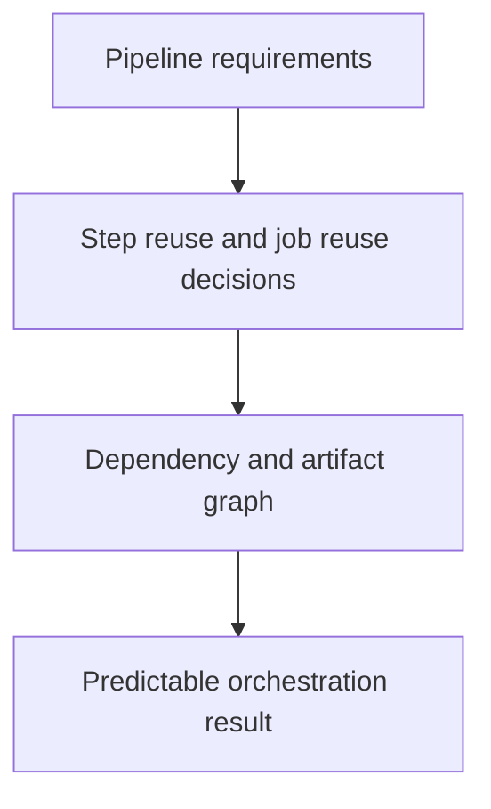

# 0030 · Compose setup/build/test steps and reusable job workflows

!!! note "Placeholder for a future teaching thread"
    This page is a teaching brief. Expand it into a full interactive lesson in its own thread. The planned exercises and outcomes have not been completed or demonstrated.

**Level:** Intermediate to advanced.

## Prerequisites

- [0029 · Reusable workflows, typed inputs, explicit secrets, and permissions](0029-reusable-workflows-and-permission-interfaces.md)
- [0006 · Matrices, job dependencies, cancellation, and failure propagation](0006-matrices-dependencies-and-cancellation.md)

## What you will learn to do

- Choose a composite or reusable workflow for a concrete reuse case.
- Design a small fan-out/fan-in pipeline with clear contracts.

## Explain the Actions behavior

Start from the prerequisite workflow or action behavior and introduce these concepts with focused examples:

1. Step reuse and job orchestration solve different duplication problems.
2. An orchestrator schedules dependencies and exchanges artifacts while workers perform bounded tasks.
3. Reusable boundaries should make runner, permission, and failure behavior understandable to callers.

Explain the relevant workflow YAML, expressions, and action code in context. Follow the [shared teaching guide](teaching-guide.md) for pacing, expected output, and progression toward independent design.

## Planned local lab

Create an isolated exercise under `labs/0030/` when the lesson is developed. Explain setup and expected output before each command; reuse installed tools rather than reinstalling them on every step.

1. Specify setup, build, test, and report responsibilities in a small pipeline.
2. Place shared step setup in a composite and job-level policy in a reusable workflow draft.
3. Trace success, one failed test branch, and a skipped publishing path before considering deployment.

## Break it and diagnose it

Hide runner selection or release policy inside a step-level component and diagnose why the caller cannot control the actual job behavior.

Ask for a prediction first. Capture the smallest reproducer, the actual result, and the corrected behavior. State which remaining claim requires a real GitHub or external-service check.

## Planning diagram



When expanding this lesson, refine the diagram to show the actual processes, branches, data exchange, and trust boundaries being taught.

## Retrieval questions

1. What belongs to the orchestrator versus a worker?
2. Where should a permission or runner decision be visible?
3. How does a downstream job know which upstream evidence is complete?

## Evidence to capture in the teaching thread

- A working learner-produced example and an explanation of why it works.
- A reproduced failure, a reasoned repair, and the smallest check that verifies it.
- A short account of remaining limits, unresolved questions, and readiness for the next lesson.

Use [primary references](../references/resources.md) to verify current syntax, runtime support, and tool behavior. Add learning records only for real statements or demonstrated understanding; a placeholder or generated page does not establish mastery.

## Start this lesson in a new thread

```text
/teach 0030

Expand docs/lessons/0030-compose-step-and-job-orchestration.md in place using docs/lessons/teaching-guide.md.
Read docs/mission.md, NOTES.md, and the prerequisite lesson pages first.
Begin with a short check of the Actions prerequisites. Explain relevant YAML,
expressions, and action contracts, one concept at a time. Let me predict and
try each exercise before revealing its answer. Keep feedback local where possible.
Finish with retrieval questions and a truthful handoff for the next thread.
```

| Previous | All lessons | Next |
| --- | --- | --- |
| [0029 · Reusable workflows, typed inputs, explicit secrets, and permissions](0029-reusable-workflows-and-permission-interfaces.md) | [Curriculum](index.md) | [0031 · Least-privilege tokens, fork pull requests, and event trust boundaries](0031-github-token-forks-and-trust-boundaries.md) |
