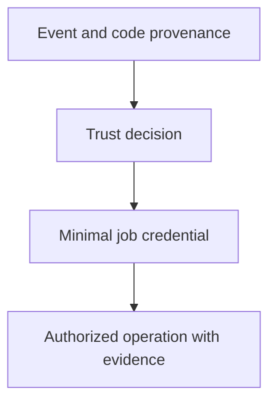

# 0031 · Least-privilege tokens, fork pull requests, and event trust boundaries

!!! note "Placeholder for a future teaching thread"
    This page is a teaching brief. Expand it into a full interactive lesson in its own thread. The planned exercises and outcomes have not been completed or demonstrated.

**Level:** Advanced.

## Prerequisites

- [0030 · Compose setup/build/test steps and reusable job workflows](0030-compose-step-and-job-orchestration.md)
- [0054 · Compose an action-based pipeline and maintain its dependencies](0054-compose-maintained-actions-and-manage-updates.md)
- [0029 · Reusable workflows, typed inputs, explicit secrets, and permissions](0029-reusable-workflows-and-permission-interfaces.md)

## What you will learn to do

- Draw credential and code-provenance boundaries for a workflow.
- Plan least-privilege access and real fork-event verification.

## Explain the Actions behavior

Start from the prerequisite workflow or action behavior and introduce these concepts with focused examples:

1. A credential identifies an authority whose effective permissions depend on platform policy.
2. Event provenance determines which code and data should be trusted for a privileged operation.
3. Credentials should be available only to work that needs the specific operation.

Explain the relevant workflow YAML, expressions, and action code in context. Follow the [shared teaching guide](teaching-guide.md) for pacing, expected output, and progression toward independent design.

## Planned local lab

Create an isolated exercise under `labs/0031/` when the lesson is developed. Explain setup and expected output before each command; reuse installed tools rather than reinstalling them on every step.

1. Inventory repository reads and writes in the existing workflows.
2. Map each operation to the intended token scope, job, event source, and checked-out revision.
3. Create a threat model for an untrusted pull request and a bounded hosted verification checklist without supplying real secrets locally.

## Break it and diagnose it

Run untrusted repository code in a job that holds a write-capable credential. Trace the authority the code would receive.

Ask for a prediction first. Capture the smallest reproducer, the actual result, and the corrected behavior. State which remaining claim requires a real GitHub or external-service check.

## Planning diagram



When expanding this lesson, refine the diagram to show the actual processes, branches, data exchange, and trust boundaries being taught.

## Retrieval questions

1. Whose code is running in this job?
2. Which precise operation requires each permission?
3. Why can a local fixture not prove how GitHub downgrades or withholds credentials?

## Evidence to capture in the teaching thread

- A working learner-produced example and an explanation of why it works.
- A reproduced failure, a reasoned repair, and the smallest check that verifies it.
- A short account of remaining limits, unresolved questions, and readiness for the next lesson.

Use [primary references](../references/resources.md) to verify current syntax, runtime support, and tool behavior. Add learning records only for real statements or demonstrated understanding; a placeholder or generated page does not establish mastery.

## Start this lesson in a new thread

```text
/teach 0031

Expand docs/lessons/0031-github-token-forks-and-trust-boundaries.md in place using docs/lessons/teaching-guide.md.
Read docs/mission.md, NOTES.md, and the prerequisite lesson pages first.
Begin with a short check of the Actions prerequisites. Explain relevant YAML,
expressions, and action contracts, one concept at a time. Let me predict and
try each exercise before revealing its answer. Keep feedback local where possible.
Finish with retrieval questions and a truthful handoff for the next thread.
```

| Previous | All lessons | Next |
| --- | --- | --- |
| [0054 · Compose an action-based pipeline and maintain its dependencies](0054-compose-maintained-actions-and-manage-updates.md) | [Curriculum](index.md) | [0032 · Script injection, untrusted artifacts, and privileged-event pitfalls](0032-script-injection-artifacts-and-privileged-events.md) |
