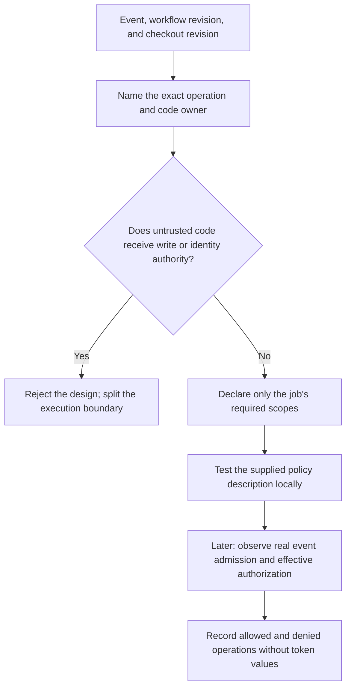

# 0031 · Least-privilege tokens, fork pull requests, and event trust boundaries

Predict the decisions in the synthetic token-policy lab before running it. The exercise uses no real credentials.

## Start with the operation and the code

Authority is the ability to perform an operation, such as writing an issue comment. **Least privilege** means granting only the authority needed for that operation, for the smallest useful job and lifetime. A trust boundary separates code or data controlled by different parties. Identify which code will execute before trusting repository membership, event names, or a green check.

`GITHUB_TOKEN` is GitHub's job credential. A job's `permissions` map requests its repository capabilities. GitHub calculates effective permissions using defaults, workflow/job declarations, and event/settings restrictions. Listing permissions sets omitted scopes to `none`; use `permissions: {}` as a clear workflow baseline, then declare each job's needs. These are requested scopes, not proof that any API call succeeded. See [workflow permission calculation](https://docs.github.com/en/actions/reference/workflows-and-actions/workflow-syntax#how-permissions-are-calculated-for-a-workflow-job), checked **2026-10-30**.

| Work | Intended scope in this lesson | Code boundary |
| --- | --- | --- |
| Pure fixture calculation, no checkout | None | Trusted inline program or unprivileged worker |
| Checkout and test repository code | `contents: read` | Contributor code remains untrusted |
| Comment on an issue or PR through the issue endpoint | `issues: write` | Reviewed reporting code; validated target and body |
| Create release metadata/assets later | `contents: write` | Reviewed release code and approved candidate |
| Request an OIDC identity later | `id-token: write` | Separate identity authority; see 0033 |

Exact API endpoints may need additional permissions. The table is an inventory starting point, not a universal endpoint authorization guide. This module performs no API operation.



## Fork admission is separate from trusted execution

For ordinary fork `pull_request` runs, the normal model withholds repository secrets and restricts the job token. Settings can permit broader fork behavior; do not assume every repository has identical configuration. Dependabot PRs also have special restrictions. Approving a contributor's run lets it start. You still need to review the code before giving it secrets or write access. Check the [fork event documentation](https://docs.github.com/en/actions/reference/workflows-and-actions/events-that-trigger-workflows#workflows-in-forked-repositories) and the [fork permission exception](https://docs.github.com/en/actions/reference/workflows-and-actions/workflow-syntax#changing-the-permissions-in-a-forked-repository).

An action can access `github.token` without a consumer explicitly passing it as an input. Omitting a `token:` input therefore does not establish isolation. Likewise, `persist-credentials: false` prevents checkout from leaving its authentication available for later Git commands; it does not remove every job credential, undo a permission grant, or isolate another step from the runner. The [secure-use reference](https://docs.github.com/en/actions/reference/security/secure-use) explains this credential exposure model.

Untrusted code can run before the command named "test". Dependency installation hooks, build plugins, local actions, and generated scripts can all execute it. A write-capable reporter should not install or execute an unreviewed PR's dependencies. A self-hosted runner also needs protection from persistent modifications; reducing the token alone does not make a long-lived host safe for arbitrary contributors.

## Read the inactive PR recipe

`labs/0031/read-only-pr.yml` is saved outside `.github/workflows/`, so it registers no workflow. Its central boundary is:

```yaml title="Read-only PR job excerpt"
permissions: {}
jobs:
  test:
    permissions:
      contents: read # (1)!
    runs-on: ubuntu-latest
    timeout-minutes: 5
    steps:
      - uses: actions/checkout@3d3c42e5aac5ba805825da76410c181273ba90b1
        with:
          persist-credentials: false # (2)!
      - run: python3 -B -m unittest discover -s labs/0031 -p 'test_*.py' -v
```

1. Read access supports checkout. No repository write is needed for the policy tests.
2. Avoid persisting checkout authentication for subsequent Git commands. Other job authorities still require review.

The pin reuses the course's existing checkout reference; a human-readable version comment does not enforce identity or establish an independent audit. [0035](0035-sha-pins-semantic-releases-and-provenance.md) develops reference integrity and current dependency-locking options.

!!! tip "Predict before running"
    A `pull_request_target` reporter requests `issues: write`, then checks out a contributor's head and executes its script. Does the privileged event make that head trusted? Would removing an explicit token input solve the exposure?

??? tip "Worked prediction"
    The head remains contributor-controlled. Changing the event gives different authority and workflow context; it does not review code. The job still has a credential that code/actions may reach. Keep untrusted tests in an unprivileged job and reviewed reporting code in a separate boundary. The next lesson examines how even a data-only follow-up needs validation.

## Local lab: inspect the supplied authority inventory

From the repository root, use installed Python; no packages or engine are needed:

```bash
python3 -B labs/0031/policy.py fork-read
python3 -B labs/0031/policy.py fork-write
python3 -B labs/0031/policy.py target-head
python3 -B labs/0031/policy.py trusted-comment
python3 -B labs/0031/policy.py missing-scope
```

`jobs.json` contains descriptions, not tokens. `code_origin=reviewed-base` is an explicit fictional review assertion. The program trusts that supplied field for this teaching policy; it cannot discover real provenance or reproduce GitHub's permission calculation.

| Case | Exit | First output line |
| --- | --- | --- |
| `fork-read` | 0 | `ALLOW: supplied job meets the teaching policy` |
| `fork-write` | 1 | `DENY: untrusted code receives authority` |
| `target-head` | 1 | `DENY: untrusted code receives authority` |
| `trusted-comment` | 0 | `ALLOW: supplied job meets the teaching policy` |
| `missing-scope` | 1 | `DENY: missing issues:write; permission exceeds operation contract` |

Every case also prints `SIMULATION: no GitHub token, settings, or API authorization observed`. Exit 1 in the denied cases is the expected negative result, not a broken lab.

```bash
python3 -B -m unittest discover -s labs/0031 -p 'test_*.py' -v
.tools/bin/actionlint labs/0031/read-only-pr.yml
```

Expected: nine test methods pass; actionlint exits 0 without diagnostics. Tests also reject unnecessary scopes, synthetic secret exposure, identity authority on untrusted code, and an unknown operation. Static workflow success proves no event admission, token downgrade, or runner execution.

## Deliberate failure, diagnosis, and repair

`missing-scope` requests `contents: read` for a comment operation. Increasing it to `contents: write` would still miss `issues: write` and add unrelated authority. Read the denied operation first, then map it to the intended endpoint's required scope.

In a scratch copy of `jobs.json`, repair this description to request only `issues: write`, with reviewed code and no named secrets. Repeat the matching policy decision and compare the scope inventory. The existing `trusted-comment` case is the worked repair; it performs no real comment.

??? tip "Diagnosis sequence"
    Identify the desired operation; confirm which code would perform it; compare the required scope with the declaration; inspect event/settings limits separately. A real `403` can also mean policy, resource access, or endpoint restrictions. A local allow result cannot diagnose a real GitHub denial by itself.

## Transfer and retrieval

A maintainer proposes putting build, PR comment, and release steps in one job with a PAT. Draw the jobs you would separate and identify what each receives. Consider why a PAT is a different credential whose authority is not reduced by the workflow's `GITHUB_TOKEN` permissions map.

??? tip "Worked transfer"
    Build/test untrusted code without write access or supplied secrets. A reviewed reporter consumes bounded validated results and gets only its comment authority. A separate release gate binds reviewed source and artifacts, with its own approval and identity policy. Avoid a broad PAT when the job token or a narrower supported identity suffices. Credential substitution must be justified by the operation, not used to bypass an unexplained denial.

Answer from memory:

1. Why are event name and checked-out revision separate inventory fields?
2. What does omitting `token:` fail to prove?
3. Why is successful policy simulation weaker than observed API authorization?
4. Which operation actually needs each scope in your design?

??? tip "Retrieval check"
    A privileged event can still execute untrusted head code. Credentials may be reachable through the job context and other mechanisms. Fixtures evaluate declared assumptions; GitHub settings, real code provenance, and actual endpoint access require platform observations. Tie each scope to a named operation and remove unused authority.

## Verification boundary

A later bounded GitHub check should record event, fork/base identity, workflow and checkout SHAs, requested/effective permission evidence, secret availability as a boolean, and harmless allowed/denied operations in a disposable context. Never record token values. Real fork settings, authorization, self-hosted isolation, and reusable permission propagation remain unverified here; `act` cannot establish them. Continue to [0032 · Injection and privileged-event boundaries](0032-script-injection-artifacts-and-privileged-events.md).

| Previous lesson | All lessons | Next lesson |
| --- | --- | --- |
| [0030 · Compose step and job orchestration](0030-compose-step-and-job-orchestration.md) | [Curriculum](index.md) | [0032 · Script injection, artifacts, and privileged events](0032-script-injection-artifacts-and-privileged-events.md) |
