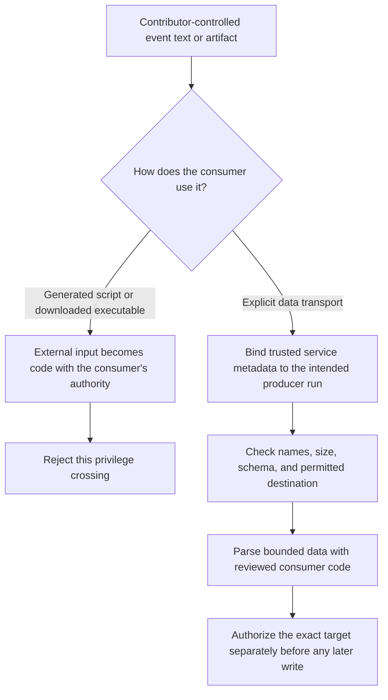

# 0032 · Script injection, untrusted artifacts, and privileged-event pitfalls

The fixed injection payload creates a temporary marker. The artifact exercise reads synthetic ZIPs in memory. Neither exercise uses a real credential or performs a privileged operation.

## Follow data through every interpreter

**Script injection** happens when external text becomes program syntax. A PR title, branch name, body, or commit message is not trusted because GitHub delivered it. Direct interpolation such as the following generates shell source before Bash starts:

```yaml title="Unsafe teaching excerpt; do not activate"
run: printf '%s\n' "${{ github.event.pull_request.title }}"
```

Shell quotes in the template cannot protect against a value that contributes new quote characters to the generated script. The safer shape transports the value separately:

```yaml title="labs/0032/data-only-pr.yml, safe transport"
env:
  TITLE: ${{ github.event.pull_request.title }} # (1)!
shell: bash
run: |
  python3 -c 'import os; print("title characters:", len(os.environ["TITLE"]))' # (2)!
```

1. The runner supplies the value through the environment rather than writing it into program source.
2. The Python source is fixed. It reads data and prints a count; it does not evaluate the title or log its arbitrary contents.

The [secure-use guidance](https://docs.github.com/en/actions/reference/security/secure-use#good-practices-for-mitigating-script-injection-attacks), checked **2026-10-30**, describes intermediate environment transport and action arguments. Passing an input to an action only preserves this boundary if that action handles it safely. Sending the string onward to `eval`, `bash -c`, a generated JavaScript expression, or an unsafe template reintroduces evaluation. Quoting also does not validate whether a data value is an authorized target, allowed filename, or valid command option.



## Privileged events change context, not the ownership of data

`pull_request` is suitable for testing contributor code with restricted authority. `pull_request_target` runs in the base repository's default-branch context and is useful for metadata operations. Checking out a PR head, running its install hooks, or sourcing its scripts in that context defeats the intended boundary. [GitHub's event reference](https://docs.github.com/en/actions/reference/workflows-and-actions/events-that-trigger-workflows#pull_request_target) warns against building/running PR code there.

A `workflow_run` follow-up can have secrets or a write token even when the preceding workflow did not. A `completed` trigger does not mean the predecessor succeeded; conclusion is a separate check. Moreover, success does not prove its artifact is authorized or safe. These are documented [workflow_run semantics](https://docs.github.com/en/actions/reference/workflows-and-actions/events-that-trigger-workflows#workflow_run).

A safer follow-up runs reviewed consumer code. It checks the service's metadata for the repository identity, workflow ID and path, run ID and attempt, event, head revision, and conclusion. It selects an exact artifact from that run, isolates the download from executable workspace files, and parses a constrained schema. The artifact's own `repository` or `sha` string is an assertion from the producer, not proof of identity. A filename such as `approved-report.zip` is equally weak.

!!! warning "A report can redirect an otherwise safe write"
    A numeric PR number in a valid report still needs to match the intended triggering PR/repository. Parsing JSON safely does not authorize the target of a comment, release, or deployment. This lab performs none of those operations.

## Local lab: predict both boundaries

Before running, predict whether a title containing `"; : > marker; #` creates a file when inserted into shell source, and whether an environment variable containing the same bytes gets parsed again.

```bash
python3 -B labs/0032/boundaries.py
```

Expected exit 0 and exact lines:

```text
unsafe: marker created
safe: exact text preserved; marker absent
temporary directory removed; no inherited credentials or network calls
report: 3/3 checks passed (data only)
```

`injection_demo()` creates a temporary directory, generates the deliberately vulnerable Bash script from a fixed payload, checks that its marker exists, removes the marker, and runs a fixed script with `TITLE` supplied separately. Its subprocess environment contains only a basic PATH and the synthetic title. It checks exact stdout and marker absence, then removes the directory. The outer demo passes only when both the unsafe behavior and safe repair are observed.

??? tip "Worked injection diagnosis"
    The first script's generated source contains a closing quote, a command separator, and the marker command. In the repaired script, Bash expands `$TITLE` inside a quoted argument without recursively parsing its contents as shell source. A file-existence assertion and exact byte comparison establish the tested distinction. Printing the title alone would miss a silent side effect.

## Consume an artifact without extracting or executing it

`consume()` opens an in-memory ZIP and accepts exactly one entry, `report.json`. It rejects unexpected paths, extra entries, symlinks, archives above 16 KiB, and report entries above 1 KiB before parsing. It never extracts files into the checkout. The report must have exactly three keys:

```json title="Accepted report schema example"
{"schema": 1, "passed": 3, "total": 3}
```

The counters must be actual integers, with `0 <= passed <= total <= 100`. Rejecting booleans matters because Python treats `bool` as an integer subtype. The strict key set also rejects a supplied `command` field; report data must not grow an accidental execution interface.

```python title="labs/0032/boundaries.py, producer boundary"
if observed_producer != EXPECTED: # (1)!
    raise ValueError("producer context mismatch")
```

1. `observed_producer` is a separate synthetic input, representing future trusted service metadata. It is not read from the ZIP. Both dictionaries are fixtures here, so this comparison demonstrates a selection rule without authenticating any real producer.

The example's expected metadata identifies a fictional push run and source revision. For a PR reporting workflow, deliberately define a different event/PR contract and bind its target. Define the allowed event before downloading the artifact. Keep that rule when a downloaded artifact fails it. Real archive consumers also need threat-appropriate compression, parser, filesystem, and race limits; this bounded in-memory exercise is not a general extraction sandbox.

```bash
python3 -B -m unittest discover -s labs/0032 -p 'test_*.py' -v
.tools/bin/actionlint labs/0032/data-only-pr.yml
```

Expected: seven test methods pass and actionlint returns 0 with no diagnostics. Cases cover wrong-run success, escaping/absolute/executable paths, extra files, invalid counts/types/keys, symlinks, and oversized reports. Inner `ValueError` failures are expected and asserted; the suite itself exits 0.

## Deliberate failure and repair

Consider a follow-up that downloads `report.zip` from the latest successful run, extracts it over the checkout, and executes `report.sh`. Name three independent defects before opening the solution.

??? tip "Worked repair"
    "Latest" can select a different revision/run; a familiar filename says nothing about provenance; extraction can overwrite trusted scripts; executing the result gives producer code the consumer's authority. Bind the triggering run and artifact ID, verify service metadata, isolate the data destination, reject unexpected entries, parse an explicit schema, and authorize a specific operation/target. Parse and evaluate the report as data. Never execute it as consumer code. Keeping a privileged consumer on reviewed code is essential even when the producer succeeded.

## Transfer and retrieval

A report with the correct schema and checksum asks a release job to publish a different source revision. Should the job accept it? Design the missing check, then explain why a checksum inside the same untrusted archive is insufficient.

??? tip "Worked transfer"
    Compare the candidate revision to independently expected reviewed source and trusted producer evidence. Reject mismatches before considering any write. An attacker can replace both bytes and an unsigned checksum; content agreement alone does not authenticate the source. [0034](0034-caches-artifacts-and-reproducibility.md) separates those contracts in a runnable exercise.

Retrieve without looking:

1. At which stage does direct expression interpolation become dangerous?
2. Why does upstream success fail to authorize artifact execution?
3. Which metadata must come from outside the artifact?
4. Why can schema-valid data still choose an unauthorized target?

??? tip "Retrieval check"
    Expression substitution writes source before the interpreter starts. Upstream success is a conclusion about a run, not a code review or permission grant. Producer identity and expected revision/run must have a trusted origin. Data parsing preserves syntax boundaries; authorization separately decides the permitted operation and target.

## Verification boundary

The host lab proves the tested Bash data boundary and synthetic archive checks. It does not verify `pull_request_target`/`workflow_run` admission, token access, hosted artifact identity, permissions, or an actual follow-up. No container or `act` execution occurred. Continue to [0033 · Identity and environment policy](0033-oidc-environments-and-hosted-policy.md), keeping policy simulation distinct from platform enforcement.

| Previous lesson | All lessons | Next lesson |
| --- | --- | --- |
| [0031 · Tokens, forks, and trust boundaries](0031-github-token-forks-and-trust-boundaries.md) | [Curriculum](index.md) | [0033 · OIDC, environments, and hosted policy](0033-oidc-environments-and-hosted-policy.md) |
