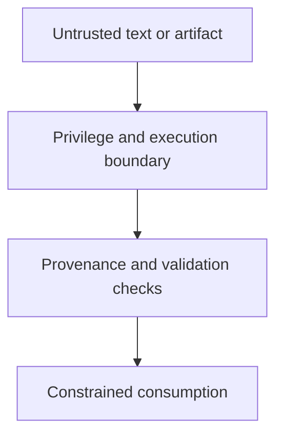

# 0032 · Script injection, untrusted artifacts, and privileged-event pitfalls

!!! note "Placeholder for a future teaching thread"
    This page is a teaching brief. Expand it into a full interactive lesson in its own thread. The planned exercises and outcomes have not been completed or demonstrated.

**Level:** Advanced.

## Prerequisites

- [0031 · Least-privilege tokens, fork pull requests, and event trust boundaries](0031-github-token-forks-and-trust-boundaries.md)
- [0027 · Transport inputs safely through environment variables and quoted arguments](0027-untrusted-input-and-shell-quoting.md)

## What you will learn to do

- Trace a plausible path from untrusted input to privileged execution.
- Design a safer contract for consuming repository data or artifacts.

## Explain the Actions behavior

Start from the prerequisite workflow or action behavior and introduce these concepts with focused examples:

1. Event text and downloaded artifacts can carry attacker-controlled data or executable content.
2. A privileged trigger and an untrusted checkout can combine authorities unexpectedly.
3. A safe boundary checks producer identity, content, and execution context before consuming data.

Explain the relevant workflow YAML, expressions, and action code in context. Follow the [shared teaching guide](teaching-guide.md) for pacing, expected output, and progression toward independent design.

## Planned local lab

Create an isolated exercise under `labs/0032/` when the lesson is developed. Explain setup and expected output before each command; reuse installed tools rather than reinstalling them on every step.

1. Use an inert fixture to map shell injection and artifact-consumption paths.
2. Inspect the semantics of pull_request_target and checkout refs against current primary documentation.
3. Redesign a privileged follow-up workflow so its code and inputs have explicit provenance and validation.

## Break it and diagnose it

Treat an artifact filename or successful upstream status as proof that its contents are safe to execute. Explain the missing trust evidence.

Ask for a prediction first. Capture the smallest reproducer, the actual result, and the corrected behavior. State which remaining claim requires a real GitHub or external-service check.

## Planning diagram



When expanding this lesson, refine the diagram to show the actual processes, branches, data exchange, and trust boundaries being taught.

## Retrieval questions

1. Which inputs can an external contributor control?
2. Where could plain data become executable behavior?
3. What does an upstream success status actually establish about an artifact?

## Evidence to capture in the teaching thread

- A working learner-produced example and an explanation of why it works.
- A reproduced failure, a reasoned repair, and the smallest check that verifies it.
- A short account of remaining limits, unresolved questions, and readiness for the next lesson.

Use [primary references](../references/resources.md) to verify current syntax, runtime support, and tool behavior. Add learning records only for real statements or demonstrated understanding; a placeholder or generated page does not establish mastery.

## Start this lesson in a new thread

```text
/teach 0032

Expand docs/lessons/0032-script-injection-artifacts-and-privileged-events.md in place using docs/lessons/teaching-guide.md.
Read docs/mission.md, NOTES.md, and the prerequisite lesson pages first.
Begin with a short check of the Actions prerequisites. Explain relevant YAML,
expressions, and action contracts, one concept at a time. Let me predict and
try each exercise before revealing its answer. Keep feedback local where possible.
Finish with retrieval questions and a truthful handoff for the next thread.
```

| Previous | All lessons | Next |
| --- | --- | --- |
| [0031 · Least-privilege tokens, fork pull requests, and event trust boundaries](0031-github-token-forks-and-trust-boundaries.md) | [Curriculum](index.md) | [0033 · OIDC, deployment environments, approval, and real platform verification](0033-oidc-environments-and-hosted-policy.md) |
