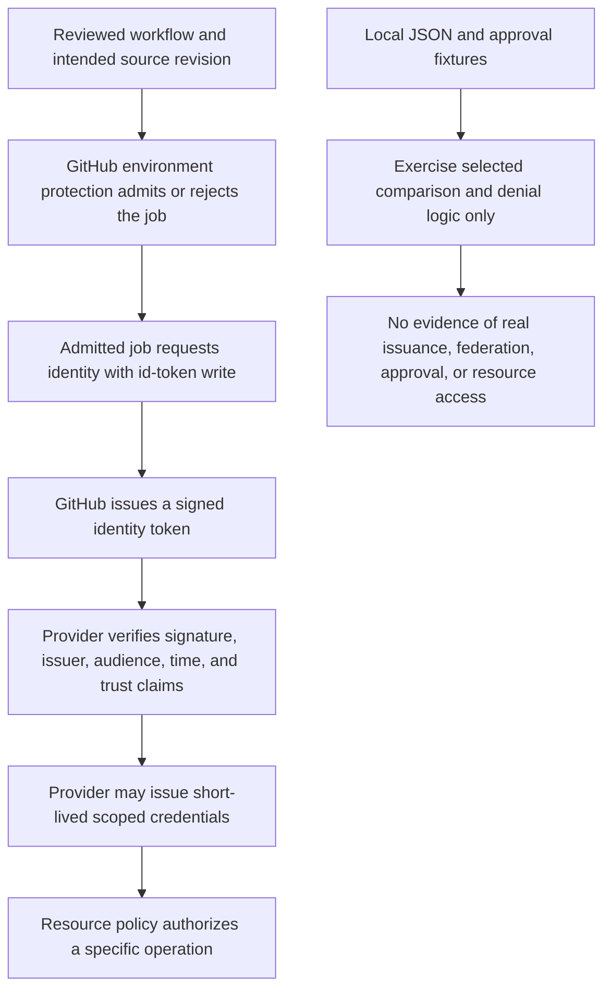

# 0033 · OIDC, deployment environments, approval, and real platform verification

The lab matches synthetic identity claims against policy rules. It does not request a JWT, configure cloud trust, or access a cloud resource. Real enforcement needs a hosted test.

## Separate four decisions

OpenID Connect, or OIDC, lets a workflow request an identity token from GitHub. Its claims describe the workflow context.

The cloud identity system verifies the token and applies its configured trust policy. It may then issue short-lived cloud credentials. Cloud role and resource policies determine what those credentials can do. Environment protection is another configured GitHub decision that controls whether the job proceeds. See the [OIDC overview](https://docs.github.com/en/actions/concepts/security/openid-connect), checked **2026-10-30**.

| Decision | Real enforcement owner | What a local fixture can test |
| --- | --- | --- |
| Job may start after protection rules | GitHub environment policy | Application handling of a supplied approval boolean |
| Job may request an identity token | GitHub OIDC endpoint and job permissions | Intended permission declaration |
| Token identity is acceptable | Provider JWT validation and trust policy | Expected claim comparisons |
| Temporary identity may perform an operation | Cloud role and resource policy | Handling a mocked allow/deny response |

A workflow `if` can reduce unintended attempts, but is not a replacement for provider-side trust. A cloud trust rule must reject an unauthorized context even if a workflow condition is removed.



## Permission to request is not permission to deploy

The job needs `id-token: write` to request the OIDC token. That scope does not grant repository writes or cloud resource writes. A job doing checkout also needs its separate `contents: read` authority. The provider's login action normally handles the exchange; choose its maintained supported interface when implementing a real integration. See [OIDC request permissions](https://docs.github.com/en/actions/reference/security/oidc#workflow-permissions-for-the-requesting-the-oidc-token).

`labs/0033/policy-shape.yml` is an inactive design recipe:

```yaml title="Identity boundary excerpt"
permissions: {}
jobs:
  planned-identity-boundary:
    if: ${{ github.ref == 'refs/heads/main' }}
    environment: staging # (1)!
    permissions:
      id-token: write # (2)!
    runs-on: ubuntu-latest
    timeout-minutes: 2
    steps:
      - run: printf '%s\n' 'Design only; no OIDC token requested and no resource accessed'
```

1. The name refers to environment configuration; it does not declare required reviewers, deployment branches, bypass rules, or cloud trust.
2. This declaration permits requesting identity if the recipe is later run on GitHub. The provided step does not request a token or deploy anything.

This recipe is a syntax specimen, not a protected deployment. It deliberately omits login and resource operations. Do not activate it expecting the environment name alone to configure approval. GitHub documents environment plan/visibility differences and protection settings in [managing environments](https://docs.github.com/en/actions/how-tos/deploy/configure-and-manage-deployments/manage-environments).

## Read a subject using the repository's actual format

A **claim** is a statement inside the signed identity. `iss` names the issuer; `aud` identifies the intended relying audience; `sub` identifies the subject. Repository IDs, ref, event, environment, and reusable workflow identity may further constrain a policy, subject to the provider's supported claim mapping.

!!! note "Current subject formats"
    GitHub's [OIDC reference](https://docs.github.com/en/actions/reference/security/oidc#immutable-subject-claims), checked **2026-10-30**, states that repositories created after July 15, 2026 use an ID-bearing default subject, with rollout/opt-in and rename/transfer behavior documented there. Older repositories may retain name-only subjects; GHES differs. Check actual configuration and provider support instead of copying a subject from an old tutorial.

The fictional lab repository chooses the ID-bearing environment subject:

```json title="Selected synthetic claims from labs/0033/claims.json"
{
  "iss": "https://token.actions.githubusercontent.com",
  "aud": "urn:lesson:deploy",
  "sub": "repo:example@100/lesson@200:environment:staging",
  "repository_id": "200",
  "repository_owner_id": "100",
  "ref": "refs/heads/main"
}
```

The audience and IDs above are teaching values, not a provider configuration to paste into a real account. A legacy name-only subject for the same environment would be `repo:example/lesson:environment:staging`. The policy accepts one explicit subject format. It does not use a wildcard to accept both. Subject context changes with an environment, PR, or branch, and subject metadata containing `:` requires documented encoding.

An environment subject does not by itself encode a branch restriction. Constrain allowed refs through environment deployment rules and a provider-supported claim or customized subject policy. With reusable workflows, check both caller and callee identity. Verify the claims under the provider's policy and tie them to reviewed workflow code.

!!! tip "Predict the missing boundary"
    A synthetic claim object has the intended environment subject, but `ref` names a topic branch. Another object has correct claims but no observed approval. Which should this lesson's policy accept? Could a caller set `approved=true` and obtain cloud credentials from this program?

??? tip "Worked prediction"
    The lab policy rejects both. It checks the ref and approval separately. The boolean is just a supplied test input. Setting it changes local selection behavior and obtains no identity or credentials. A real environment approval is GitHub state; a provider must validate a real signed token and its own trust/resource policy.

## Local lab: test allowed and rejected descriptions

From the repository root:

```bash
python3 -B labs/0033/trust.py allowed
python3 -B labs/0033/trust.py wrong-audience
python3 -B labs/0033/trust.py fork
python3 -B labs/0033/trust.py expired
python3 -B labs/0033/trust.py unapproved
```

The allowed case exits 0 with `ALLOW: synthetic claim selection and approval match`. The other four exit 1:

| Case | Required diagnostic fragment |
| --- | --- |
| `wrong-audience` | `claim aud mismatch` |
| `fork` | `claim sub mismatch; claim repository_id mismatch` |
| `expired` | `outside validity window` |
| `unapproved` | `approval not observed in simulation` |

Every case prints `NOT VERIFIED: signature, issuer keys, real approval, federation, resource authorization`. The tests use fictional time `now=1100` and validity interval `[1000,1300)`. These values do not track the real clock or a live token's expiry.

```bash
python3 -B -m unittest discover -s labs/0033 -p 'test_*.py' -v
.tools/bin/actionlint labs/0033/policy-shape.yml
```

Expected: seven test methods pass and actionlint emits no diagnostics, exit 0. Tests vary every configured identity field, remove a required claim, exercise exact time boundaries, and reject legacy-format subjects and wrong refs. They are comparison tests, not cryptographic JWT tests.

## Deliberate failure and repair

A developer replaces exact subject matching with `sub.startswith('repo:')` to make a fork case pass. Diagnose what authority this broadens, then repair it without trying a real login.

??? tip "Worked diagnosis"
    The prefix describes almost every repository subject. It no longer binds the identity to the intended repository, owner, or environment. Restore exact intended identity conditions and keep negative cases. If the repository changes its subject format, review its identity evidence and update the configured policy. Do not broaden the rule to unrelated namespaces. Verify signature, issuer, audience, timing, and provider-supported conditions in the real federation boundary later; JSON field equality cannot substitute for those checks.

## Transfer and retrieval

Design a future disposable test with a single permitted resource operation. Include intended main/staging identity, wrong audience, wrong repository, wrong ref, missing approval, and a valid identity lacking the resource permission. Specify expected denial evidence without printing tokens or claims containing sensitive values.

??? tip "Worked transfer"
    Record reviewed policy/config revisions, workflow/source SHAs, run references, non-sensitive identity identifiers, approval/admission observations, exchange success/failure, and the resource operation result. Use provider logs or bounded denied operations to distinguish trust rejection from resource authorization denial. Do not treat one successful login as evidence that unauthorized contexts fail. No such infrastructure or hosted experiment is performed by this lab.

Retrieve:

1. What does `id-token: write` enable?
2. Why is an environment name insufficient to prove protection?
3. How can a correct subject still allow the wrong branch?
4. What does the local `approved` input actually establish?

??? tip "Retrieval check"
    It permits identity requests, not arbitrary writes. Rules are configured outside the workflow and depend on platform availability. An environment subject needs a separate ref restriction if branch context is required. The supplied boolean tests application selection only; it observes no real approval.

## Verification boundary

No token was minted, decoded, or printed; no credentials were changed; no cloud or environment setup occurred. Actual environment admission, OIDC signatures/claims, provider mapping, resource access, and rejection behavior remain later integration evidence. `act` cannot certify these contracts. Continue to [0034 · Reuse and provenance](0034-caches-artifacts-and-reproducibility.md).

| Previous lesson | All lessons | Next lesson |
| --- | --- | --- |
| [0032 · Injection and privileged-event boundaries](0032-script-injection-artifacts-and-privileged-events.md) | [Curriculum](index.md) | [0034 · Caches, artifacts, and reproducibility](0034-caches-artifacts-and-reproducibility.md) |
