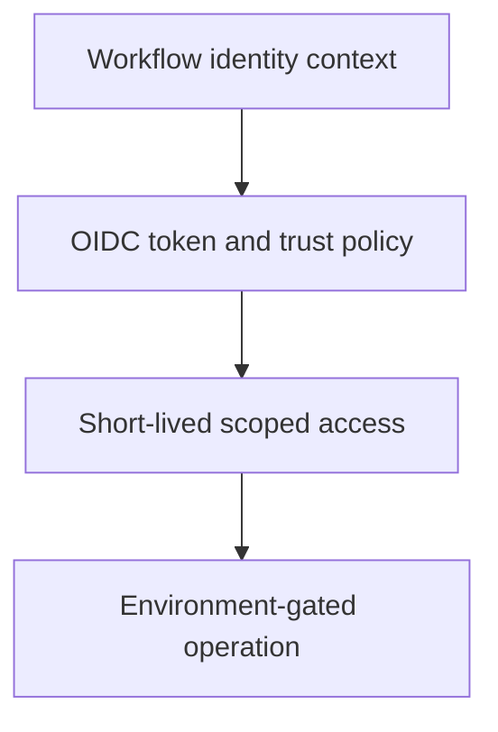

# 0033 · OIDC, deployment environments, approval, and real platform verification

!!! note "Placeholder for a future teaching thread"
    This page is a teaching brief. Expand it into a full interactive lesson in its own thread. The planned exercises and outcomes have not been completed or demonstrated.

**Level:** Advanced.

## Prerequisites

- [0032 · Script injection, untrusted artifacts, and privileged-event pitfalls](0032-script-injection-artifacts-and-privileged-events.md)
- [0031 · Least-privilege tokens, fork pull requests, and event trust boundaries](0031-github-token-forks-and-trust-boundaries.md)
- [0012 · Define the local/hosted coverage boundary and usage budget](0012-local-hosted-coverage-and-usage-budget.md)

## What you will learn to do

- Explain the identity chain without relying on a permanent cloud secret.
- Design a hosted check for intended and rejected identity contexts.

## Explain the Actions behavior

Start from the prerequisite workflow or action behavior and introduce these concepts with focused examples:

1. Federated identity exchanges a workflow identity for narrowly scoped short-lived access.
2. A trust policy checks claims about the workflow, repository, revision, or environment.
3. Environment protection and identity issuance require evidence from the actual platform.

Explain the relevant workflow YAML, expressions, and action code in context. Follow the [shared teaching guide](teaching-guide.md) for pacing, expected output, and progression toward independent design.

## Planned local lab

Create an isolated exercise under `labs/0033/` when the lesson is developed. Explain setup and expected output before each command; reuse installed tools rather than reinstalling them on every step.

1. Draw the runner-to-identity-provider-to-resource chain using placeholder claim data.
2. Specify a restrictive trust policy and intended environment approval path as a design exercise.
3. Plan a disposable hosted validation that checks both allowed and denied cases before any production deployment.

## Break it and diagnose it

Use a broad identity trust condition or assume local OIDC mocks enforce the real provider policy. Identify the missing authorization boundary.

Ask for a prediction first. Capture the smallest reproducer, the actual result, and the corrected behavior. State which remaining claim requires a real GitHub or external-service check.

## Planning diagram



When expanding this lesson, refine the diagram to show the actual processes, branches, data exchange, and trust boundaries being taught.

## Retrieval questions

1. Who issues and who trusts each identity token?
2. Which claim binds access to the intended repository or environment?
3. Which rejected context must the hosted check include?

## Evidence to capture in the teaching thread

- A working learner-produced example and an explanation of why it works.
- A reproduced failure, a reasoned repair, and the smallest check that verifies it.
- A short account of remaining limits, unresolved questions, and readiness for the next lesson.

Use [primary references](../references/resources.md) to verify current syntax, runtime support, and tool behavior. Add learning records only for real statements or demonstrated understanding; a placeholder or generated page does not establish mastery.

## Start this lesson in a new thread

```text
/teach 0033

Expand docs/lessons/0033-oidc-environments-and-hosted-policy.md in place using docs/lessons/teaching-guide.md.
Read docs/mission.md, NOTES.md, and the prerequisite lesson pages first.
Begin with a short check of the Actions prerequisites. Explain relevant YAML,
expressions, and action contracts, one concept at a time. Let me predict and
try each exercise before revealing its answer. Keep feedback local where possible.
Finish with retrieval questions and a truthful handoff for the next thread.
```

| Previous Lesson | All Lessons | Next Lesson |
| --- | --- | --- |
| [0032 · Script injection, untrusted artifacts, and privileged-event pitfalls](0032-script-injection-artifacts-and-privileged-events.md) | [Curriculum](index.md) | [0034 · Caches, artifacts, retention, poisoning risks, and reproducible inputs](0034-caches-artifacts-and-reproducibility.md) |
