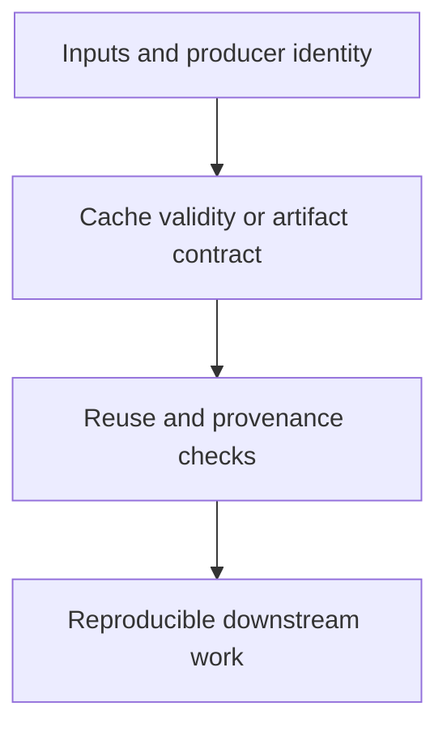

# 0034 · Caches, artifacts, retention, poisoning risks, and reproducible inputs

!!! note "Placeholder for a future teaching thread"
    This page is a teaching brief. Expand it into a full interactive lesson in its own thread. The planned exercises and outcomes have not been completed or demonstrated.

**Level:** Advanced.

## Prerequisites

- [0033 · OIDC, deployment environments, approval, and real platform verification](0033-oidc-environments-and-hosted-policy.md)
- [0007 · Taskfile as the command contract shared by humans and CI](0007-taskfile-shared-command-contract.md)
- [0032 · Script injection, untrusted artifacts, and privileged-event pitfalls](0032-script-injection-artifacts-and-privileged-events.md)

## What you will learn to do

- Design cache keys that include the inputs affecting correctness.
- Separate untrusted reusable data from reviewed release evidence.

## Explain the Actions behavior

Start from the prerequisite workflow or action behavior and introduce these concepts with focused examples:

1. A cache is a reuse optimization with a validity rule; an artifact is a named produced result.
2. Producer identity, dependency locks, and content provenance affect whether reuse is acceptable.
3. Retention, invalidation, and stale-result behavior are part of the operational contract.

Explain the relevant workflow YAML, expressions, and action code in context. Follow the [shared teaching guide](teaching-guide.md) for pacing, expected output, and progression toward independent design.

## Planned local lab

Create an isolated exercise under `labs/0034/` when the lesson is developed. Explain setup and expected output before each command; reuse installed tools rather than reinstalling them on every step.

1. Inventory dependency, build, and diagram caches and state what invalidates each.
2. Trace a produced artifact through upload, download, verification, and intended consumption.
3. Create stale-input and untrusted-producer scenarios and decide which checks must rerun.

## Break it and diagnose it

Reuse a successful validation result after an undeclared dependency changes. Diagnose the invalidation gap and repair the key or verification rule.

Ask for a prediction first. Capture the smallest reproducer, the actual result, and the corrected behavior. State which remaining claim requires a real GitHub or external-service check.

## Planning diagram



When expanding this lesson, refine the diagram to show the actual processes, branches, data exchange, and trust boundaries being taught.

## Retrieval questions

1. What makes cached evidence valid for this input?
2. How does an artifact differ from a cache entry?
3. Which producer or retention policy could make reused data unsafe?

## Evidence to capture in the teaching thread

- A working learner-produced example and an explanation of why it works.
- A reproduced failure, a reasoned repair, and the smallest check that verifies it.
- A short account of remaining limits, unresolved questions, and readiness for the next lesson.

Use [primary references](../references/resources.md) to verify current syntax, runtime support, and tool behavior. Add learning records only for real statements or demonstrated understanding; a placeholder or generated page does not establish mastery.

## Start this lesson in a new thread

```text
/teach 0034

Expand docs/lessons/0034-caches-artifacts-and-reproducibility.md in place using docs/lessons/teaching-guide.md.
Read docs/mission.md, NOTES.md, and the prerequisite lesson pages first.
Begin with a short check of the Actions prerequisites. Explain relevant YAML,
expressions, and action contracts, one concept at a time. Let me predict and
try each exercise before revealing its answer. Keep feedback local where possible.
Finish with retrieval questions and a truthful handoff for the next thread.
```

| Previous | All lessons | Next |
| --- | --- | --- |
| [0033 · OIDC, deployment environments, approval, and real platform verification](0033-oidc-environments-and-hosted-policy.md) | [Curriculum](index.md) | [0035 · Commit pins, semantic releases, major tags, and distribution integrity](0035-sha-pins-semantic-releases-and-provenance.md) |
