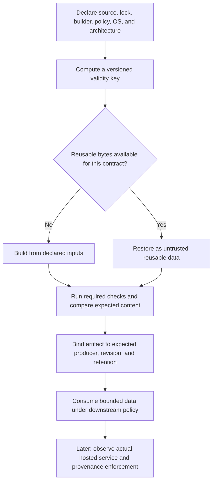

# 0034 · Caches, artifacts, retention, poisoning risks, and reproducible inputs

!!! note "Authored reference lesson"
    The lab uses deterministic byte strings, an in-memory cache, and unsigned synthetic manifests. It contacts no cache/artifact service and publishes nothing. A checksum comparison or assistant-run test is neither authenticated provenance nor learner mastery.

## Prerequisites and observable goals

Read [0033 · Identity and policy](0033-oidc-environments-and-hosted-policy.md), [0007 · Task invalidation](0007-taskfile-shared-command-contract.md), and [0032 · Artifact boundaries](0032-script-injection-artifacts-and-privileged-events.md).

Reproduce a stale hit caused by an undeclared builder change, repair the key, compare two clean outputs, and reject wrong-producer/tampered/expired evidence. Success means you state independently why bytes are reusable, who produced them, and what a downstream consumer may do with them.

## Give stored data a purpose

A **cache** avoids repeated work; correctness must survive a miss. An **artifact** is a produced result retained for inspection or transfer between jobs. A **validation result** records a claim about a subject under specific checks. Putting all three in storage does not make them interchangeable. [GitHub's caching overview](https://docs.github.com/en/actions/concepts/workflows-and-actions/dependency-caching), checked **2026-10-30**, distinguishes caches from workflow artifacts.

| Stored object | Useful validity inputs | Safe miss/expiry behavior |
| --- | --- | --- |
| Package-manager download cache | OS/architecture where relevant, package-manager version, lockfile, schema epoch | Restore or fetch permitted dependencies; perform locked installation and integrity checks |
| Compiled output cache | Source, dependency lock, compiler/options, target/runtime, relevant environment | Rebuild and retest |
| Diagram render validation | Diagram, validator implementation, renderer/browser versions, lockfile | Revalidate the changed contract |
| Test report artifact | Repository/run/attempt, revision, worker/check version, content digest | Rerun the required check or explicitly block the gate |
| Release candidate | Reviewed source, reproducible build inputs, distribution bytes, release policy | Obtain new reviewed evidence; do not substitute an arbitrary latest artifact |

This table is a design inventory, not a claim that the repository's caches were inspected or rebuilt during this lab. Cache keys should capture actual validity inputs. An all-purpose key containing every file hash reduces reuse without necessarily expressing the right contract.



## A key is not an access-control boundary

A clever key does not prevent another authorized writer from producing malicious bytes under it. **Cache poisoning** is reuse of attacker-influenced cached content in a more trusted execution context. Restoring an executable tool, dependency tree, or build script can turn cache reuse into code execution. Store no credentials, private environment dumps, or token files in cache paths; readers may include fork PR contexts.

The [dependency caching reference](https://docs.github.com/en/actions/reference/workflows-and-actions/dependency-caching#controlling-cache-access-with-cache-mode) currently documents `cache-mode` at workflow/job level (`read`, `write`, `write-only`, `none`) and trigger-based defaults. Explicit write-capable declarations can override low-trust restrictions. Reusable callers can impose explicit limits. Review the actual trigger, scope, and declaration; assuming an event can always write, or can never write, hides the policy decision. No hosted cache-mode enforcement is tested here.

For `actions/cache`, an exact hit and a restore-prefix match have different meanings. A broad fallback can provide useful package downloads, but cannot certify a compiled output or an old test report for the current source. Keep locked installation/build/tests authoritative. Missing lockfile selection must fail or be diagnosed; do not silently turn an empty hash into a shared correctness key. Consult the [cache action interface](https://github.com/actions/cache) before selecting its reviewed version and inputs.

For example, a dependency key can include:

```yaml title="Key expression example, within reviewed cache configuration"
key: npm-v2-${{ runner.os }}-${{ runner.arch }}-node24-${{ hashFiles('package-lock.json') }} # (1)!
```

1. This separates target/runtime and lockfile inputs. It does not prove a trustworthy writer, validate package bytes, or justify skipping tests. The selected action version and broader policy still need review.

## Treat the artifact contract as a separate interface

A useful artifact record identifies repository, workflow, run/attempt, exact source, artifact ID, expected file set, digest, and intended consumer. Require missing files to fail when evidence is mandatory. Name artifacts per producer or matrix case to avoid accidental merging. Retain enough evidence for the approval/incident window, then expire it deliberately.

The [upload action](https://github.com/actions/upload-artifact) exposes artifact IDs and digests, retention configuration, missing-file behavior, and replacement semantics. Overwriting a name creates a new artifact identity; a familiar name is not the previous artifact. The [download action](https://github.com/actions/download-artifact) supports ID selection, run/repository selection, destination control, and version-specific integrity options. Check the exact pinned version: current download documentation includes a configurable digest mismatch policy; older examples may warn instead of fail. Service transfer integrity alone does not authorize executing the producer's content.

An application-file SHA-256 is not necessarily the same value as the service's archive digest. Compare hashes over the defined bytes and format. A trusted expected digest detects changes to those bytes; a digest supplied alongside attacker-controlled bytes can be replaced too.

!!! tip "Prediction"
    Source and lockfile are unchanged, but the builder version changes. A cache keyed only by lockfile returns the old output. Do passing old tests certify it? If an attacker replaces a report and its unsigned digest together, will equality detect the producer change?

??? tip "Worked prediction"
    Old tests describe the old subject/check inputs. A builder change invalidates a build-output claim when it can affect bytes or behavior. Update the declared key and rebuild. Matching an attacker-supplied digest only confirms internal agreement, so producer authenticity must have independent evidence.

## Local lab: stale hit, fresh build, and artifact decisions

Run from the repository root:

```bash
python3 -B labs/0034/reuse.py
```

Expected exit 0:

```text
clean rebuild: identical bytes
broken key: stale hit after builder changed
fixed key: miss after builder changed; rebuild required
tamper: rejected (content digest mismatch)
wrong producer: rejected (producer context mismatch)
retention: rejected (artifact expired under lab policy)
unsigned manifest: matching checksum alone cannot authenticate a producer
```

`build()` serializes the declared source, lock, and builder into canonical JSON bytes. This intentionally small builder makes two clean builds comparable without downloading dependencies. Its broken cache keys only the lock; the fixed key hashes source, lock, builder, policy, OS, and architecture, prefixed by `lab-v2` so key semantics can change deliberately.

```python title="labs/0034/reuse.py — independent checks"
if observed != expected:
    raise ValueError("producer context mismatch")
if manifest["sha256"] != digest(data): # (1)!
    raise ValueError("content digest mismatch")
```

1. In the full program, source and expiry are checked too. `observed` and `expected` are synthetic fixtures representing a future trusted evidence channel; equality does not authenticate them. The final demonstration deliberately forges both bytes and checksum and shows that this unsigned record is insufficient.

```bash
python3 -B -m unittest discover -s labs/0034 -p 'test_*.py' -v
.tools/bin/actionlint labs/0034/local-reuse.yml
```

Expected: four test methods pass, including six independent key-input mutations and tamper/producer/revision/expiry rejection subcases. actionlint exits 0 without diagnostics. The inactive workflow runs these local checks only; it neither creates hosted caches nor uploads artifacts.

## Diagnose and repair the undeclared input

The stale-hit experiment is a deliberate incorrect reuse decision, asserted inside a passing demo. Trace the cached result back to the declared inputs before clearing caches indiscriminately. Add the missing builder input, select a new key schema if needed, and rebuild. A wider restore prefix does not repair the validity rule; it can make the same defect easier to repeat.

??? tip "Worked repair for validation evidence"
    If a result says a report passed policy-v1, changing to policy-v2 requires reevaluation even if the report bytes remain identical. Include the policy/check implementation in the validation key or stop caching that decision. Preserve package-download caches independently when they remain useful. A required check should run after dependency restoration rather than treating a cache hit as its success result.

## Reproducibility and provenance answer different questions

**Reproducibility** asks whether the same declared inputs/toolchain produce the same intended output. Two matching local builds demonstrate this property only for the tested inputs and environment. A hostile builder can reproducibly produce hostile output. Network fetches, timestamps, locale, platform, native dependencies, or unpinned base images can all enlarge the input set.

**Provenance** describes where/how bytes were built. An authenticated attestation binds a digest to verified identity/build claims; a consumer still chooses whether that producer/process is trusted. It does not prove the absence of defects. [0035](0035-sha-pins-semantic-releases-and-provenance.md) connects this distinction to reviewed release references. No signing or attestation generation occurs here.

## Transfer and retrieval

A release gate restores `build-latest`, accepts `tests-passed.txt`, and deploys after the original artifacts expired. Redesign the evidence flow without performing a deployment.

??? tip "Worked transfer"
    Separate dependency optimization from release evidence. Build a candidate for the exact reviewed revision, rerun required checks with known versions, and bind their artifacts to trusted producer/run/attempt identities and expected digests. Retain that evidence through review. Expired required evidence means rerun or block; a filename or newer unrelated successful run cannot fill the gap. Download to an isolated location, validate content, and authorize the eventual release separately.

Retrieve:

1. Why must a cache miss remain correct?
2. Which changed input invalidates your compiled output? Your validation result?
3. What does an artifact ID establish that a name cannot?
4. Why can reproducible bytes still lack trustworthy provenance?

??? tip "Retrieval check"
    Reuse is optional; the underlying build/check must work without it. Output validity depends on source/toolchain/target inputs; validation also depends on the checker and policy. IDs distinguish specific service objects, while names can be reused. Reproducibility checks output agreement, and authenticated provenance checks origin; neither alone proves acceptable behavior.

## Verification boundary

The deterministic host experiments exercise key design and supplied manifest decisions. Actual branch scopes, cache tokens/modes, hosted transfer, retention/eviction, service digests, and attestations remain unobserved. Container and `act` execution remain deferred. Continue to [0035 · Release references and distribution integrity](0035-sha-pins-semantic-releases-and-provenance.md).

| Previous Lesson | All Lessons | Next Lesson |
| --- | --- | --- |
| [0033 · OIDC, environments, and hosted policy](0033-oidc-environments-and-hosted-policy.md) | [Curriculum](index.md) | [0035 · Pins, releases, and distribution integrity](0035-sha-pins-semantic-releases-and-provenance.md) |
