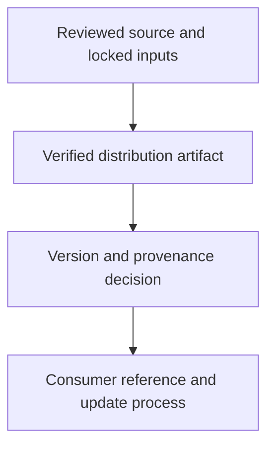

# 0035 · Commit pins, semantic releases, major tags, and distribution integrity

!!! note "Placeholder for a future teaching thread"
    This page is a teaching brief. Expand it into a full interactive lesson in its own thread. The planned exercises and outcomes have not been completed or demonstrated.

**Level:** Advanced.

## Prerequisites

- [0034 · Caches, artifacts, retention, poisoning risks, and reproducible inputs](0034-caches-artifacts-and-reproducibility.md)
- [0021 · TypeScript compilation, bundling, and committed distribution files](0021-typescript-bundling-and-dist-drift.md)
- [0024 · Cross-platform action behavior, dependency updates, and release versions](0024-cross-platform-actions-and-versioned-releases.md)

## What you will learn to do

- Design an action release policy with clear compatibility expectations.
- Show how source, bundle, and release references remain reviewable together.

## Explain the Actions behavior

Start from the prerequisite workflow or action behavior and introduce these concepts with focused examples:

1. A reference selects code, but mutable tags and immutable commits have different update behavior.
2. A release should bind reviewed source, generated artifacts, and consumer-visible changes.
3. Compatibility and supply-chain verification require both an update process and release evidence.

Explain the relevant workflow YAML, expressions, and action code in context. Follow the [shared teaching guide](teaching-guide.md) for pacing, expected output, and progression toward independent design.

## Planned local lab

Create an isolated exercise under `labs/0035/` when the lesson is developed. Explain setup and expected output before each command; reuse installed tools rather than reinstalling them on every step.

1. Prepare an unreleased candidate with a source change and matching bundle.
2. Explain patch, minor, and breaking changes using consumer examples.
3. Plan reviewed commit pins, moving major channels, changelog entries, artifact provenance, and rollback expectations without changing a published tag.

## Break it and diagnose it

Move a release reference to code with a stale dist file. Identify which consumer promise is broken even if source tests pass.

Ask for a prediction first. Capture the smallest reproducer, the actual result, and the corrected behavior. State which remaining claim requires a real GitHub or external-service check.

## Planning diagram



When expanding this lesson, refine the diagram to show the actual processes, branches, data exchange, and trust boundaries being taught.

## Retrieval questions

1. Which reference can change after a consumer adopts it?
2. What evidence binds the executable artifact to reviewed source?
3. How will consumers receive a security update deliberately?

## Evidence to capture in the teaching thread

- A working learner-produced example and an explanation of why it works.
- A reproduced failure, a reasoned repair, and the smallest check that verifies it.
- A short account of remaining limits, unresolved questions, and readiness for the next lesson.

Use [primary references](../references/resources.md) to verify current syntax, runtime support, and tool behavior. Add learning records only for real statements or demonstrated understanding; a placeholder or generated page does not establish mastery.

## Start this lesson in a new thread

```text
/teach 0035

Expand docs/lessons/0035-sha-pins-semantic-releases-and-provenance.md in place using docs/lessons/teaching-guide.md.
Read docs/mission.md, NOTES.md, and the prerequisite lesson pages first.
Begin with a short check of the Actions prerequisites. Explain relevant YAML,
expressions, and action contracts, one concept at a time. Let me predict and
try each exercise before revealing its answer. Keep feedback local where possible.
Finish with retrieval questions and a truthful handoff for the next thread.
```

| Previous | All lessons | Next |
| --- | --- | --- |
| [0034 · Caches, artifacts, retention, poisoning risks, and reproducible inputs](0034-caches-artifacts-and-reproducibility.md) | [Curriculum](index.md) | [0036 · Logs, annotations, summaries, concurrency, and usage budgets](0036-observability-concurrency-and-usage-budgets.md) |
