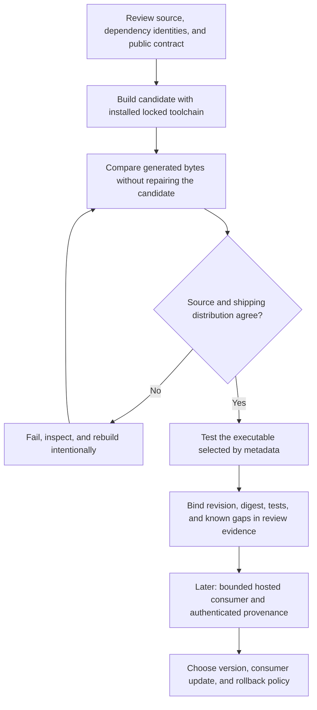

# 0035 · Commit pins, semantic releases, major tags, and distribution integrity

Prepare and inspect a local release candidate. The lab simulates reference changes with a dictionary, leaving Git references, releases, registries, and attestations untouched.

## A reference selects a revision; it does not review it

A remote action reference names a repository, optional subdirectory, and ref. An ordinary branch or tag can move. A full commit SHA identifies specific Git content, but still needs review, source-identity checks, and deliberate updates. A version comment beside a pin helps review; it does not enforce that association. A local `uses: ./path` reads the checked-out directory instead of resolving a separate remote action revision.

| Reference form | Consumer expectation | Remaining review |
| --- | --- | --- |
| Branch such as `main` | Follow current branch target | Every upstream movement can change executable code |
| Major alias such as `v1` | Receive compatible updates under publisher policy | Alias can move; compatibility is a promise to assess |
| Specific version tag such as `v1.2.3` | Identify a release | Immutability depends on actual protections/features |
| Full reviewed commit SHA | Keep fixed repository content until an explicit update | Verify upstream identity, package, transitive/runtime inputs |
| Adopted workflow dependency lockfile | Resolve covered action dependencies through the lock | Review generated lock changes and uncovered boundaries |

The [secure-use reference](https://docs.github.com/en/actions/reference/security/secure-use#using-third-party-actions), checked **2026-10-30**, now points to workflow dependency lockfiles as the stronger option for repositories that adopt them, with full-SHA pinning as the fallback. A fixed direct reference leaves other dependencies free to change. A composite can call mutable remote actions. A Dockerfile can use a mutable base, and code can fetch content at runtime.

## Know the current dependency-locking boundary

GitHub documents `.github/workflows/actions.lock`, generated by `gh actions-lock`, covering onboarded workflows' direct/transitive action dependencies and recording repository identity. It does not pin `jobs.<job_id>.uses` reusable-workflow calls; pin those to full SHAs and review the callee repository's own dependency policy. It also does not freeze runner images, inputs, secrets, or arbitrary runtime downloads. See [workflow dependency lockfiles](https://docs.github.com/en/actions/concepts/security/workflow-dependency-lockfiles).

This lesson neither installs that extension nor generates/edits a lockfile. The lab retains existing full-SHA checkout references and local action paths. A future adoption decision needs the documented tooling and actual hosted resolution evidence; a fabricated `actions.lock` would establish neither.



## The consumer executes the shipped file

`labs/0035/action.yml` selects Node 24 and `dist/index.cjs`. The TypeScript source implements a single-line greeting and writes a `greeting` output. The consumer does not type-check or build that source before running the action. The [action maintenance documentation](https://docs.github.com/en/actions/how-tos/create-and-publish-actions/release-and-maintain-actions) discusses committing runtime dependencies/distribution with the action.

```yaml title="labs/0035/action.yml, runtime selection"
runs:
  using: node24
  main: dist/index.cjs # (1)!
```

1. This is the file to test and ship. Tests of `src/index.ts` alone cannot establish what the consumer receives.

`build.cjs` reuses root-installed esbuild. It targets Node 24, emits CommonJS, and produces candidate bytes in memory. Normal mode writes `dist`; `--check` compares and fails without modifying it. Absolute working-directory configuration lets the same builder check a disposable candidate copy. The action uses Node built-ins only and adds no dependency installation step.

!!! tip "Prediction"
    Source changes `Hello,` to `Welcome,`, but `dist` is unchanged. Will a type check necessarily fail? Which greeting does metadata select? If a publisher moves `v1`, what happens to a consumer already pinned to the old full commit?

??? tip "Worked prediction"
    Both strings can be type-correct. Metadata selects old JavaScript until an intentional build updates it. The full-commit consumer continues using its old revision; changing a mutable alias does not change that pin. Security fixes require a reviewed consumer update or a deliberately adopted locked update process.

## Local lab: check and execute the actual candidate

Start at the repository root with the existing installed Node/TypeScript/esbuild:

```bash
node node_modules/typescript/bin/tsc --project labs/0035/tsconfig.json
node labs/0035/build.cjs --check
python3 -B -m unittest discover -s labs/0035 -p 'test_*.py' -v
.tools/bin/actionlint labs/0035/candidate-consumer.yml
```

Expected: no type diagnostics, `PASS: distribution matches current source and builder`, four test methods passing, and no actionlint diagnostics. Tests launch the shipping `.cjs` from temporary consumer contexts, assert the exact output record, reject invalid input without success output, and exercise temporary stale-candidate repair. esbuild generates JavaScript without checking TypeScript types. Run both commands to check types and generate the executable. See [esbuild's TypeScript limitations](https://esbuild.github.io/content-types/#typescript) and [build API](https://esbuild.github.io/api/).

The complete inactive consumer recipe checks out files with the course's existing reviewed pin, uses `./labs/0035`, and asserts `${{ steps.candidate.outputs.greeting }}`. Static linting does not execute that runner output mapping or prove a remote ref resolves correctly.

## Break and repair a candidate without touching any tag

```bash
python3 -B labs/0035/release_demo.py
```

Expected exit 0:

```text
synthetic refs: v1 moved; full commit and v1.0.0 snapshot unchanged
stale candidate: source changed; check exit=1; consumer still says Hello, Ada!
repaired candidate: check exit=0; consumer says Welcome, Ada!
review record: digest collected; hosted consumer and attestation remain unverified
temporary candidate removed; no git refs or releases changed
```

The program copies source, metadata, distribution, and TypeScript configuration into a temporary directory. It changes source, requires the inner comparison to exit **1**, verifies the old bytes were preserved, and runs the stale artifact. Then it explicitly builds, rechecks, and runs the repaired artifact. It writes a temporary review record containing the candidate label, executable digest, and honest `not-run`/`not-generated` fields before removing the directory.

The all-`a` and all-`b` strings are synthetic revision labels, not real upstream commits. The dictionary preserves the version snapshot by lab design. It does not enforce GitHub immutable releases or guarantee ordinary Git tags are immutable.

??? tip "Diagnosis and repair"
    A source test can pass while consumers still execute stale code. Follow metadata to the shipping file, run a comparison that preserves the defect, build deliberately, review the generated diff, and retest the artifact. Do not "fix" a drift checker by making it silently rebuild first; that erases evidence that the proposed package was incomplete.

For a deliberate change to the maintained lab rather than a temporary copy, the repair command is:

```bash
node labs/0035/build.cjs
node labs/0035/build.cjs --check
```

It writes the owned distribution file. Repeat type and process checks after the intended behavior and expectations are reviewed together.

## Version the public promise

Under semantic versioning, use a patch release for a compatible fix and a minor release for compatible added functionality. Breaking a public promise needs a major release under the chosen policy. Consider the caller's behavior, not the number of changed lines.

| Proposed change | Decision to justify |
| --- | --- |
| Fix a crash for already documented valid Unicode input | Patch if existing public behavior is preserved |
| Add an optional output without altering existing outputs | Minor under the stated compatibility policy |
| Prefix every existing greeting or rename `greeting` | Major if callers rely on its documented value/name |
| Raise runtime requirements | Assess consumers excluded by the new runner/runtime floor |
| Security correction that rejects formerly accepted unsafe input | Document the security/compatibility tradeoff and migration explicitly |

With GitHub immutable releases enabled, release-associated tags/assets have protections that ordinary movable aliases do not. Keep convenience aliases separate according to [immutable releases and compatibility tags](https://docs.github.com/en/actions/how-tos/create-and-publish-actions/using-immutable-releases-and-tags-to-manage-your-actions-releases). Check release protections before moving a tag. Keep this local exercise in the reference simulation. Rollback usually changes the consumer to a known-good reviewed SHA; publish a new fixed release rather than rewriting history consumers already reviewed.

## Bind provenance to the intended subject

A useful future release record names the candidate commit, source/build locks, metadata, distribution and asset digests, check/run references, supported runtime/OS evidence, release notes, and rollback target. A local JSON record is unsigned and editable. It is a review aid, not authenticated provenance.

[GitHub artifact attestations](https://docs.github.com/en/actions/how-tos/secure-your-work/use-artifact-attestations/use-artifact-attestations) can bind artifact digests to build identity. Consumers must verify the attestation and expected producer policy; existence alone proves no safety. Offline verification also needs downloaded bundles and trusted roots, as explained in [offline attestation verification](https://docs.github.com/en/actions/how-tos/secure-your-work/use-artifact-attestations/verify-attestations-offline). This lab generates no attestation and calls no attestation API.

## Transfer and retrieval

A dependency update changes bundled code, but source unit tests pass and the reviewer sees only a version comment change next to a SHA. Write the smallest missing release review and consumer update plan.

??? tip "Worked transfer"
    Confirm the real upstream repository/release association, review dependency/lock/source and executable diffs, type-check, compare the bundle, and execute the packaged entrypoint. Review transitive actions/runtime fetches and required target-platform evidence. Bind the candidate revision/digests to actual results, then update the consumer's pin or generated lock deliberately. Keep the old known-good SHA as rollback evidence. A version comment cannot substitute for any of those observations.

Retrieve:

1. Which refs can move, and what changes when immutable releases are enabled?
2. Why does a full direct pin leave transitive/runtime inputs to review?
3. Which executable does this consumer actually run?
4. Why does a passing digest check fail to prove acceptable behavior?

??? tip "Retrieval check"
    Ordinary branches/tags can move; immutable release protections constrain release-linked tags/assets. Nested action references and fetched dependencies are separate resolution boundaries. Metadata selects `dist/index.cjs`. A digest establishes agreement with expected bytes, while behavior, origin, and authorization each require appropriate evidence.

## Verification boundary

Local evidence covers the declared source/toolchain, shipping bytes, process outputs, and static recipe. Real remote resolution, dependency-lock enforcement, intended hosted OS support, signed provenance, release protection, and distribution remain unverified. No Git mutation, release write, deployment, or hosted execution occurs. Continue to [0036 · Operating diagnostics and usage](0036-observability-concurrency-and-usage-budgets.md).

| Previous lesson | All lessons | Next lesson |
| --- | --- | --- |
| [0034 · Caches, artifacts, and reproducibility](0034-caches-artifacts-and-reproducibility.md) | [Curriculum](index.md) | [0036 · Observability, concurrency, and budgets](0036-observability-concurrency-and-usage-budgets.md) |
