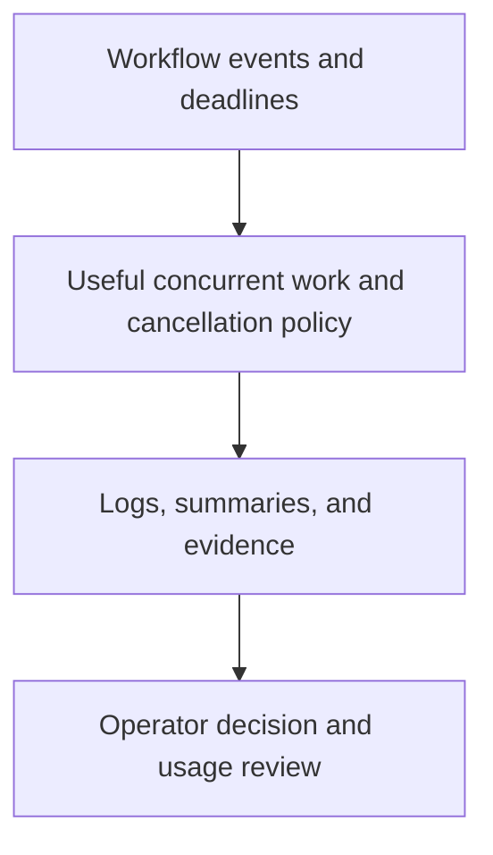

# 0036 · Logs, annotations, summaries, concurrency, and usage budgets

!!! note "Placeholder for a future teaching thread"
    This page is a teaching brief. Expand it into a full interactive lesson in its own thread. The planned exercises and outcomes have not been completed or demonstrated.

**Level:** Advanced.

## Prerequisites

- [0035 · Commit pins, semantic releases, major tags, and distribution integrity](0035-sha-pins-semantic-releases-and-provenance.md)
- [0006 · Matrices, job dependencies, cancellation, and failure propagation](0006-matrices-dependencies-and-cancellation.md)
- [0012 · Define the local/hosted coverage boundary and usage budget](0012-local-hosted-coverage-and-usage-budget.md)

## What you will learn to do

- Design diagnostics that a new operator can use to find the failing boundary.
- Choose a usage policy without cancelling important side effects unsafely.

## Explain the Actions behavior

Start from the prerequisite workflow or action behavior and introduce these concepts with focused examples:

1. Observability should show what ran, which contract failed, and which evidence was produced.
2. Concurrency and cancellation policies balance useful work against superseded runs.
3. Runner time, storage, and model usage need separate measurements and explicit budgets.

Explain the relevant workflow YAML, expressions, and action code in context. Follow the [shared teaching guide](teaching-guide.md) for pacing, expected output, and progression toward independent design.

## Planned local lab

Create an isolated exercise under `labs/0036/` when the lesson is developed. Explain setup and expected output before each command; reuse installed tools rather than reinstalling them on every step.

1. Add a diagnostic design for the capstone with useful summaries and redacted context.
2. Measure representative local checks and identify duplicated installation or repeated validation.
3. Plan path filters, concurrency groups, deadlines, and a hosted usage review with current pricing verified only when needed.

## Break it and diagnose it

Cancel a publishing job as though it were a disposable test job. Explain the partial-operation risk and redesign the concurrency boundary.

Ask for a prediction first. Capture the smallest reproducer, the actual result, and the corrected behavior. State which remaining claim requires a real GitHub or external-service check.

## Planning diagram



When expanding this lesson, refine the diagram to show the actual processes, branches, data exchange, and trust boundaries being taught.

## Retrieval questions

1. What does an operator need besides a red failure icon?
2. Which work is safe to cancel after a newer commit arrives?
3. Which usage is runner consumption and which belongs to an external service?

## Evidence to capture in the teaching thread

- A working learner-produced example and an explanation of why it works.
- A reproduced failure, a reasoned repair, and the smallest check that verifies it.
- A short account of remaining limits, unresolved questions, and readiness for the next lesson.

Use [primary references](../references/resources.md) to verify current syntax, runtime support, and tool behavior. Add learning records only for real statements or demonstrated understanding; a placeholder or generated page does not establish mastery.

## Start this lesson in a new thread

```text
/teach 0036

Expand docs/lessons/0036-observability-concurrency-and-usage-budgets.md in place using docs/lessons/teaching-guide.md.
Read docs/mission.md, NOTES.md, and the prerequisite lesson pages first.
Begin with a short check of the Actions prerequisites. Explain relevant YAML,
expressions, and action contracts, one concept at a time. Let me predict and
try each exercise before revealing its answer. Keep feedback local where possible.
Finish with retrieval questions and a truthful handoff for the next thread.
```

| Previous Lesson | All Lessons | Next Lesson |
| --- | --- | --- |
| [0035 · Commit pins, semantic releases, major tags, and distribution integrity](0035-sha-pins-semantic-releases-and-provenance.md) | [Curriculum](index.md) | [0037 · Choose popular pre-built actions and verify their publishers](0037-selecting-popular-prebuilt-actions.md) |
