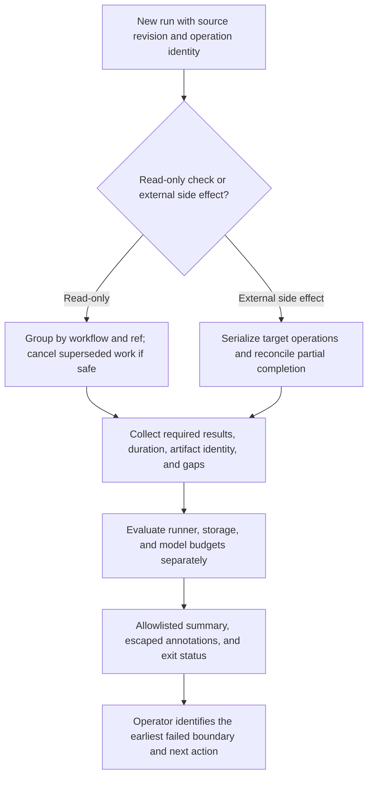

# 0036 · Logs, annotations, summaries, concurrency, and usage budgets

!!! note "Authored reference lesson"
    The lab evaluates a synthetic run ledger and reconciles temporary local markers. It creates no release or deployment, cancels no hosted run, and calls no model. Its results establish tested local behavior, not platform scheduling, actual billing, or learner mastery.

## Prerequisites and observable goals

Read [0035 · Release evidence](0035-sha-pins-semantic-releases-and-provenance.md), [0006 · Dependencies and cancellation](0006-matrices-dependencies-and-cancellation.md), and [0012 · Usage boundaries](0012-local-hosted-coverage-and-usage-budget.md). Recall why a skipped required check cannot be accepted as success.

Produce a compact diagnostic summary without dumping sensitive context, reject missing/failed/over-budget evidence, choose a cancellation policy per operation, and explain recovery from interrupted side effects. Success means another operator can identify the failing boundary and next safe action from your evidence.

## Make the failure observable at the right boundary

**Observability** means having enough evidence to explain system behavior. A log gives chronological detail, an annotation highlights a specific issue, and a job summary presents a concise result for an operator. None replaces the process exit status: emitting `::error::` text alone is not a reliable way to fail the process or enforce a release gate.

A useful record names run ID/attempt, source revision, worker and policy versions, required results, durations, artifact references, and a next diagnostic step. Keep unverified states visible. `success`, `failure`, `skipped`, and `cancelled` are distinct outcomes; a required worker must have matching success evidence. [0006](0006-matrices-dependencies-and-cancellation.md) develops the dependency-aware gate.



## Use fixed structure and safe data channels

The sample ledger contains a deliberately private-looking synthetic string. The reporter builds output from allowlisted identifiers, enums, and numeric measurements; it never dumps the ledger or process environment. Real masking is a backstop with limitations, not permission to log tokens, credential-bearing URLs, or whole contexts.

Workflow annotations use command syntax on stdout; command data must escape percent and line endings so a supplied message cannot create extra command lines. Summary files contain Markdown, so arbitrary user text can also alter presentation or links; validate or escape it for that destination separately. The [workflow commands reference](https://docs.github.com/en/actions/reference/workflows-and-actions/workflow-commands), checked **2026-10-30**, documents annotations, groups, environment files, and summaries.

```python title="labs/0036/operations.py — command data escaping"
def escape_command(text):
    return text.replace("%", "%25").replace("\r", "%0D").replace("\n", "%0A") # (1)!
```

1. This handles command **data**. Variable property values such as a dynamic filename need the command property's escaping rules too. The lab uses a fixed annotation title and validated messages rather than dynamic properties.

The inactive `labs/0036/observable-check.yml` runs the reporter and records its step outcome with an explicit status-aware condition. A bounded reporting step can diagnose a failed preceding step; it must not rewrite a failed required result as successful evidence. Critical cleanup cannot rely solely on a final step surviving termination.

## Local lab: report an honest run ledger

Start at the repository root:

```bash
python3 -B labs/0036/operations.py pass
python3 -B labs/0036/operations.py over-budget
python3 -B labs/0036/operations.py failed-worker
```

The first exits 0 with:

```text
Run 360 attempt 1 at aaaaaaaaaaaaaaaaaaaaaaaaaaaaaaaaaaaaaaaa

Required evidence: PASS

Runner seconds: 75; artifact bytes: 3072; model calls: 0
```

These are supplied measurements for fictional Linux/Windows workers, not measurements of this machine or hosted runs. `over-budget` changes the second worker to 100 seconds, exits **1**, and includes `::error title=Module 6 policy::runner_seconds over budget`. `failed-worker` exits **1** and includes `::error title=Module 6 policy::required windows=failure`. Both show `Required evidence: BLOCKED`.

Predict the summary file before running this isolated adapter check:

```bash
summary_file="$(mktemp)"
GITHUB_STEP_SUMMARY="$summary_file" python3 -B labs/0036/operations.py pass
cat "$summary_file"
rm "$summary_file"
```

Expected: stdout and the temporary file contain the same allowlisted report; `SYNTHETIC-SECRET-MUST-NOT-APPEAR` appears in neither. On a terminal, annotation text is just text. This test exercises file append/formatting, not GitHub's summary rendering, annotation processing, or run authorization.

```bash
python3 -B -m unittest discover -s labs/0036 -p 'test_*.py' -v
.tools/bin/actionlint labs/0036/observable-check.yml
```

Expected: seven test methods pass and actionlint exits 0 without diagnostics. Tests cover each budget axis, failure/skip/cancellation, missing evidence, invalid measurements, synthetic private-field omission, annotation escaping, and repeatable local recovery.

!!! tip "Prediction"
    Two workers overlap for 30 and 45 seconds. Is total runner execution 45 or 75 seconds? If the read-only check for commit B supersedes A, can cancellation undo a release asset that A already uploaded?

??? tip "Worked prediction"
    Aggregate execution is 75 seconds even if wall-clock completion is about 45 seconds. Runner billing can apply other rules, so these raw durations are not an invoice. Cancellation stops eligible future work and attempts to terminate processes; it does not roll back an external write already completed.

## Choose concurrency per operation

A **concurrency group** coordinates jobs/runs with the same group string. Use enough context to avoid unrelated workflows cancelling one another. The read-only sample uses:

```yaml title="labs/0036/observable-check.yml — run grouping"
concurrency:
  group: ${{ github.workflow }}-${{ github.ref }} # (1)!
  cancel-in-progress: true # (2)!
```

1. Workflow and ref separate unrelated work. Group names are case-insensitive, so do not rely on case to separate release targets.
2. Superseding a read-only check may save useless work. This is a policy request whose actual behavior needs real runs.

Under default single-pending behavior, new pending work replaces an older pending entry. `cancel-in-progress: false` preserves currently running work; it does not guarantee every queued candidate executes. The current [concurrency guide](https://docs.github.com/en/actions/how-tos/write-workflows/choose-when-workflows-run/control-workflow-concurrency) also documents optional `queue: max` with up to 100 pending entries; it cannot combine with `cancel-in-progress: true`. Ordering depends on when work starts waiting, and this bounded queue is not a durable release transaction system. This lab does not configure or test that newer option.

For release/deployment operations, group by the actual target when conflicting writes must be serialized. Include cross-workflow collisions in the design. Preserve the running transaction where appropriate, then reconcile its state before starting another. A workflow-wide cancel policy can still terminate a side-effect job even when its own job policy looks conservative, so review both levels.

Matrix `max-parallel` only bounds matrix overlap. Matrix `fail-fast` reacts to sibling failures. Neither is a repository-wide usage budget or a target lock. Environment approval and concurrency are also separate controls.

## Deliberate failure: treat publication like a disposable check

Imagine a publisher creates an asset, then is cancelled before writing its completion receipt. A blind retry might duplicate, replace, or mislabel that asset. Model this partial operation locally:

```bash
python3 -B labs/0036/operations.py recovery
```

Expected exit 0:

```text
interrupted model: upload marker exists; receipt missing
reconcile twice: one upload marker; matching completed receipt
temporary journal removed; no real publication or cancellation
```

The program creates one temporary upload marker, intentionally omits the receipt, verifies the gap, and reconciles the same operation identity twice. It checks existing content before completing a matching receipt. The marker is a local stand-in for external state; this is not a process-signal or GitHub cancellation experiment.

??? tip "Worked diagnosis and repair"
    The failed boundary is completion bookkeeping after a side effect. Reconcile actual external state under an operation key tied to target and candidate; reject conflicting content, and record completion only after verifying the intended result. This is **idempotent recovery**: repeating it preserves the intended outcome. A real integration also needs service concurrency/precondition support and durable records. A local marker proves none of those distributed guarantees.

GitHub [cancellation behavior](https://docs.github.com/en/actions/reference/workflows-and-actions/workflow-cancellation) includes condition re-evaluation, process signals, and forced termination. `always()` may affect job/step eligibility, but it cannot guarantee recovery after runner loss or kill escalation. Keep cleanup bounded and make important reconciliation possible from a subsequent independent attempt.

## Separate usage measurements and controls

| Axis | Measure | Useful control | What the lab establishes |
| --- | --- | --- | --- |
| Runner execution | Sum per-job durations and attempts, with runner type | Job/step timeouts, bounded matrix, selective checks | Arithmetic and declared limit checks |
| Stored artifacts/caches | Bytes and retained duration by object | Minimal paths, retention/eviction policy | Supplied byte-total comparison only |
| Model/API consumption | Calls/tokens/service usage with retries | Tool/call ceilings and provider controls | Zero-call fixture policy only |
| Wall-clock latency | Queue, approval wait, execution, dependencies | Remove unnecessary dependencies and repeated setup | No hosted latency measurement |

The synthetic budgets are 90 runner seconds, 4096 artifact bytes, and zero model calls. They detect declared overruns after receiving measurements; they do not prevent dispatches or cap invoices. A timeout is a real workflow bound if GitHub enforces it, but repeated runs can still exceed a monthly budget. Storage byte totals omit retention-time billing. No pricing is asserted; verify current primary billing information when making a monetary estimate.

Path filtering can avoid unnecessary jobs, but skipped required checks need an explicit design so a gate does not wait forever or accept missing evidence. Cache dependencies where justified, keep tests authoritative, and avoid repeated installation/documentation checks during an edit loop. Optimize after identifying the costly boundary rather than weakening required evidence.

## Transfer and retrieval

Design a pipeline that cancels superseded PR checks but preserves an approved publishing transaction. Include summary fields, target grouping, deadlines, attempt tracking, and a recovery action after an unknown partial result.

??? tip "Worked transfer"
    Keep read-only PR checks in their own workflow/ref group. Put publishing behind reviewed evidence and approval with target-level serialization; avoid a surrounding cancel policy that defeats it. Record candidate identity, run/attempt, required results, artifact digests, side-effect operation key, and unresolved state. After interruption, query/reconcile the target under that key before retrying or completing the receipt. Limit attempts and observe actual usage; none of these declarations proves the live behavior until tested deliberately.

Retrieve:

1. What should an operator learn beyond “the job failed”?
2. Why do annotations and summary text not replace exit status?
3. Why can `cancel-in-progress: false` still lose pending work under the default queue?
4. Which observations are required before declaring a partial operation recovered?

??? tip "Retrieval check"
    Show the revision/attempt, first failed contract, relevant evidence, and next diagnostic action. Presentation does not enforce process success/failure. Default concurrency retains only one pending entry, so a newer entry can replace it. Recovery needs authoritative target state, matching operation identity/content, and durable completion evidence; a final log line is insufficient.

## Verification boundary and next module

Host tests cover supplied ledger decisions, formatting, escaping, and temporary marker reconciliation. Actual GitHub scheduling/cancellation, summary rendering, billing, environment admission, service writes, and multi-run recovery remain later integration evidence. No container or `act` execution, publication, deployment, or model call occurred. Continue in course order to [0037 · Select maintained pre-built actions](0037-selecting-popular-prebuilt-actions.md), applying these trust and operating boundaries to dependency selection.

| Previous Lesson | All Lessons | Next Lesson |
| --- | --- | --- |
| [0035 · Pins, releases, and distribution integrity](0035-sha-pins-semantic-releases-and-provenance.md) | [Curriculum](index.md) | [0037 · Choose popular pre-built actions and verify publishers](0037-selecting-popular-prebuilt-actions.md) |
