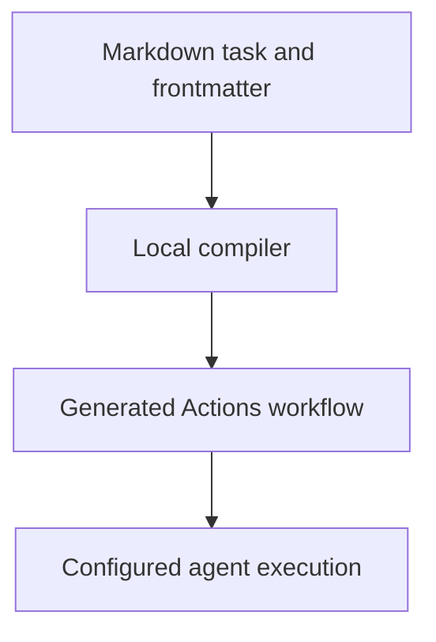

# 0037 · Agentic Markdown sources, frontmatter, lock workflows, and execution stages

!!! note "Placeholder for a future teaching thread"
    This page is a teaching brief. Expand it into a full interactive lesson in its own thread. The planned exercises and outcomes have not been completed or demonstrated.

**Level:** Advanced.

## Prerequisites

- [0036 · Logs, annotations, summaries, concurrency, and usage budgets](0036-observability-concurrency-and-usage-budgets.md)
- [0012 · Define the local/hosted coverage boundary and usage budget](0012-local-hosted-coverage-and-usage-budget.md)

## What you will learn to do

- Trace one Markdown workflow through compilation and runtime boundaries.
- Explain what a successful local compile establishes and leaves unknown.

## Explain the Actions behavior

Start from the prerequisite workflow or action behavior and introduce these concepts with focused examples:

1. GitHub Agentic Workflows separates Markdown authoring from compiled Actions execution.
2. Frontmatter declares machine-readable configuration while the body describes the task.
3. Compiler validation and agent behavior produce different kinds of evidence.

Explain the relevant workflow YAML, expressions, and action code in context. Follow the [shared teaching guide](teaching-guide.md) for pacing, expected output, and progression toward independent design.

## Planned local lab

Create an isolated exercise under `labs/0037/` when the lesson is developed. Explain setup and expected output before each command; reuse installed tools rather than reinstalling them on every step.

1. Read the existing repository-report example line by line.
2. Identify its trigger, engine, permissions, tools, staged outputs, and task instructions.
3. Compile without running an agent and inspect current source/lock rules using the installed CLI help and primary documentation.

## Break it and diagnose it

Treat a successful compile as proof that an agent inspected files or ran tests. Identify the missing execution evidence.

Ask for a prediction first. Capture the smallest reproducer, the actual result, and the corrected behavior. State which remaining claim requires a real GitHub or external-service check.

## Planning diagram



When expanding this lesson, refine the diagram to show the actual processes, branches, data exchange, and trust boundaries being taught.

## Retrieval questions

1. Who transforms the source into Actions configuration?
2. Which part of the task is deterministic configuration?
3. Which claims about model behavior still require evaluation?

## Evidence to capture in the teaching thread

- A working learner-produced example and an explanation of why it works.
- A reproduced failure, a reasoned repair, and the smallest check that verifies it.
- A short account of remaining limits, unresolved questions, and readiness for the next lesson.

Use [primary references](../references/resources.md) to verify current syntax, runtime support, and tool behavior. Add learning records only for real statements or demonstrated understanding; a placeholder or generated page does not establish mastery.

## Start this lesson in a new thread

```text
/teach 0037

Expand docs/lessons/0037-agentic-markdown-and-compiled-workflows.md in place using docs/lessons/teaching-guide.md.
Read docs/mission.md, NOTES.md, and the prerequisite lesson pages first.
Begin with a short check of the Actions prerequisites. Explain relevant YAML,
expressions, and action contracts, one concept at a time. Let me predict and
try each exercise before revealing its answer. Keep feedback local where possible.
Finish with retrieval questions and a truthful handoff for the next thread.
```

| Previous | All lessons | Next |
| --- | --- | --- |
| [0036 · Logs, annotations, summaries, concurrency, and usage budgets](0036-observability-concurrency-and-usage-budgets.md) | [Curriculum](index.md) | [0038 · Agent engines, authentication, tools, and network boundaries](0038-agentic-engines-tools-and-authentication.md) |
