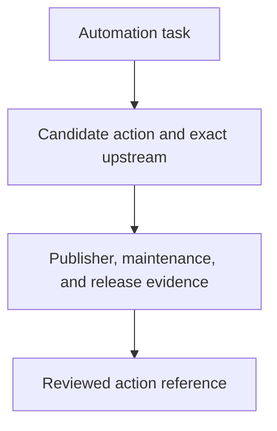

# 0037 · Choose popular pre-built actions and verify their publishers

!!! note "Teaching brief"
    This page defines the planned lesson. Use its module guide and checked-in examples for context; develop the guided exercise in a teaching session. Written plans and assistant-run checks do not establish learner mastery.

## Prerequisites

- [0036 · Logs, annotations, summaries, concurrency, and usage budgets](0036-observability-concurrency-and-usage-budgets.md)
- [0006 · Matrices, job dependencies, cancellation, and failure propagation](0006-matrices-dependencies-and-cancellation.md)
- [0030 · Compose setup/build/test steps and reusable job workflows](0030-compose-step-and-job-orchestration.md)
- [Module guide](prebuilt-actions.md)

## What you will learn to do

- Select an action using task fit, publisher evidence, release activity, and a dated star count.
- Distinguish a verified creator from a reviewed action release.

## Explain the Actions behavior

1. Stars help discover widely used repositories; rank them within a stated shortlist and date.
2. Match the Marketplace listing to the exact upstream owner/repository before checking its creator badge.
3. Choose a reviewed commit and minimal permissions after checking the action interface and maintenance evidence.

Prefer maintained pre-built actions for standard platform operations. Keep project build/test commands explicit and introduce custom code only where the required behavior needs it. Follow the [teaching guide](teaching-guide.md).

## Planned local lab

Develop the exercise under `labs/0037/` or extend the linked examples. Reuse installed tools and explain what each check proves.

1. Compare actions/checkout, docker/build-push-action, and dorny/paths-filter in the action catalog.
2. Read the saved snapshot and follow the upstream release and Marketplace links.
3. Write a short selection decision that keeps publisher identity and code review separate.

## Break it and diagnose it

Choose a similarly named Marketplace listing backed by a different owner. Diagnose the repository mismatch before considering its badge or stars.

Ask for a prediction before reproducing the failure. Keep permission-dependent and remote-service behavior separate from local static checks.

## Planning diagram



## Retrieval questions

1. Why does a high star count not establish code safety?
2. What exactly does the Marketplace creator badge verify?
3. Which source proves the commit belongs to the intended upstream release?

## Evidence and remaining limits

Capture the learner's prediction, modified example, failure diagnosis, repair, and explanation of the appropriate test boundary. Local YAML validation does not execute a remote action or prove GitHub permissions. Hosted exercises and repository writes need a deliberate execution plan.

Use the [primary sources](../references/resources.md) and [dated action catalog](../references/prebuilt-actions.md). Recheck current releases, publisher evidence, and permissions when developing the lesson.

## Start this lesson in a new thread

```text
/teach 0037

Expand docs/lessons/0037-selecting-popular-prebuilt-actions.md in place.
Read docs/mission.md, NOTES.md, docs/lessons/teaching-guide.md, the module
guide, and prerequisite Actions pages. Prefer pre-built actions over shell glue.
Teach one concept at a time. Ask for predictions and exercises before revealing
solutions. Keep local checks small, distinguish hosted effects, and record only
actual learner evidence.
```

| Previous Lesson | All Lessons | Next Lesson |
| --- | --- | --- |
| [0036 · Logs, annotations, summaries, concurrency, and usage budgets](0036-observability-concurrency-and-usage-budgets.md) | [Curriculum](index.md) | [0038 · Replace git-diff shell logic with dorny/paths-filter](0038-paths-filter-and-selective-jobs.md) |
