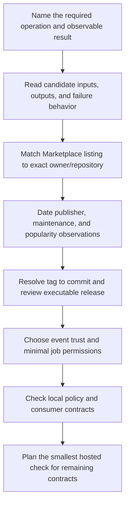

# 0037 · Choose popular pre-built actions and verify their publishers

A maintained action can replace an installer, an API pagination loop, or an upload script with a documented interface. Selecting it also adds executable code to your job. Make that dependency decision explicit before copying `uses:`.

!!! note "Reference lesson"
    Predict outcomes before opening the solutions. Written availability and assistant-run checks do not establish learner mastery. All commands below run from the repository root using the existing environment; no dependency installation is needed.

## Prerequisites and observable goal

Read [0036 · Observability and budgets](0036-observability-concurrency-and-usage-budgets.md), [0030 · Step and job orchestration](0030-compose-step-and-job-orchestration.md), and [0006 · Dependency graphs](0006-matrices-dependencies-and-cancellation.md). Recall from [0035 · Commit pins](0035-sha-pins-semantic-releases-and-provenance.md) why a tag and a commit have different update behavior.

You will produce a selection decision that names the exact repository, intended operation, release commit, observed publisher evidence, permissions, and remaining checks. Success means you can reject a popular lookalike and explain why a verified publisher still needs release review.

## Start with the operation

An **action** is a reusable step implementation. A **publisher** owns the repository or Marketplace listing distributing it. A **release reference** identifies the version a consumer selects. These answer different questions:

| Question | Useful evidence | Insufficient substitute |
| --- | --- | --- |
| Does it solve this task? | Documented inputs, outputs, behavior, and failure modes | A similar name |
| Is this the intended publisher? | Marketplace listing matched to the exact owner/repository | A badge on a different listing |
| Is the project maintained? | Archive state, releases, issues, advisories, activity and response quality | One recent push |
| Which code will execute? | Full upstream commit, tag resolution, source and packaged-code review | A major tag comment |
| Is it widely adopted? | Dated repository stars within a stated shortlist | An undated claim of being most popular |
| May this job perform the operation? | Event trust, effective credentials, job permissions and service policy | A successful local lint |

GitHub's [discovery guide](https://docs.github.com/en/actions/how-tos/write-workflows/choose-what-workflows-do/find-and-customize-actions) describes how existing actions are referenced. Start with a vendor-maintained action when it fits a standard platform operation. Keep `npm test` explicit: a new dependency whose only purpose is to hide that command rarely improves its contract.



## Separate popularity, identity, and release review

The [curated catalog](../references/prebuilt-actions.md) and `docs/references/actions-snapshot.json` are historical observations. They are not a live leaderboard or an automatic recommendation to adopt every latest release. The lab's separate `labs/0037/upstream-evidence.json` records fresh read-only checks dated **2026-10-30** without changing that catalog.

For a manageable discovery exercise, inspect `actions/checkout`, `docker/build-push-action`, and `dorny/paths-filter`. The first materializes repository files, the second builds/exports images, and the third produces changed-path decisions. They are not interchangeable competitors simply because their stars can be counted.

The fresh evidence matched the checkout and Docker Marketplace listings and observed their creator badges. The matched paths-filter listing reported an unverified owner field and showed no badge. This is a community selection requiring its own review and rationale. The receipt also preserves initially unsuccessful matching attempts; an unresolved match is **unconfirmed**, not evidence against the publisher.

GitHub explains that the [Marketplace creator badge](https://docs.github.com/en/actions/how-tos/create-and-publish-actions/publish-in-github-marketplace#about-badges-in-github-marketplace) identifies a creator verified as a partner organization. It does not certify every action release. An organization-profile badge is a different signal. A full commit selects a stable revision, but does not prove that revision is safe or that an action cannot download other mutable tools at runtime.

!!! tip "Prediction"
    A listing shows a badge and one million stars, but its repository is `lookalike/checkout` while your decision says `actions/checkout`. Which evidence should stop adoption first? Would copying the correct SHA into the wrong owner's reference repair it?

??? tip "Worked explanation"
    Reject the identity mismatch first. A reference includes both repository and commit; the commit must belong to the intended upstream. Neither stars nor another publisher's badge establishes that connection. Resolve and review the intended repository's release, then reconsider the decision.

## Read the exact interface before using it

The project pin was re-resolved through GitHub's read-only tag API and the metadata was fetched at that commit:

```yaml title="Checkout step excerpt"
- uses: actions/checkout@3d3c42e5aac5ba805825da76410c181273ba90b1 # v7.0.1 (1)!
  with:
    persist-credentials: false # (2)!
```

1. The executable reference is the full commit. The comment is a human-readable release label; it cannot change which code executes. The [tag API](https://api.github.com/repos/actions/checkout/git/ref/tags/v7.0.1) provides mapping evidence, not a source-code audit.
2. This input is declared by [metadata at the pin](https://github.com/actions/checkout/blob/3d3c42e5aac5ba805825da76410c181273ba90b1/action.yml). Avoid retaining checkout credentials when subsequent Git writes are unnecessary. Other steps can still access their job token, so this input does not replace a `permissions` policy.

Read the implementation and release notes as well as metadata: inputs alone do not describe every network request, post step, downloaded binary, or permission requirement. Recheck self-hosted runner compatibility for the action's own runtime separately from the version it installs for your application.

## Local lab: enforce a selection record

`labs/0037/selection.py` is an actual offline admission policy for selection records. It checks identity consistency, a full pin matching observed tag resolution, available metadata, non-archived state, task-fit/review fields, and an explicit community exception where applicable. It never contacts GitHub.

`accepted.json` is a **synthetic teaching decision**. Its review field explicitly limits the work to tag and interface inspection. Passing the policy validates the record's required fields; it cannot prove that a human completed a code audit.

```bash
.venv/bin/python labs/0037/selection.py labs/0037/accepted.json
.venv/bin/python -m unittest discover -s labs/0037 -p test_selection.py -v
```

Expected: exit **0** with `ADMIT RECORD: actions/checkout@3d3c42e5aac5ba805825da76410c181273ba90b1; code audit and hosted execution remain separate`, followed by six passing tests. The tests also reject a mutable tag, wrong commit, absent review field, and undocumented community exception.

Inspect selected evidence without making a network request:

```bash
.venv/bin/python - <<'PY'
import json
from pathlib import Path
records = json.loads(Path('labs/0037/upstream-evidence.json').read_text())['records']
for record in records:
    if record['repository'] in {'actions/checkout', 'docker/build-push-action', 'dorny/paths-filter'}:
        print(record['repository'], record['checked_on'], record['pin_matches'], record['publisher']['status'])
PY
```

Expected: three dated lines with `pin_matches` equal to `True`; checkout and Docker have `verified creator observed`, while paths-filter has `no badge observed`. These are saved observations, not a promise about today's listing when you revisit the lesson.

### Deliberate failure: mismatched publisher evidence

```bash
.venv/bin/python labs/0037/selection.py labs/0037/mismatched.json
```

Expected: exit **1**, `BLOCKED: Marketplace repository mismatch`.

??? tip "Diagnosis and repair"
    Compare `repository` with `listing_repository`. The candidate pin is correct, but the supposed listing evidence points elsewhere. Use `accepted.json` to demonstrate the repaired record, then write your own decision only after matching the actual listing. Do not repair identity by adding a larger star count or checking a box without evidence.

## Transfer exercise and retrieval

A team needs to upload a build result, propose generated documentation changes, and run a one-line project test. Choose an interface for each and describe which adds repository or service authority. Write the required evidence for a community PR action even if its task fit is excellent.

1. What does a Marketplace creator badge establish?
2. Which evidence maps a release tag to the commit in `uses:`?
3. Why can a full pin still execute code you have not reviewed?
4. Which selection fields become stale, and what triggers a recheck?

??? tip "Worked transfer"
    Use an artifact action for named data exchange and review a PR action for intended branch/PR writes. Keep the project's test command explicit. For every dependency, record exact upstream identity, release mapping, executable/transitive behavior review, event trust, permissions, update ownership, and local/hosted checks. Stars and activity are dated discovery clues; they do not replace those decisions.

## Verification boundary

This lab checks saved evidence and policy behavior. It does not download or execute actions, verify effective token scopes, test Marketplace enforcement, or prove maintenance quality. Read-only repository metadata and a successful tag lookup are narrower evidence than an executable release review. Continue to [0038](0038-paths-filter-and-selective-jobs.md) to apply the selection process to named change outputs.

| Previous Lesson | All Lessons | Next Lesson |
| --- | --- | --- |
| [0036 · Logs, annotations, summaries, concurrency, and usage budgets](0036-observability-concurrency-and-usage-budgets.md) | [Curriculum](index.md) | [0038 · Replace git-diff shell logic with dorny/paths-filter](0038-paths-filter-and-selective-jobs.md) |
