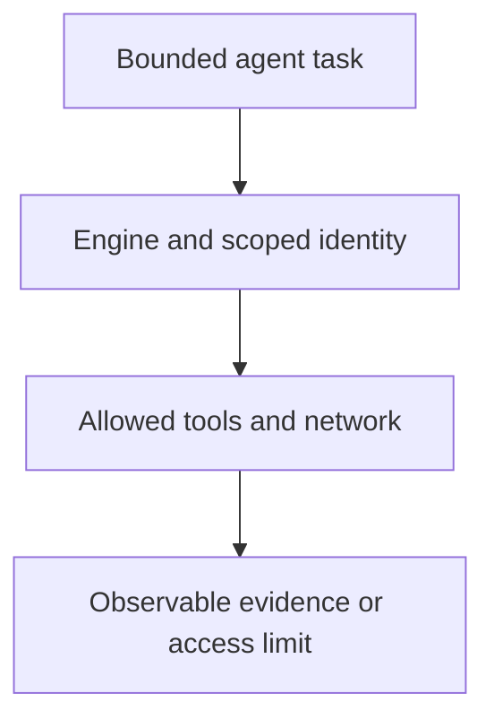

# 0038 · Agent engines, authentication, tools, and network boundaries

!!! note "Placeholder for a future teaching thread"
    This page is a teaching brief. Expand it into a full interactive lesson in its own thread. The planned exercises and outcomes have not been completed or demonstrated.

**Level:** Advanced.

## Prerequisites

- [0037 · Agentic Markdown sources, frontmatter, lock workflows, and execution stages](0037-agentic-markdown-and-compiled-workflows.md)
- [0031 · Least-privilege tokens, fork pull requests, and event trust boundaries](0031-github-token-forks-and-trust-boundaries.md)
- [0033 · OIDC, deployment environments, approval, and real platform verification](0033-oidc-environments-and-hosted-policy.md)

## What you will learn to do

- Map the engine, tool, network, and credential boundaries of an agentic task.
- Choose the minimum capabilities needed to inspect repository evidence.

## Explain the Actions behavior

Start from the prerequisite workflow or action behavior and introduce these concepts with focused examples:

1. An engine runs the agent; tools and network access determine the operations it can attempt.
2. Credential scope and configured tool policy enforce boundaries beyond natural-language instructions.
3. External model/service usage is separate from GitHub runner execution.

Explain the relevant workflow YAML, expressions, and action code in context. Follow the [shared teaching guide](teaching-guide.md) for pacing, expected output, and progression toward independent design.

## Planned local lab

Create an isolated exercise under `labs/0038/` when the lesson is developed. Explain setup and expected output before each command; reuse installed tools rather than reinstalling them on every step.

1. Inventory the exact observations needed for a repository report.
2. Map each to a read tool and a narrowly scoped identity in the design.
3. Compile a constrained configuration and identify authentication or network behavior that requires a deliberate live test later.

## Break it and diagnose it

Grant broad tool or credential access merely to compensate for a missing capability. Explain the unnecessary authority and redesign the task.

Ask for a prediction first. Capture the smallest reproducer, the actual result, and the corrected behavior. State which remaining claim requires a real GitHub or external-service check.

## Planning diagram



When expanding this lesson, refine the diagram to show the actual processes, branches, data exchange, and trust boundaries being taught.

## Retrieval questions

1. What can an instruction ask for that the available tools cannot perform?
2. Which boundary limits an actual write?
3. Which usage depends on the chosen engine rather than Actions minutes?

## Evidence to capture in the teaching thread

- A working learner-produced example and an explanation of why it works.
- A reproduced failure, a reasoned repair, and the smallest check that verifies it.
- A short account of remaining limits, unresolved questions, and readiness for the next lesson.

Use [primary references](../references/resources.md) to verify current syntax, runtime support, and tool behavior. Add learning records only for real statements or demonstrated understanding; a placeholder or generated page does not establish mastery.

## Start this lesson in a new thread

```text
/teach 0038

Expand docs/lessons/0038-agentic-engines-tools-and-authentication.md in place using docs/lessons/teaching-guide.md.
Read docs/mission.md, NOTES.md, and the prerequisite lesson pages first.
Begin with a short check of the Actions prerequisites. Explain relevant YAML,
expressions, and action contracts, one concept at a time. Let me predict and
try each exercise before revealing its answer. Keep feedback local where possible.
Finish with retrieval questions and a truthful handoff for the next thread.
```

| Previous | All lessons | Next |
| --- | --- | --- |
| [0037 · Agentic Markdown sources, frontmatter, lock workflows, and execution stages](0037-agentic-markdown-and-compiled-workflows.md) | [Curriculum](index.md) | [0039 · Strict local compilation and inspection of generated workflows](0039-agentic-local-compilation-and-generated-yaml.md) |
