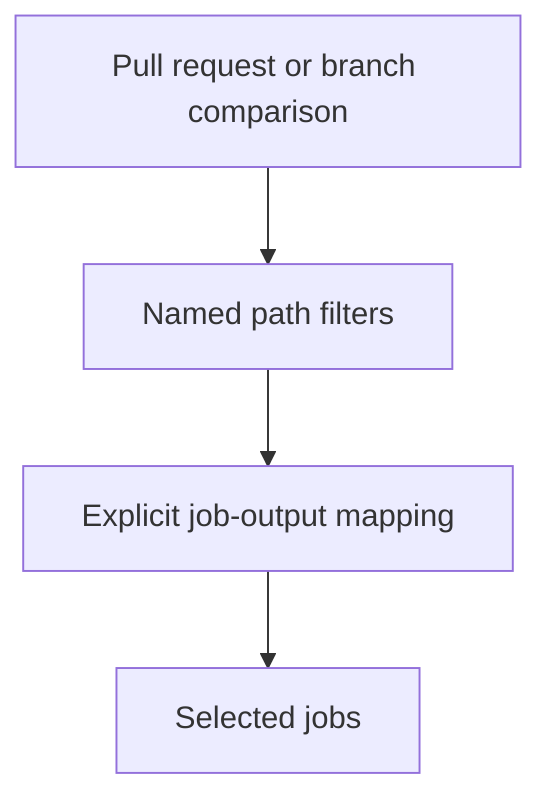

# 0038 · Replace git-diff shell logic with dorny/paths-filter

!!! note "Teaching brief"
    This page defines the planned lesson. Use its module guide and checked-in examples for context; develop the guided exercise in a teaching session. Written plans and assistant-run checks do not establish learner mastery.

## Prerequisites

- [0037 · Choose popular pre-built actions and verify their publishers](0037-selecting-popular-prebuilt-actions.md)
- [Module guide](prebuilt-actions.md)

## What you will learn to do

- Select jobs from named changed-path outputs without a custom git-diff pipeline.
- Explain pull-request API permissions, checkout requirements, and string-valued outputs.

## Explain the Actions behavior

1. dorny/paths-filter exposes named filters that can drive step conditions or job outputs.
2. Pull-request change discovery and branch comparisons use different inputs and execution boundaries.
3. Compare the output with the string true explicitly and choose a deliberate policy for manual runs.

Prefer maintained pre-built actions for standard platform operations. Keep project build/test commands explicit and introduce custom code only where the required behavior needs it. Follow the [teaching guide](teaching-guide.md).

## Planned local lab

Develop the exercise under `labs/0038/` or extend the linked examples. Reuse installed tools and explain what each check proves.

1. Inspect examples/prebuilt-actions/ci.yml and predict code-only, docs-only, mixed, and unrelated changes.
2. Trace the filter step output through job outputs into each dependent job condition.
3. Run static validation, then design a reviewed GitHub PR exercise that checks the actual changed-file behavior.

## Break it and diagnose it

Use a bare nonempty output string as a condition and observe why the text false can select the wrong branch. Repair the comparison with an explicit string value.

Ask for a prediction before reproducing the failure. Keep permission-dependent and remote-service behavior separate from local static checks.

## Planning diagram



## Retrieval questions

1. How does native trigger path filtering differ from selecting individual jobs?
2. When is pull-requests: read required?
3. What should manual dispatch run when no meaningful comparison is available?

## Evidence and remaining limits

Capture the learner's prediction, modified example, failure diagnosis, repair, and explanation of the appropriate test boundary. Local YAML validation does not execute a remote action or prove GitHub permissions. Hosted exercises and repository writes need a deliberate execution plan.

Use the [primary sources](../references/resources.md) and [dated action catalog](../references/prebuilt-actions.md). Recheck current releases, publisher evidence, and permissions when developing the lesson.

## Start this lesson in a new thread

```text
/teach 0038

Expand docs/lessons/0038-paths-filter-and-selective-jobs.md in place.
Read docs/mission.md, NOTES.md, docs/lessons/teaching-guide.md, the module
guide, and prerequisite Actions pages. Prefer pre-built actions over shell glue.
Teach one concept at a time. Ask for predictions and exercises before revealing
solutions. Keep local checks small, distinguish hosted effects, and record only
actual learner evidence.
```

| Previous Lesson | All Lessons | Next Lesson |
| --- | --- | --- |
| [0037 · Choose popular pre-built actions and verify their publishers](0037-selecting-popular-prebuilt-actions.md) | [Curriculum](index.md) | [0039 · Use setup, cache, and artifact actions instead of bootstrap scripts](0039-setup-cache-and-artifact-actions.md) |
