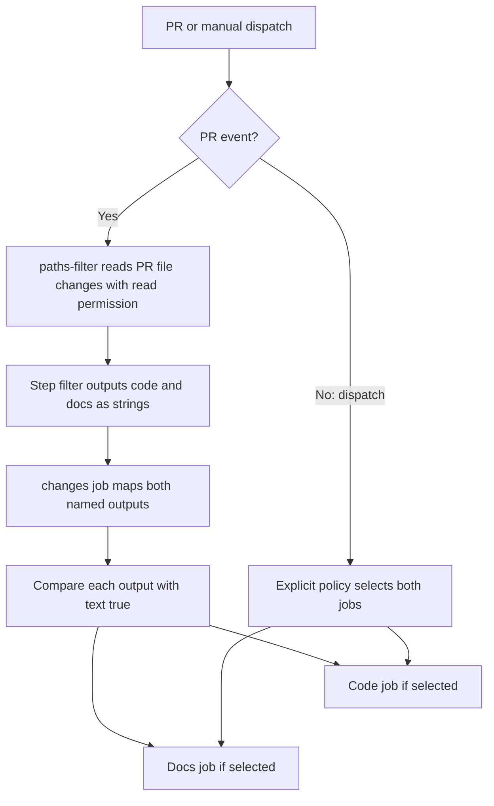

# 0038 · Replace git-diff shell logic with dorny/paths-filter

Replace repeated changed-file parsing with named action outputs, then keep the job-selection policy visible. A path filter decides what changed; your workflow decides which work that evidence requires.

!!! note "Lab scope"
    Run commands from the repository root with the existing `.venv`. The fixture consumer reads actual recipe mappings but receives synthetic action outputs. It does not run paths-filter, match globs, query a PR, or emulate GitHub expressions.

## Choose the change-discovery boundary

`dorny/paths-filter` is a community action with named filters. Its [README at the reviewed pin](https://github.com/dorny/paths-filter/blob/ceb8a2b8f2d89434be7ff52d3de7ec3738c5cc9d/README.md) documents event-specific discovery:

| Workflow context | Discovery mechanism | Contract to review |
| --- | --- | --- |
| Pull request | GitHub changed-file API against the PR base | `pull-requests: read`; token availability and API behavior |
| Feature branch against another base | Local Git comparison using merge-base | Checkout, history and intended `base`/`ref` |
| Same-base branch push | Local Git comparison for pushed changes | Event's before/after history, including new/forced branches |
| Manual dispatch | No universally correct change intent | Explicit compare-base policy or deliberately run all checks |

For PR API discovery, checkout is unnecessary in the filter job. Git-based discovery requires a checked-out repository and sufficient history. A `base` input does not override the PR API comparison in the usual PR mode. Setting an empty token to choose Git discovery changes the boundary and requires reading upstream guidance rather than assuming it fixes permissions.

The lab recipe supports PRs and manual dispatch only. It skips the filter step for manual dispatch and deliberately selects both jobs. It has no accidental fallback comparison against an arbitrary branch.

Native `on.pull_request.paths` admission can suppress the entire workflow. A filter action runs inside an admitted workflow and can select individual jobs or steps. Required-check policy needs care when work is intentionally skipped; a stable evidence gate can distinguish an allowed skip from missing required work, as in [0006](0006-matrices-dependencies-and-cancellation.md).

## Define named filter outputs

The inactive recipe is `labs/0038/selective.yml`. Its producer excerpt is:

```yaml title="Named filters within the changes job"
permissions:
  contents: read
  pull-requests: read # (1)!
outputs:
  code: ${{ steps.filter.outputs.code }} # (2)!
  docs: ${{ steps.filter.outputs.docs }}
steps:
  - id: filter
    if: github.event_name == 'pull_request'
    uses: dorny/paths-filter@ceb8a2b8f2d89434be7ff52d3de7ec3738c5cc9d # v4.0.3
    with:
      filters: |
        code:
          - 'examples/**'
          - 'scripts/**'
          - 'tests/**'
          - 'package*.json'
          - '.github/workflows/**'
        docs:
          - 'docs/**'
          - 'zensical.toml'
          - '.github/workflows/**'
```

1. This permission belongs to the discovery job. Dependent jobs need only the permissions required for their own work. Fork policy and repository settings can affect effective credentials.
2. `id: filter` names the step. The job's output mapping makes its result available through `needs.changes.outputs.code`. Identical names do not make this mapping automatic; see [passing job outputs](https://docs.github.com/en/actions/how-tos/write-workflows/choose-what-workflows-do/pass-job-outputs).

Under the default predicate, a filter matches when at least one changed file matches one of its patterns. Paths-filter returns text `'true'` or `'false'` for each filter, plus counts and optional file lists. Its metadata lists the static `changes` output; the action generates named outputs from the supplied filter names. Reading metadata alone cannot reveal every output name.

Workflow files appear in both groups because changing orchestration can affect both branches. A production repository should include all inputs that affect its builds, including lockfiles and tool configuration. Copying this intentionally small filter list without that inventory can silently omit work.

!!! tip "Pattern semantics"
    Quote glob strings in YAML. This pin uses picomatch and enables matching dotfiles. Multiple patterns normally mean any match; adding a negated pattern is not automatically a universal exclusion. Review the pin's predicate options before combining positive and negative rules. A homemade Python glob test would not verify this action's matcher.

## Consume strings explicitly

```yaml title="Dependent job excerpt"
code:
  needs: changes
  if: github.event_name == 'workflow_dispatch' || needs.changes.outputs.code == 'true' # (1)!
  runs-on: ubuntu-latest
  steps:
    - run: echo 'Code checks selected; place explicit project commands here'
```

1. Compare text to `'true'`. The manual branch supplies a separate selection rule. Do not infer that an omitted output means a meaningful negative result.

The full recipe's `docs` job uses the corresponding docs output. These jobs print the selected responsibility; they do not claim that project tests or documentation builds occurred. When adapting them, place explicit project commands inside each branch.



## Predict and run the fixture consumer

Predict the selected jobs before executing:

| Supplied output case | `code` | `docs` | Intended selected jobs |
| --- | --- | --- | --- |
| Code only | `'true'` | `'false'` | Code |
| Docs only | `'false'` | `'true'` | Docs |
| Mixed | `'true'` | `'true'` | Both |
| Unrelated | `'false'` | `'false'` | None |
| Dispatch | Missing | Missing | Both, by explicit event policy |

```bash
.venv/bin/python labs/0038/route.py code
.venv/bin/python labs/0038/route.py docs
.venv/bin/python labs/0038/route.py mixed
.venv/bin/python labs/0038/route.py unrelated
.venv/bin/python labs/0038/route.py manual
.venv/bin/python -m unittest discover -s labs/0038 -p test_route.py -v
```

Expected lines: `selected=code`, `selected=docs`, `selected=code,docs`, `selected=none`, and `selected=code,docs`. The four test methods cover the table, missing output, typo, and unsafe string policy. All normal commands exit **0**.

The program parses only the two documented literal mapping forms from the real recipe. It then applies this lab's small explicit selection policy to fixtures. This checks the consumer's assumptions and makes output loss observable without presenting a substitute runner as evidence.

### Deliberate failure: truthy false

```bash
.venv/bin/python labs/0038/route.py unrelated --bare
```

Expected: exit **0**, but the intentionally wrong result is `selected=code,docs`. Python's nonempty-string behavior illustrates the same hazard; GitHub's [expression rules](https://docs.github.com/en/actions/reference/workflows-and-actions/expressions) are the authority for Actions truthiness.

??? tip "Diagnosis and repair"
    A nonempty string is not a Boolean negative. Remove `--bare` to restore `value == 'true'` in the fixture policy. In a workflow, repair `if: needs.changes.outputs.code` to the explicit comparison shown above. Passing actionlint alone cannot prove the intended truth table.

### Deliberate failure: a lost output

```bash
.venv/bin/python labs/0038/route.py code --typo
.venv/bin/python labs/0038/route.py missing
```

Expected: both exit **1**, reporting `missing or invalid output: codes` and `missing or invalid output: docs`. The typo mutation exists only in memory.

??? tip "Diagnosis and repair"
    Trace filter name → step output → job mapping → `needs` expression. `codes` was never produced. Restore the exact mapping. For a missing expected output, investigate producer failure or skipping before interpreting it as false. The fixture's strict rejection is a diagnostic policy; GitHub itself can resolve a missing output to an empty value.

## Transfer exercise and retrieval

Design a third `api` filter for a monorepo. Include its source directory, lockfile and shared workflow changes, map it through the producer job, and state manual behavior. Keep every proposed workflow inactive.

1. When does this action require checkout?
2. Which job needs `pull-requests: read` in the lab?
3. Why does native event filtering not replace a per-job decision?
4. Which check can prove that the real matcher handled a renamed or deleted file as intended?

??? tip "Worked explanation"
    PR API discovery needs a token with the required read permission. Git discovery needs a checkout with enough history. Map the new filter explicitly and compare its output with `'true'`. Test fixture consumers locally, then use a reviewed bounded PR run to observe actual file discovery, matching, rename/deletion behavior, API permission and job selection. A synthetic list cannot establish those upstream behaviors.

## Verification boundary

The local policy and recipe syntax are testable without a daemon. Actual API calls, fork token behavior, Git-history discovery, picomatch behavior in this action, runner output mapping and hosted job selection remain integration boundaries. No remote action is executed by the lab.

| Previous lesson | All lessons | Next lesson |
| --- | --- | --- |
| [0037 · Choose popular pre-built actions and verify their publishers](0037-selecting-popular-prebuilt-actions.md) | [Curriculum](index.md) | [0039 · Use setup, cache, and artifact actions instead of bootstrap scripts](0039-setup-cache-and-artifact-actions.md) |
