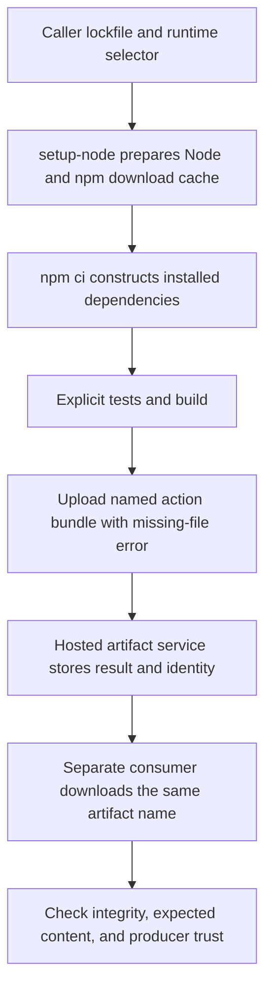

# 0039 · Use setup, cache, and artifact actions instead of bootstrap scripts

Use setup actions to prepare tools, caches to avoid repeated downloads, and artifacts to exchange named results. Keep the commands that install, test and build your project visible: those commands decide whether the application is actually ready.

## Prerequisites and observable goal

Read [0038 · Named selection outputs](0038-paths-filter-and-selective-jobs.md), [0034 · Cache validity and artifact trust](0034-caches-artifacts-and-reproducibility.md), and [0005 · Output contracts](0005-environment-files-and-output-contracts.md). Recall that jobs have separate filesystems; a dependency orders jobs but does not copy files.

You will explain what each action prepares, why installation remains necessary after a cache hit, and how a named artifact reaches a separate consumer. Success means you can reproduce a missing-module failure, repair the fixture's installed tree, and reject a wrong artifact name or altered result.

!!! note "Run locally without installing anything"
    Use the repository root and existing `.venv` and Node. The runnable lab materializes a tiny synthetic module in a temporary directory. It performs no npm installation, network download, hosted cache operation, or artifact-service call.

## Setup has a precise responsibility

The inactive `labs/0039/exchange.yml` selects Node and npm caching before explicit project commands:

```yaml title="Setup and application work"
- uses: actions/setup-node@949feb2413d6458794dcd2491c4babbbce0c15c1 # v7.1.0
  with:
    node-version: '24' # (1)!
    cache: npm
    cache-dependency-path: package-lock.json # (2)!
- run: npm ci # (3)!
- run: npm test
- run: npm run build:action
```

1. This requests the project's Node major on PATH. The setup action's own `runs.using: node24` is a separate runtime selected by the runner. Running setup-node is not necessary merely to invoke another packaged JavaScript action.
2. This identifies the caller's lockfile for the cache contract. A nested project needs its actual lockfile path and the correct working directory for npm commands.
3. Installation remains explicit. The excerpt is a hosted recipe, not a command block to execute during this no-install local lab.

The [setup-node metadata at this pin](https://github.com/actions/setup-node/blob/949feb2413d6458794dcd2491c4babbbce0c15c1/action.yml) declares these input and output names. Its [caching documentation](https://github.com/actions/setup-node/blob/949feb2413d6458794dcd2491c4babbbce0c15c1/README.md#caching-global-packages-data) states that the npm cache contains package-manager data rather than `node_modules`. Automatic npm cache behavior also depends on package metadata and action version; explicit inputs make this recipe's intent easier to review. Review `package-manager-cache` when disabling automatic caching in a privileged job.

For Python projects, the shared recipe uses the checked `astral-sh/setup-uv` interface with `python-version` and `enable-cache`. Tool setup and download reuse do not replace the project's locked synchronization command. Do not infer that one package manager's cache stores another's installed environment. See [setup-uv's upstream contract](https://github.com/astral-sh/setup-uv).

## When an explicit cache action is useful

Setup-action caching handles a standard package-manager case. Use `actions/cache` when you need an explicit directory/key contract, such as a custom compiler's reusable intermediates. Avoid independently caching the same npm directory through both interfaces.

```yaml title="Reference excerpt for a custom cache, not an activated workflow"
- id: compiler_cache
  uses: actions/cache@55cc8345863c7cc4c66a329aec7e433d2d1c52a9 # v6.1.0
  with:
    path: .fixture-compiler-cache
    key: compiler-${{ runner.os }}-${{ runner.arch }}-node24-${{ hashFiles('package-lock.json') }} # (1)!
    restore-keys: |
      compiler-${{ runner.os }}-${{ runner.arch }}-node24-
```

1. The key names declared validity inputs: platform, architecture, tool major, and lockfile content. A real compiler cache may also require compiler version, flags and source inputs. This is a custom-key example, not a claim to reproduce setup-node's internal key.

A restore prefix permits reuse from a less specific key. Its bytes are a starting point, not evidence that current work is complete. The [cache action contract](https://github.com/actions/cache/blob/55cc8345863c7cc4c66a329aec7e433d2d1c52a9/README.md) distinguishes an exact hit (`'true'`), a non-exact restore (`'false'`), and a miss (empty output). Use explicit comparisons. A cache hit does not certify tests, artifact provenance, or the source revision. Keep secrets out of caches and respect trust boundaries when sharing reusable data.

!!! tip "Prediction"
    A runner restores npm's download cache, but `node_modules` is absent. Will a Node program requiring a project dependency start? Does an exact cache hit justify skipping `npm ci` in this recipe?

??? tip "Worked explanation"
    Download bytes do not form the installed dependency tree Node resolves. Installation is still needed. `npm ci` uses the lockfile and may reuse downloaded bytes; the cache can change download cost without changing the requirement to construct and validate the current project environment.

## Artifacts are named results between jobs

The producer uploads a specific bundle after a successful build:

```yaml title="Producer excerpt"
- id: upload
  uses: actions/upload-artifact@cf430e030ddbb5b0abf93d22962f4752f3646cd9 # v7.0.2
  with:
    name: module7-action-bundle # (1)!
    path: examples/typescript-action/dist/index.cjs
    if-no-files-found: error # (2)!
    retention-days: 3
```

1. Artifact identity is not a local directory name. Use unique names for matrix members or independently produced results.
2. Missing build output should fail the producer rather than create a misleading successful job with a warning. Validate the result's content as well as its existence.

A separate job declares `needs: build` and downloads the same name to `received/`:

```yaml title="Consumer excerpt"
- id: download
  uses: actions/download-artifact@9000827ccba6bdab643e8b6fd33ac0654aef8333 # v8.0.2
  with:
    name: module7-action-bundle
    path: received
    digest-mismatch: error # (1)!
- run: test -s received/index.cjs
```

1. This exact pin declares `digest-mismatch` and defaults it to `error`; the recipe states the policy explicitly. Check metadata when updating, rather than copying old advice that mismatches only warn. The existence assertion is deliberately narrow; it does not execute or certify the downloaded bundle.

The [upload metadata](https://github.com/actions/upload-artifact/blob/cf430e030ddbb5b0abf93d22962f4752f3646cd9/action.yml) exposes artifact ID, URL and digest outputs; the [download metadata](https://github.com/actions/download-artifact/blob/9000827ccba6bdab643e8b6fd33ac0654aef8333/action.yml) defines retrieval inputs. Default retrieval is within the current run. Other runs or repositories need explicit identity and access decisions. A digest detects content disagreement; it does not authenticate a producer you never trusted.

Artifacts are retained results; caches are reusable acceleration data. Artifact retention and repository policy limit future availability. The upload action excludes hidden files by default; enabling them requires reviewing the content. Archive handling can also affect executable permissions. Neither contract should be treated as a private secret store.



## Local lab: observe real module resolution

`contract.py` creates a temporary project with a synthetic download-cache marker. It can materialize `fixture-dependency.cjs` under that project's `node_modules/fixture-dependency/index.cjs`, then invokes the real Node program `build.cjs`. The build writes a bounded JSON result. A separate local directory receives a copy, whose digest and message are checked. These operations test actual host behavior without pretending to implement a cache or artifact service.

```bash
node --version
.venv/bin/python labs/0039/contract.py
.venv/bin/python -m unittest discover -s labs/0039 -p test_contract.py -v
```

Expected: Node major 24; `PASS: synthetic dependency materialized; real Node build and local file consumer verified`; five passing test methods. Temporary directories are removed automatically. The key test verifies that changing lock bytes, architecture or Node major changes this lab's custom key.

### Deliberate failure: downloads without installation

```bash
.venv/bin/python labs/0039/contract.py --skip-install
```

Expected: exit **1**, beginning `BLOCKED: BUILD FAILED: MODULE_NOT_FOUND` and explaining that download bytes did not install the module.

??? tip "Diagnosis and repair"
    The real Node process cannot resolve the required file. The cache marker exists, so increasing cache retention cannot fix the installed-tree boundary. Run the normal command to materialize the synthetic module. In the hosted npm recipe, retain `npm ci`; do not copy this fixture's file-copy shortcut into a real dependency installer.

### Deliberate failures: name and integrity contracts

```bash
.venv/bin/python labs/0039/contract.py --wrong-name
.venv/bin/python labs/0039/contract.py --tamper
```

Expected: exit **1** with `BLOCKED: artifact name mismatch` and `BLOCKED: consumer digest mismatch`, respectively.

??? tip "Diagnosis and repair"
    The first failure reads the actual recipe's producer and consumer names and mutates the consumer in memory. Restore the shared name. The second modifies the local copied result after recording its digest. Reproduce the result from its intended producer and validate it again; accepting the modified bytes by updating the expected digest would erase the evidence of the disagreement.

## Transfer exercise and retrieval

A monorepo app lives under `apps/web/` and a two-OS matrix produces bundles. Adapt the runtime/cache paths, command working directories, and artifact names. Explain why a Linux-produced executable should not be treated as a Windows artifact merely because download succeeded.

1. Which files does setup-node's npm cache avoid downloading again?
2. Why are the action runtime and application runtime separate decisions?
3. What must be identical between upload and named download?
4. Why is a matching digest insufficient to trust an arbitrary PR artifact?

??? tip "Worked transfer"
    Point caching at `apps/web/package-lock.json`, run npm commands in `apps/web`, and give matrix outputs distinct names such as `bundle-Linux` and `bundle-Windows`. Verify the intended producer, revision, format and platform in the consumer. Package bytes in a cache do not replace installation; matching bytes from an untrusted producer remain untrusted bytes.

## Verification boundary

The local lab proves real Node resolution, build failure status, recipe-name consistency and local file integrity. It does not prove setup-node installed a runtime, npm installed a real project, hosted cache keys hit, artifacts uploaded/downloaded, permissions were effective, or another OS behaved identically. A future bounded GitHub run should collect those separate observations. Written material and assistant checks establish no learner mastery.

| Previous Lesson | All Lessons | Next Lesson |
| --- | --- | --- |
| [0038 · Replace git-diff shell logic with dorny/paths-filter](0038-paths-filter-and-selective-jobs.md) | [Curriculum](index.md) | [0040 · Compose Docker build and cloud authentication actions](0040-docker-build-and-cloud-auth-actions.md) |
