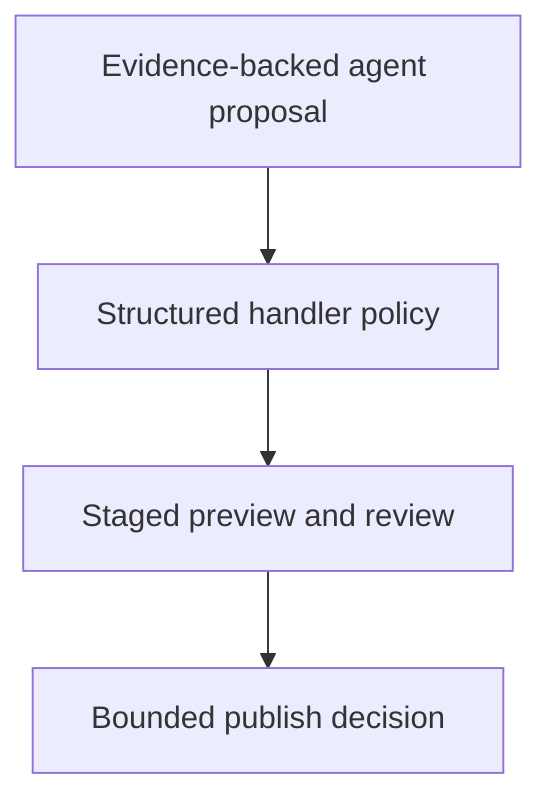

# 0040 · Safe outputs, staging, write limits, and human review

!!! note "Placeholder for a future teaching thread"
    This page is a teaching brief. Expand it into a full interactive lesson in its own thread. The planned exercises and outcomes have not been completed or demonstrated.

**Level:** Advanced.

## Prerequisites

- [0039 · Strict local compilation and inspection of generated workflows](0039-agentic-local-compilation-and-generated-yaml.md)
- [0032 · Script injection, untrusted artifacts, and privileged-event pitfalls](0032-script-injection-artifacts-and-privileged-events.md)
- [0038 · Agent engines, authentication, tools, and network boundaries](0038-agentic-engines-tools-and-authentication.md)

## What you will learn to do

- Trace a proposed change through validation, staging, and a publish decision.
- Design a bounded output policy with explicit human review.

## Explain the Actions behavior

Start from the prerequisite workflow or action behavior and introduce these concepts with focused examples:

1. An agent proposal and a published repository mutation are separate operations.
2. A configured output handler applies structured policy and operation limits.
3. Staging previews configured output operations but does not make remote agent execution local or free.

Explain the relevant workflow YAML, expressions, and action code in context. Follow the [shared teaching guide](teaching-guide.md) for pacing, expected output, and progression toward independent design.

## Planned local lab

Create an isolated exercise under `labs/0040/` when the lesson is developed. Explain setup and expected output before each command; reuse installed tools rather than reinstalling them on every step.

1. Inspect the existing staged issue proposal and its configured maximum count.
2. Create fixture proposals that are valid, oversized, unsupported, or beyond the intended operation limit.
3. Compile the policy and plan a staged hosted review before any published operation is enabled.

## Break it and diagnose it

Assume staged outputs prevent every possible side effect even when an unrelated tool has direct write authority. Identify the unguarded path.

Ask for a prediction first. Capture the smallest reproducer, the actual result, and the corrected behavior. State which remaining claim requires a real GitHub or external-service check.

## Planning diagram



When expanding this lesson, refine the diagram to show the actual processes, branches, data exchange, and trust boundaries being taught.

## Retrieval questions

1. Which component actually publishes a safe-output operation?
2. Which policy is enforced outside the prompt?
3. What additional authority could bypass the intended staging boundary?

## Evidence to capture in the teaching thread

- A working learner-produced example and an explanation of why it works.
- A reproduced failure, a reasoned repair, and the smallest check that verifies it.
- A short account of remaining limits, unresolved questions, and readiness for the next lesson.

Use [primary references](../references/resources.md) to verify current syntax, runtime support, and tool behavior. Add learning records only for real statements or demonstrated understanding; a placeholder or generated page does not establish mastery.

## Start this lesson in a new thread

```text
/teach 0040

Expand docs/lessons/0040-agentic-safe-outputs-and-human-review.md in place using docs/lessons/teaching-guide.md.
Read docs/mission.md, NOTES.md, and the prerequisite lesson pages first.
Begin with a short check of the Actions prerequisites. Explain relevant YAML,
expressions, and action contracts, one concept at a time. Let me predict and
try each exercise before revealing its answer. Keep feedback local where possible.
Finish with retrieval questions and a truthful handoff for the next thread.
```

| Previous | All lessons | Next |
| --- | --- | --- |
| [0039 · Strict local compilation and inspection of generated workflows](0039-agentic-local-compilation-and-generated-yaml.md) | [Curriculum](index.md) | [0041 · Agentic fixtures, adversarial repository text, and quality evaluation](0041-agentic-fixtures-adversarial-input-and-evaluation.md) |
