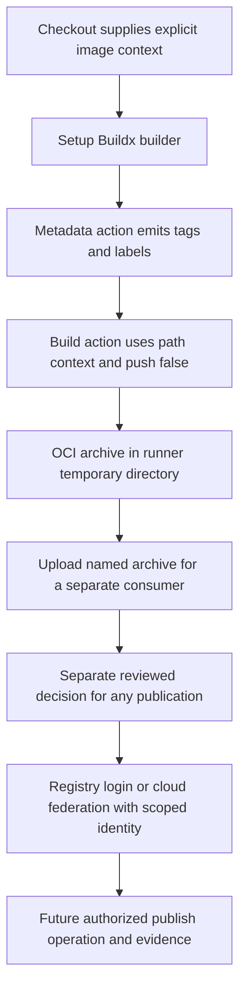

# 0040 · Compose Docker build and cloud authentication actions

Separate builder setup, image metadata, build/export, registry login and cloud identity. A build can produce an OCI file without publishing an image. Authentication is a distinct authority boundary, not a side effect to hide inside a build script.

## Prerequisites and observable goal

Read [0039 · Setup and result exchange](0039-setup-cache-and-artifact-actions.md), [0014 · Docker build context](0014-dockerfiles-layers-and-build-context.md), and [0033 · OIDC and environments](0033-oidc-environments-and-hosted-policy.md). Be ready to distinguish the filesystem used as a build context from the credentials used to access a registry.

You will trace tags and labels into a build-only recipe, explain its OCI output, and reject an unintended push. You will also test a synthetic intended-identity policy that rejects a wrong subject or absent token-request permission. Success means you can state exactly which image, registry and cloud claims still need real integration evidence.

!!! note "No infrastructure is needed for the host lab"
    Run commands from the repository root using the existing `.venv`. The policy programs make no Docker, registry or cloud calls. Check engine availability before any future container exercise; a local policy pass cannot establish that an image was built.

## Compose four different interfaces

| Interface | Responsibility | Does not establish |
| --- | --- | --- |
| `docker/setup-buildx-action` | Prepare a Buildx builder for later steps | That a Dockerfile built successfully |
| `docker/metadata-action` | Produce image tag and label values from context | Registry ownership or authorization |
| `docker/build-push-action` | Build and export according to its inputs | That a separate deployment succeeded |
| `docker/login-action` | Configure credentials for the intended registry | Authorization to every repository or a cloud role |

The checked project pins resolve to their named upstream tags. Review [Buildx setup](https://github.com/docker/setup-buildx-action/blob/f87e5991a6d7451dcb8d9637bfbc97413f497069/README.md), [metadata generation](https://github.com/docker/metadata-action/blob/dc802804100637a589fabce1cb79ff13a1411302/README.md), [build/export](https://github.com/docker/build-push-action/blob/c3c9e263c25d99ce0380d002d59b67737d91b0dc/README.md), and [registry login](https://github.com/docker/login-action/blob/81c6f93d4bc991e510b342a00b419b3bb4efc5c6/README.md) as separate contracts. Runtime downloads, builder images and base images can remain additional dependencies even when each action itself is pinned.

## Trace a build-only recipe

The complete inactive workflow is `labs/0040/build.yml`. Checkout supplies a bounded context under `labs/0040/image/`. That Dockerfile uses `FROM scratch` and copies one synthetic text file; it has no executable entrypoint and makes no application-network calls. The builder itself can still need downloads when first configured.

```yaml title="Metadata and build steps"
- uses: docker/setup-buildx-action@f87e5991a6d7451dcb8d9637bfbc97413f497069 # v4.4.1
- id: meta
  uses: docker/metadata-action@dc802804100637a589fabce1cb79ff13a1411302 # v6.2.0
  with:
    images: ghcr.io/${{ github.repository }}
    tags: type=sha # (1)!
- id: build
  uses: docker/build-push-action@c3c9e263c25d99ce0380d002d59b67737d91b0dc # v7.4.0
  with:
    context: labs/0040/image # (2)!
    push: false # (3)!
    tags: ${{ steps.meta.outputs.tags }}
    labels: ${{ steps.meta.outputs.labels }}
    outputs: type=oci,dest=${{ runner.temp }}/module7-image.tar # (4)!
```

1. The metadata action produces tag/label strings. A revision-derived tag improves traceability but is still a tag, not an immutable registry digest or proof of provenance.
2. An explicit path context uses the checked-out filesystem. The action's default Git context can ignore earlier workspace modifications; choose the context according to what should be built.
3. This recipe deliberately exports a file instead of pushing. It needs no registry-login step or package-write permission.
4. OCI export writes an image-layout archive for transfer. It does not automatically load the image into the engine. This fixture image is data-only, so trying to run it is not a useful smoke test.

The upload action then stores the archive as `module7-oci-image`, rejects a missing file and requests three-day retention. `DOCKER_BUILD_RECORD_UPLOAD: 'false'` disables the build action's separate build-record upload in this exercise; the explicit OCI artifact remains. Every artifact still needs its producer/revision/integrity contract.

The shared Docker recipe demonstrates `cache-from: type=gha` and `cache-to: type=gha,mode=max`. Those use GitHub cache services and their restrictions. They are omitted from this smaller lab to keep its contract focused. See Docker's [cache backend guidance](https://docs.docker.com/build/ci/github-actions/cache/) before enabling them. A host cache-policy test is not proof of BuildKit cache reuse.



## Cloud authentication needs a trust contract

OIDC allows a job to request a signed GitHub identity token and exchange it with a provider for short-lived access. `id-token: write` permits requesting that token; it grants neither general repository writes nor a cloud role. The provider must trust the issuer, intended audience and suitably narrow claims. Environment approval and resource authorization remain additional checks. See GitHub's [OIDC model](https://docs.github.com/en/actions/concepts/security/openid-connect).

The vendor interfaces differ:

| Vendor action | Typical federation inputs to review | Additional boundary |
| --- | --- | --- |
| [AWS credentials](https://github.com/aws-actions/configure-aws-credentials) | Intended role, region and audience | IAM trust and role resource policy |
| [Azure login](https://github.com/Azure/login) | Client, tenant and subscription identity | Federated credential and Azure role assignment |
| [Google Cloud auth](https://github.com/google-github-actions/auth) | Workload identity provider and, if used, service account | Attribute conditions, impersonation and resource access |

These are discovery references, not activated or fully reviewed new dependencies in this lab. Resolve a suitable full pin and review exact inputs before adopting one. The historical catalog's publisher observations do not automatically establish a fresh match for every vendor listing.

For an environment-bound workflow, a default GitHub subject can identify the repository and environment rather than a branch. If policy needs a branch restriction too, enforce that through the relevant claims/provider conditions and environment deployment-branch policy. Merely placing the expected branch string beside a subject in a JSON fixture does not make the provider enforce it.

!!! tip "Prediction"
    The job has `id-token: write`, but the provider expects a different subject. Can login succeed because the action comes from a verified vendor? Would a successful local comparison prove token issuance?

??? tip "Worked explanation"
    Publisher identity does not override provider trust. A subject mismatch should prevent the intended exchange. A local comparison can test your own policy expectations, but cannot validate a JWT signature, token issuance, provider trust evaluation or the resulting resource permissions.

## Local lab: reject unintended operations

```bash
.venv/bin/python labs/0040/policy.py build
.venv/bin/python labs/0040/policy.py oidc-ok
.venv/bin/python -m unittest discover -s labs/0040 -p test_policy.py -v
```

Expected: exit **0**, `PASS: build-only recipe policy; image execution unverified`, then `PASS: intended identity plan; no token or cloud authorization verified`. Four test methods cover the recipe and identity plan, including mutations of every expected identity field.

`check_build` reads the actual inactive YAML and rejects pushes, a changed context, a missing OCI exporter, or a login step. `check_identity` compares a synthetic plan against this exercise's explicit policy: dispatch from main, preview environment, expected issuer/audience/subject, token-request permission, acknowledgment and a read-only preview role. It is a project planning check, not a cloud simulator.

### Deliberate failure: enable push without an identity design

```bash
.venv/bin/python labs/0040/policy.py push
```

Expected: exit **1**, `BLOCKED: build-only policy rejects registry push; design a separate authenticated job`.

??? tip "Diagnosis and repair"
    This mutates `push` only in memory. The local failure is your policy rejecting scope expansion; it is not a reproduced registry 401 response. Restore build-only operation by running the normal command. For a future publish job, review event/ref trust, registry target, login credentials, package permissions and environment protection before adding `push: true`. A public registry may allow anonymous pushes to some resources; this exercise does not assume a specific server error.

### Deliberate failures: identity-plan mismatch

```bash
.venv/bin/python labs/0040/policy.py oidc-wrong-subject
.venv/bin/python labs/0040/policy.py oidc-no-permission
```

Expected: exit **1**, ending `identity plan rejected: subject` and `identity plan rejected: id_token_permission`, respectively.

??? tip "Diagnosis and repair"
    Compare the plan's exact issuer, audience, subject, environment and permission expectations. Rerun `oidc-ok` for the corrected fixture. Do not broaden trust to every repository to suppress a mismatch. In a real integration, inspect the authorized claims and provider denial evidence without logging sensitive tokens.

## Transfer exercise and retrieval

Design a separate job that would publish a reviewed image to GHCR after tests, without implementing or running it. State the required `packages` permission, login identity, intended repository, protected event/ref, image digest evidence and recovery after partial publication. Then describe how the identity contract would differ for a cloud registry using OIDC.

1. Which action owns tags and labels?
2. How does path context differ from default Git context?
3. Does OCI export imply registry publication or engine loading?
4. Which identity questions cannot be answered by this lab's JSON policy?

??? tip "Worked explanation"
    Metadata supplies tags and labels; the build action consumes them. A path context uses checkout files, while Git context selects repository content independently of earlier local changes. OCI export creates transferable image data. Publication needs intended credentials and service authorization; OIDC additionally needs signed claims and real provider trust. Record immutable image identity and partial-side-effect recovery separately from build success.

## Verification boundary

A refused engine socket blocks image and builder execution, while the host policy tests remain usable. Image construction, metadata action execution, hosted artifacts, registry authorization, effective OIDC and cross-OS behavior need their own evidence. A local policy pass supplies none of those observations. No learner mastery follows from assistant checks.

| Previous Lesson | All Lessons | Next Lesson |
| --- | --- | --- |
| [0039 · Use setup, cache, and artifact actions instead of bootstrap scripts](0039-setup-cache-and-artifact-actions.md) | [Curriculum](index.md) | [0041 · Automate releases, pull requests, and reports with pre-built actions](0041-release-pr-and-reporting-actions.md) |
