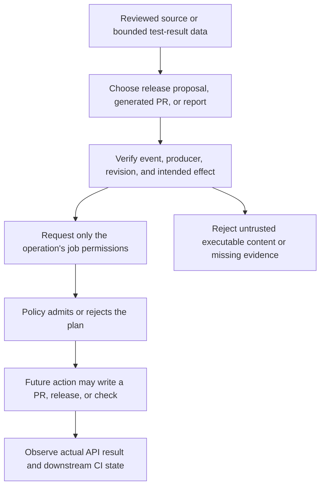

# 0041 · Automate releases, pull requests, and reports with pre-built actions

Replace standard release and reporting API glue with reviewed action interfaces. State the operation, identify which code or report you trust, and grant only its required write permission. Opening a pull request, publishing a release and uploading coverage are different external effects even when all appear near the end of CI.

!!! note "Inactive recipes and bounded fixtures"
    Work from the repository root using the existing `.venv`. The workflow stays under `labs/0041/`. Host commands read JSON/XML fixtures and perform no API calls. A fixture's acknowledgment field is an input to a policy test, not a real user's approval or a GitHub environment review.

## Choose the effect before the dependency

| Intended result | Candidate interface | Authority and review boundary |
| --- | --- | --- |
| Version/changelog proposal and eventual release | `googleapis/release-please-action` | Contents, issues and PR writes in its documented setup; trusted release input |
| Generated repository changes proposed for review | `peter-evans/create-pull-request` | Branch/commit and PR writes; generated-file allowlist |
| Structured test results as a GitHub check | `dorny/test-reporter` | Checks write; artifact read access when retrieving another run's results |
| Coverage sent to an external service | `codecov/codecov-action` | Service upload/authentication policy and intended data disclosure |
| A local human-readable summary | Explicit formatter and `GITHUB_STEP_SUMMARY` | Local file protocol; no PR/check API write merely to append text |

Google's Marketplace listing was matched to the action and showed creator verification on **2026-10-30**. The separate selection receipt records the current matching method. The matched create-pull-request listing showed no creator badge. Treat community task fit and release review explicitly; do not borrow Google's publisher evidence for another action.

The [Release Please README at the project pin](https://github.com/googleapis/release-please-action/blob/45996ed1f6d02564a971a2fa1b5860e934307cf7/README.md), [create-pull-request contract](https://github.com/peter-evans/create-pull-request/blob/5f6978faf089d4d20b00c7766989d076bb2fc7f1/README.md), [test-reporter guidance](https://github.com/dorny/test-reporter), and [Codecov action](https://github.com/codecov/codecov-action) document different operations. Only the release-proposal recipe below is a complete workflow in this lab; the others are selection/transfer cases requiring their own exact-pin review before adoption.

## Release Please proposes changes before releasing them

Release Please interprets supported commit conventions and release configuration to maintain a release pull request with version/changelog changes. In the normal release lifecycle, merging the release PR allows a later run to create the corresponding GitHub release and tag. It does not automatically publish every package to every package registry; downstream packaging and credentials remain separate.

The lab deliberately requests **proposal-only** behavior:

```yaml title="labs/0041/release.yml, job excerpt"
propose:
  if: inputs.acknowledge_writes && github.ref == 'refs/heads/main' # (1)!
  runs-on: ubuntu-latest
  permissions:
    contents: write
    issues: write
    pull-requests: write # (2)!
  steps:
    - uses: actions/checkout@3d3c42e5aac5ba805825da76410c181273ba90b1 # v7.0.1
      with:
        persist-credentials: false
    - name: Check intended effect policy
      env:
        EVENT_NAME: ${{ github.event_name }}
        REF_NAME: ${{ github.ref }}
        ACKNOWLEDGE: ${{ inputs.acknowledge_writes }}
      run: python3 labs/0041/effects.py --env
    - id: release
      uses: googleapis/release-please-action@45996ed1f6d02564a971a2fa1b5860e934307cf7 # v5.0.0
      with:
        release-type: simple # (3)!
        skip-github-release: true # (4)!
        target-branch: main
```

1. The complete recipe is manual-only and defaults its Boolean acknowledgment input to false. Ref/event checks make this particular policy explicit; they are not a replacement for protected workflow changes or environment policy.
2. The workflow default is `permissions: {}`; only this job requests the documented writes. Repository/organization settings can still prevent an intended PR write. The local policy cannot inspect effective hosted authority.
3. A simple release strategy avoids pretending that this synthetic lab publishes the workspace's Node package. A production project should review its strategy, manifest/config, version files, commit conventions and target branch.
4. This input suppresses GitHub release creation. It is **not a dry run**: an activated recipe may still create/update a release PR and associated metadata. Its intended writes must be reviewed before activation.

The [exact metadata](https://github.com/googleapis/release-please-action/blob/45996ed1f6d02564a971a2fa1b5860e934307cf7/action.yml) defaults the action token to `github.token`. Adding more write scopes does not repair incorrect release configuration or missing qualifying commits. Some outputs are dynamic and not enumerated in this metadata; verify upstream output names and compare string-valued flags explicitly before conditioning downstream publication on them.

### Check current token-trigger behavior

A successful automated PR does not imply that all required workflows ran. Current GitHub [trigger guidance](https://docs.github.com/en/actions/how-tos/write-workflows/choose-when-workflows-run/trigger-a-workflow#triggering-a-workflow-from-a-workflow), checked **2026-10-30**, describes exceptions to token recursion prevention: dispatch events can trigger runs, and token-created/updated PR events for `opened`, `synchronize` or `reopened` can create approval-required runs. Other token-generated events, including ordinary pushes, generally do not recursively trigger workflows.

Older action READMEs may summarize this as no CI on token-created PRs. Inspect actual approval-required state and current platform documentation rather than silently adding a broad personal token. A separately reviewed GitHub App identity may be appropriate for a production automation design, but no credential change is needed for this local lesson.

## Generated PRs need an explicit file boundary

The create-pull-request action commits workspace changes and creates or updates a PR branch. It does not generate the desired files for you. Keep the generator command visible, then restrict what it may propose:

```yaml title="Reference step after checkout and a reviewed generator"
- uses: peter-evans/create-pull-request@5f6978faf089d4d20b00c7766989d076bb2fc7f1 # v8.1.1
  with:
    branch: automation/generated-report
    base: main
    add-paths: generated/report.md # (1)!
    title: Update generated report
    body: Generated from the reviewed source revision; inspect the diff before merging.
```

1. This narrows files for the intended proposal. Also verify the generator, working tree, branch/base policy and resulting diff. A filename allowlist alone does not make malicious generated content trustworthy.

This is an interface excerpt, not a runnable workflow added to GitHub. A constant branch can update one ongoing automation PR instead of creating one per run; it still needs a deliberate concurrency and recovery policy. Never run an untrusted PR's generator in a job holding repository-write credentials simply because the final operation is performed by a maintained action.

## Reporting is still an effect

A test report is input data. A reporter parses that data; it does not rerun or validate the tests that allegedly produced it. Test-reporter's own documentation warns that a same-workflow check writer cannot operate with the usual restricted fork-PR token. Switching to `pull_request_target` and executing the fork's code would move untrusted execution into a privileged context.

A separate privileged reporter can read a size-limited report from a known workflow, run, and commit, then create checks. Validate producer identity and expected files; never execute downloaded report scripts. Keep required test success separate from report delivery. `if: ${{ !cancelled() }}` can allow a bounded report step after failed tests, but a successful report must not erase the failing test result.

Codecov upload is another service boundary. It sends coverage data to a third party and needs its own repository/service identity and upload policy. Neither a local XML parser nor `checks: write` proves that service authentication or upload succeeded.



## Local lab: gate plans and consume report data

```bash
.venv/bin/python labs/0041/effects.py release
.venv/bin/python labs/0041/report.py labs/0041/pass.xml
.venv/bin/python -m unittest discover -s labs/0041 -p test_effects.py -v
```

Expected: `ALLOW PLAN: release-pr; no API operation performed`, then `REPORT DATA: total=2 failed=0 skipped=0; no check published`; both exit **0**. Five test methods cover valid plans, rejected plans, Boolean acknowledgment, report counts and missing-case data.

`effects.py` is the policy program used by the inactive release recipe. The fixture mode supplies explicit JSON; `--env` consumes the recipe's event/ref/acknowledgment environment values. Permission fields in a fixture describe intended policy, not an introspection of the real token.

`report.py` accepts a bounded synthetic `testsuite`, rejects empty or oversized input and document-type/entity declarations, and counts failure/error/skipped nodes. It is a deliberately narrow fixture consumer, not a substitute for a general production JUnit parser or test-reporter implementation.

!!! tip "Prediction"
    A fork fixture has the same requested write permissions as the release fixture. Should the policy admit it? What exit code should a report formatter return when one supplied test case fails?

### Deliberate failures

```bash
.venv/bin/python labs/0041/effects.py fork
.venv/bin/python labs/0041/effects.py no-write
.venv/bin/python labs/0041/effects.py untrusted
.venv/bin/python labs/0041/effects.py excess
.venv/bin/python labs/0041/report.py labs/0041/fail.xml
```

Expected: all exit **1**. The plan failures respectively identify the required dispatch/main boundary, mismatched permissions, untrusted producer and excess permissions. The report prints `total=2 failed=1 skipped=0; no check published` and preserves failure through its exit code.

??? tip "Diagnosis and repair"
    Adding writes does not change a fork's trust. Restore the reviewed dispatch/main plan rather than broadening the gate. Use the exact operation-specific permission map; surplus authority is rejected by this exercise. Repair missing report evidence at its producer and rerun the tests; do not delete the failing XML node to claim the original tests passed. `pass.xml` demonstrates healthy consumer behavior with a different explicitly synthetic input.

## Transfer exercise and retrieval

Design a generated changelog PR and a fork-safe test report. Name the generator, allowed files, writer identity, expected source revision, report schema and maximum input size. Explain how required checks become observable on the resulting automated PR. Keep the plan inactive.

1. Why does proposal-only Release Please still need write review?
2. Which action generates project files, and which merely proposes their diff?
3. How can report delivery succeed while required tests remain failed?
4. Why must token-trigger behavior be checked against current GitHub documentation?

??? tip "Worked explanation"
    The release action can mutate PRs even when release creation is suppressed. A separate reviewed generator produces files before a PR action commits them. Reports summarize evidence and must preserve the original failure gate. Separate privileged writers from untrusted execution, validate downloaded data, and inspect actual hosted PR/check/approval state rather than assuming a token-created event ran CI.

## Verification boundary

Local checks validate intended-effect policy and bounded XML consumption. They do not establish actual token scopes, PR/release/check writes, downstream CI approvals, fork restrictions, Codecov upload, or service behavior. Those require separately reviewed hosted checks.

| Previous lesson | All lessons | Next lesson |
| --- | --- | --- |
| [0040 · Compose Docker build and cloud authentication actions](0040-docker-build-and-cloud-auth-actions.md) | [Curriculum](index.md) | [0042 · Compose an action-based pipeline and maintain its dependencies](0042-compose-maintained-actions-and-manage-updates.md) |
