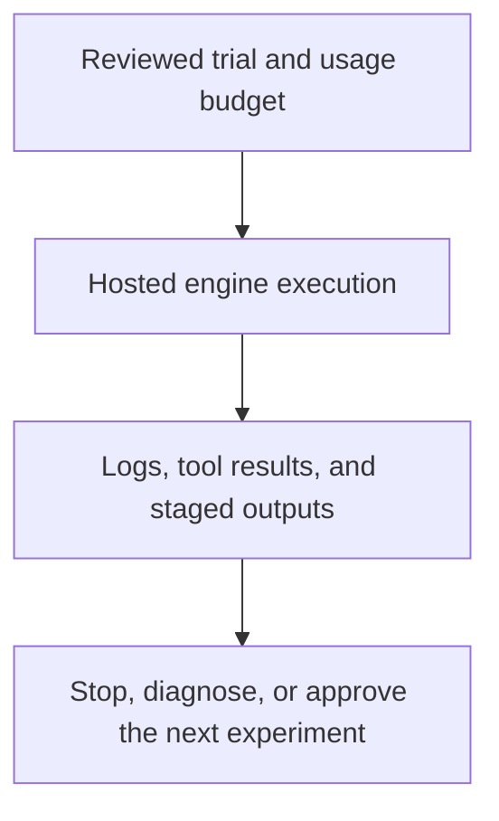

# 0042 · Hosted trials, model variability, usage budgets, and diagnostics

!!! note "Placeholder for a future teaching thread"
    This page is a teaching brief. Expand it into a full interactive lesson in its own thread. The planned exercises and outcomes have not been completed or demonstrated.

**Level:** Advanced.

## Prerequisites

- [0041 · Agentic fixtures, adversarial repository text, and quality evaluation](0041-agentic-fixtures-adversarial-input-and-evaluation.md)
- [0036 · Logs, annotations, summaries, concurrency, and usage budgets](0036-observability-concurrency-and-usage-budgets.md)
- [0039 · Strict local compilation and inspection of generated workflows](0039-agentic-local-compilation-and-generated-yaml.md)

## What you will learn to do

- Specify a bounded trial plan with stop conditions and an explicit usage budget.
- Diagnose a failed live run by execution boundary rather than repeated blind reruns.

## Explain the Actions behavior

Start from the prerequisite workflow or action behavior and introduce these concepts with focused examples:

1. A hosted trial is a real repository execution and can consume runner and model usage.
2. Repeated model outcomes vary, so one successful report is incomplete quality evidence.
3. Run logs and output-handler evidence help separate authentication, tool, model, and policy failures.

Explain the relevant workflow YAML, expressions, and action code in context. Follow the [shared teaching guide](teaching-guide.md) for pacing, expected output, and progression toward independent design.

## Planned local lab

Create an isolated exercise under `labs/0042/` when the lesson is developed. Explain setup and expected output before each command; reuse installed tools rather than reinstalling them on every step.

1. Review the installed CLI testing commands and their actual execution location.
2. Design one disposable-repository trial with constrained tools, staged outputs, deadlines, and an acceptable budget.
3. Define the evidence to capture, the failure categories, and the condition for trying another run before any trial is dispatched.

## Break it and diagnose it

Repeatedly rerun a failing workflow without classifying an authentication or policy error. Explain why extra model calls cannot repair that boundary.

Ask for a prediction first. Capture the smallest reproducer, the actual result, and the corrected behavior. State which remaining claim requires a real GitHub or external-service check.

## Planning diagram



When expanding this lesson, refine the diagram to show the actual processes, branches, data exchange, and trust boundaries being taught.

## Retrieval questions

1. Where does a trial actually execute?
2. What limits the number of attempts and side effects?
3. Which evidence distinguishes a poor report from unavailable tools or a rejected output?

## Evidence to capture in the teaching thread

- A working learner-produced example and an explanation of why it works.
- A reproduced failure, a reasoned repair, and the smallest check that verifies it.
- A short account of remaining limits, unresolved questions, and readiness for the next lesson.

Use [primary references](../references/resources.md) to verify current syntax, runtime support, and tool behavior. Add learning records only for real statements or demonstrated understanding; a placeholder or generated page does not establish mastery.

## Start this lesson in a new thread

```text
/teach 0042

Expand docs/lessons/0042-agentic-hosted-trials-budgets-and-diagnostics.md in place using docs/lessons/teaching-guide.md.
Read docs/mission.md, NOTES.md, and the prerequisite lesson pages first.
Begin with a short check of the Actions prerequisites. Explain relevant YAML,
expressions, and action contracts, one concept at a time. Let me predict and
try each exercise before revealing its answer. Keep feedback local where possible.
Finish with retrieval questions and a truthful handoff for the next thread.
```

| Previous | All lessons | Next |
| --- | --- | --- |
| [0041 · Agentic fixtures, adversarial repository text, and quality evaluation](0041-agentic-fixtures-adversarial-input-and-evaluation.md) | [Curriculum](index.md) | [0043 · Specify the repository-health orchestrator and acceptance criteria](0043-capstone-specification-and-orchestrator-design.md) |
