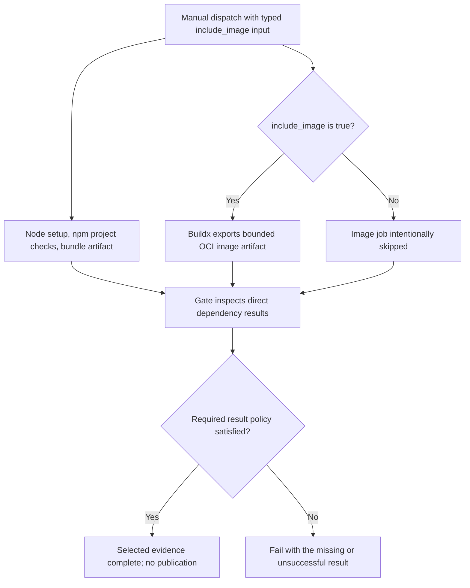

# 0042 · Compose an action-based pipeline and maintain its dependencies

A useful action-based pipeline makes platform operations reusable and project behavior explicit. Changing an action SHA selects different code. Review the release, its interface, and its access before accepting that change.

!!! note "Local scope"
    All commands run from the repository root with the already installed `.venv`. The lab performs no dependency installation or remote action execution. The Dependabot file is a proposal under `labs/0042/`, not installed repository configuration.

## Put each responsibility in the right place

The complete inactive workflow is `labs/0042/pipeline.yml`. Manual dispatch always selects the Node branch; a typed Boolean `include_image` also selects the OCI build with a timeout from 0040. The branches have independent runners and can become eligible together.

| Responsibility | Interface in this pipeline | Policy still visible to the reader |
| --- | --- | --- |
| Obtain repository files | Checkout action | Intended revision and credential persistence |
| Prepare Node and download reuse | Setup-node action | Version, lockfile and cache behavior |
| Construct/install, test and build | `npm ci`, `npm test`, `npm run build:action` | Actual project scripts and failure status |
| Construct/export OCI data | Docker Buildx and build actions | Explicit context, no push, output format |
| Retain named results | Upload-artifact action | Exact path, missing-file error and retention |
| Join selected worker evidence | Small project policy program | Required versus intentionally skipped results |

These interfaces remove acquisition/upload/builder glue while retaining the repository's domain commands. A composite action is appropriate when a team needs a stable step-level convention; a reusable workflow can expose job-level runner, permission and orchestration policy. Do not hide a write-capable job inside a setup abstraction whose name implies only tool preparation.

## Trace the evidence join

The gate declares both branches as direct dependencies and runs for non-cancelled workflows even when a dependency fails or skips:

```yaml title="labs/0042/pipeline.yml, gate excerpt"
gate:
  needs: [node, image]
  if: ${{ !cancelled() }} # (1)!
  runs-on: ubuntu-latest
  steps:
    - uses: actions/checkout@3d3c42e5aac5ba805825da76410c181273ba90b1 # v7.0.1
      with:
        persist-credentials: false
    - name: Join the selected evidence
      env:
        INCLUDE_IMAGE: ${{ inputs.include_image }} # (2)!
        NODE_RESULT: ${{ needs.node.result }}
        IMAGE_RESULT: ${{ needs.image.result }}
      run: python3 labs/0042/gate.py # (3)!
```

1. The status function makes the gate eligible to inspect unsuccessful dependencies. It does not turn their results into success or guarantee execution after runner termination.
2. A typed dispatch input becomes environment text. The program accepts exactly `true` or `false`, avoiding the truthy-string mistake from 0038.
3. This is the same executable policy tested on the host. It requires Node success and either image success when selected or image skipped when intentionally unselected. It authorizes no release or deployment.

The gate checks job-result evidence, not the content or provenance of the uploaded bytes. A future consumer intending to execute a bundle needs artifact identity, revision, integrity and content checks as additional requirements. This workflow ends after evidence collection; it does not download and execute the artifacts.



## A pin needs maintenance ownership

The module reuses project pins after re-resolving their upstream tags and reading exact metadata on **2026-10-30**. The saved receipts under `labs/0037/` are useful reproducible inputs to offline checks. They are dated evidence, not a subscription to upstream changes or proof that every transitive dependency was audited.

For each proposed update, review:

1. Confirm the upstream repository and the commit selected by the release tag. Read its release notes and advisories. A changed comment beside an unchanged SHA does not update executable code.
2. Compare input and output names, defaults, value formats, post steps, failure behavior, and dynamic outputs. A metadata parser can check some names; it cannot infer every runtime output or undocumented behavior.
3. Check runner compatibility, bundled JavaScript changes, downloaded tools, builder images, and network endpoints. Action pins do not automatically pin every resource fetched by the action.
4. Review event and ref trust, token scopes, persisted credentials, provider identity requirements, and new external operations.
5. Run host and static checks, then test the changed integrations. Keep the previous reviewed commit and a recovery plan for partial writes.

GitHub's [secure-use reference](https://docs.github.com/en/actions/reference/security/secure-use#using-third-party-actions) explains full-SHA references and third-party action review. A stable pin makes updates deliberate; ignoring it indefinitely can retain known vulnerabilities.

### Propose updates without assuming coverage

`labs/0042/dependabot.example.yml` contains an inactive proposal:

```yaml title="Proposed GitHub Actions update schedule"
version: 2
updates:
  - package-ecosystem: github-actions
    directory: / # (1)!
    schedule:
      interval: weekly
    open-pull-requests-limit: 5
```

1. GitHub's [Actions update guide](https://docs.github.com/en/code-security/how-tos/secure-your-supply-chain/secure-your-dependencies/auto-update-actions) documents `/` for workflows under `.github/workflows`. This does not promise coverage of arbitrary inactive YAML files in `labs/` or `examples/`. Inventory those recipes explicitly and use a separate reviewed maintenance process for them.

An update bot proposes changes; it does not supply your consumer-level compatibility decision. Keep owner review, minimal permissions and required checks. Review major changes separately when grouping updates would obscure their individual contracts. No scheduling or repository configuration changes are performed by this lesson.

## Local lab: inspect actual recipe input contracts

The installed locked environment includes PyYAML. `check_contracts.py` reads an explicit five-file positive list and checks literal action references and `with` keys against the recorded **exact commit's** metadata. It requires full pins and available matching receipts. It does not fetch code, lint Markdown, interpret expressions, execute actions or assess source safety.

```bash
.venv/bin/python labs/0042/check_contracts.py
.tools/bin/actionlint -no-color \
  labs/0038/selective.yml \
  labs/0039/exchange.yml \
  labs/0040/build.yml \
  labs/0041/release.yml \
  labs/0042/pipeline.yml
```

Expected: the first exits **0** with `PASS: 5 explicit recipes; 20 exact-pin action input contracts`. Actionlint exits **0** without diagnostics. These are complementary static checks, not proof of remote output mapping or service behavior. The negative fixture below is deliberately excluded; do not replace this list with a YAML glob.

### Deliberate failure: retain an obsolete input

Historical [setup-node v4.0.0 metadata](https://github.com/actions/setup-node/blob/v4.0.0/action.yml) declared `always-auth`. The [project's newer pinned metadata](https://github.com/actions/setup-node/blob/949feb2413d6458794dcd2491c4babbbce0c15c1/action.yml) does not. An update that retains the old input leaves the consumer outside the declared contract.

```bash
.venv/bin/python labs/0042/check_contracts.py labs/0042/obsolete-input.negative.yml
```

Expected: exit **1**, naming `actions/setup-node unknown inputs: always-auth`. This is an intentionally incompatible consumer fixture, not a proposed dependency upgrade to activate.

??? tip "Diagnosis and repair"
    Compare the step's `with` keys with exact-pin metadata and migration guidance. Remove the obsolete `always-auth` field; `pipeline.yml` is the repaired consumer. If the project actually needs registry authentication, review its current package-manager and setup-node contract separately. Do not guess a replacement input, suppress the diagnostic, or assume a runner warning means the old setting still works.

## Exercise the actual join policy

Predict these outcomes first:

```bash
.venv/bin/python labs/0042/gate.py --image false --node-result success --image-result skipped
.venv/bin/python labs/0042/gate.py --image true --node-result success --image-result success
.venv/bin/python labs/0042/gate.py --image true --node-result success --image-result skipped
.venv/bin/python labs/0042/gate.py --image false --node-result failure --image-result skipped
.venv/bin/python -m unittest discover -s labs/0042 -p test_maintenance.py -v
```

The first two exit **0**, `READY: selected evidence complete; no release or deployment authorized`. The next two exit **1**: an image was required but skipped, then the required Node branch failed. Six test methods cover metadata acceptance/rejection, optional selection, missing/failed/cancelled required work and invalid Boolean text.

??? tip "Worked reasoning"
    A skip is acceptable only when selection explicitly made that branch optional for this run. The gate never treats every skipped result as success. A failed Node branch always blocks. The local test executes the real gate program but supplies its result inputs; it cannot establish GitHub's scheduling or result propagation.

## Transfer exercise and retrieval

Draft a review for updating setup-node and the artifact pair in a monorepo. State the exact old/new commits, changed inputs/defaults, runner compatibility, lockfile paths, artifact names, service boundaries and rollback. Then add a required report branch to the evidence policy and explain what happens when reporting succeeds but tests fail.

1. Which operations should remain explicit project commands?
2. What does a full SHA pin leave mutable outside its repository?
3. Why does metadata success not establish an output was produced?
4. Which dependency files are outside the update bot's demonstrated coverage?
5. Which integration check would you choose if an artifact major upgrade changed archive behavior?

??? tip "Worked review outline"
    Keep installation, tests, builds and the repository's gate policy visible. Review both action source and fetched resources, then validate literal interfaces and consumer behavior. Preserve tests as required evidence independently of reporting. Inventory inactive recipes separately from active workflows. For changed archive behavior, use a small reviewed hosted upload/download with representative files, expected paths and integrity checks; avoid publishing a release merely to test data exchange.

## Verification boundary

Host tests exercise real policy and fixture-consumer code; metadata/actionlint checks inspect declared structure. Actual remote action execution, runner mapping, hosted caches/artifacts, GitHub authorization, provider identity, cancellation and intended OS coverage require separate evidence. Module 8 begins at [0043](0043-agentic-markdown-and-compiled-workflows.md), applying the same explicit-contract discipline to agentic workflows.

| Previous lesson | All lessons | Next lesson |
| --- | --- | --- |
| [0041 · Automate releases, pull requests, and reports with pre-built actions](0041-release-pr-and-reporting-actions.md) | [Curriculum](index.md) | [0043 · Agentic Markdown sources, frontmatter, lock workflows, and execution stages](0043-agentic-markdown-and-compiled-workflows.md) |
