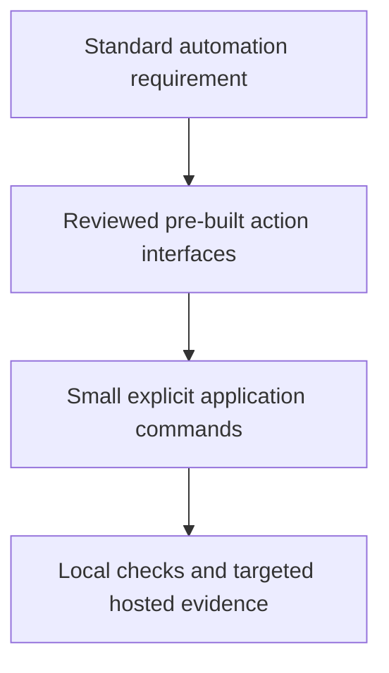

# 0042 · Compose an action-based pipeline and maintain its dependencies

!!! note "Teaching brief"
    This page defines the planned lesson. Use its module guide and checked-in examples for context; develop the guided exercise in a teaching session. Written plans and assistant-run checks do not establish learner mastery.

## Prerequisites

- [0041 · Automate releases, pull requests, and reports with pre-built actions](0041-release-pr-and-reporting-actions.md)
- [Module guide](prebuilt-actions.md)

## What you will learn to do

- Replace reusable platform glue with pre-built actions while preserving explicit application commands.
- Maintain reviewed action pins and verify interface changes during upgrades.

## Explain the Actions behavior

1. Prefer an existing maintained action for standard platform operations before writing new glue.
2. Compose actions through named inputs and outputs; avoid adding dependencies that only hide a trivial command.
3. A commit pin needs an update process, release mapping, and a review of transitive and runtime changes.

Prefer maintained pre-built actions for standard platform operations. Keep project build/test commands explicit and introduce custom code only where the required behavior needs it. Follow the [teaching guide](teaching-guide.md).

## Planned local lab

Develop the exercise under `labs/0042/` or extend the linked examples. Reuse installed tools and explain what each check proves.

1. Annotate each step in the CI recipe as platform setup, data exchange, or application behavior.
2. Use the snapshot to map each full SHA in a recipe to its upstream release tag.
3. Plan an update pull request and the smallest local and hosted checks it requires.

## Break it and diagnose it

Upgrade an action while keeping an obsolete input or output name. Use metadata and a consumer check to diagnose the contract change.

Ask for a prediction before reproducing the failure. Keep permission-dependent and remote-service behavior separate from local static checks.

## Planning diagram



## Retrieval questions

1. Which shell operations were removed from the recipe?
2. When is a short application command still the right interface?
3. How will you detect a changed action contract after updating a pin?

## Evidence and remaining limits

Capture the learner's prediction, modified example, failure diagnosis, repair, and explanation of the appropriate test boundary. Local YAML validation does not execute a remote action or prove GitHub permissions. Hosted exercises and repository writes need a deliberate execution plan.

Use the [primary sources](../references/resources.md) and [dated action catalog](../references/prebuilt-actions.md). Recheck current releases, publisher evidence, and permissions when developing the lesson.

## Start this lesson in a new thread

```text
/teach 0042

Expand docs/lessons/0042-compose-maintained-actions-and-manage-updates.md in place.
Read docs/mission.md, NOTES.md, docs/lessons/teaching-guide.md, the module
guide, and prerequisite Actions pages. Prefer pre-built actions over shell glue.
Teach one concept at a time. Ask for predictions and exercises before revealing
solutions. Keep local checks small, distinguish hosted effects, and record only
actual learner evidence.
```

| Previous Lesson | All Lessons | Next Lesson |
| --- | --- | --- |
| [0041 · Automate releases, pull requests, and reports with pre-built actions](0041-release-pr-and-reporting-actions.md) | [Curriculum](index.md) | [0043 · Agentic Markdown sources, frontmatter, lock workflows, and execution stages](0043-agentic-markdown-and-compiled-workflows.md) |
