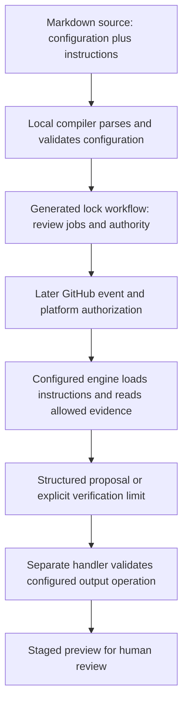

# 0043 · Agentic Markdown sources, frontmatter, lock workflows, and execution stages

Start Module 8 by tracing a repository report through source, compilation, and execution. The local labs use synthetic evidence and make no model calls.

## Add an agent at a defined boundary

A conventional Actions job runs commands selected by its author. An **agentic workflow** gives a configured coding agent a task and a set of allowed tools. The agent chooses steps within those limits. Deterministic checks should still compute facts such as bundle drift or test status directly. An agent can summarize those facts and explain findings, but its prose does not replace the checks.

GitHub's [tutorial](https://docs.github.com/en/actions/tutorials/develop-agentic-workflows-in-github-actions) describes Markdown sources compiled by the `gh aw` extension into Actions `.lock.yml` files. A **source** contains YAML frontmatter followed by instructions. A **lock workflow** is generated executable configuration consumed by Actions. The filename extension does not mean every runtime dependency, model response, or repository byte is frozen.



The arrows below the lock require runtime observations. Even runtime success is evidence about that revision, event, policy, and environment, rather than every possible future execution.

## Read the source in two passes

`labs/0043/repo-report.md` copies and narrows the shared repository-report example. The original `examples/agentic/repo-report.md` stays unchanged. This lab source remains outside the active `.github/workflows/` directory.

```yaml title="labs/0043/repo-report.md, frontmatter excerpt"
on:
  workflow_dispatch: # (1)!
permissions:
  contents: read
engine: copilot
network: defaults
tools:
  bash: []
  github:
    toolsets: [repos]
    allowed: [get_file_contents] # (2)!
safe-outputs:
  staged: true
  create-issue:
    title-prefix: "[learning] "
    max: 1 # (3)!
timeout-minutes: 5
max-turns: 4
```

1. Manual dispatch declares an event contract. Keeping this source in `labs/` does not register a dispatchable workflow.
2. The task needs file reads. It does not need arbitrary shell execution or issue-management tools. Availability, authorization, and reachability remain distinct boundaries.
3. One requested issue is the operation limit. Staging previews the handler's operation; it does not make inference local.

The [frontmatter reference](https://github.github.com/gh-aw/reference/frontmatter/) documents these fields. The five-minute setting bounds the agentic execution step in the current implementation; generated jobs have separate timeouts. Do not call five minutes the complete run budget. Likewise, four turns does not promise four billable API requests.

The body asks the agent to inspect README, Taskfile, examples, and test scripts, cite actual paths, distinguish failures from suggestions, and name unavailable evidence. The body says "do not claim tests passed unless a tool result provides evidence". This source disables shell commands. The agent can read a test script, but it cannot claim to have run it.

!!! tip "Predict"
    You replace the report's heading without changing frontmatter. You then change `max: 1` to `max: 2`. Which edit changes generated execution policy? Does either prove the report is accurate?

??? tip "Worked prediction"
    The heading changes instructions; the output limit changes configuration and requires regeneration/review of the lock. Neither verifies the report. The current [Markdown contract](https://github.github.com/gh-aw/reference/markdown/) loads instructions at runtime, so instruction-only changes can affect behavior without a new lock. Include both source revision and generated workflow in review evidence.

## Lab: inspect real bytes without inventing execution

Run commands from the repository root with the existing [host tools](../cheatsheet/local-testing.md).

Run the inventory with the already-installed Python environment and PyYAML:

```bash
.venv/bin/python labs/0043/inventory.py
```

Expected: JSON containing `workflow_dispatch`, engine `copilot`, permission `contents: read`, toolset `repos`, `staged: "true"`, `issue_limit: "1"`, two SHA-256 strings, and:

```text
"claim": "source inspected; compile and runtime unverified"
```

The script uses `yaml.BaseLoader`, preserving scalars as strings, including the key `on`. Its output types reflect that loader choice, rather than a new gh-aw schema. The digests fingerprint literal frontmatter/body bytes for this exercise. They do not implement the compiler's normalization or hash algorithm.

Predict the result, then run:

```bash
.venv/bin/python labs/0043/exercise.py
```

Expected, exit 0:

```text
body edit: lab frontmatter digest unchanged; body digest changed
output-limit edit: lab frontmatter digest changed
expected rejection: missing opening frontmatter delimiter
PASS: source edits distinguished; invented runtime claims rejected
```

The script mutates strings in memory, checks changed policy, reproduces malformed frontmatter, and checks a small teaching ledger. It creates no workflow, lock, run, or model result. The parser rejection is a deliberate local failure, rather than a compiler diagnostic.

## Diagnose a false success claim

A report says, "The source passed inspection, therefore the agent inspected the repository and all tests passed." Locate the unsupported transition before changing YAML.

??? tip "Diagnosis and repair"
    Inspection observed configuration bytes. It did not observe an engine reading files or a test process returning success. Replace the claim with the inventory's exact scope. Preserve `runtime unverified` until relevant runtime evidence exists, and `tests not executed` until a test actually ran at the target revision. Adding permissions or extending a prompt cannot turn static evidence into execution.

A second failure is missing the closing frontmatter delimiter. The parser cannot separate instructions from configuration. Repair the delimiter in a disposable copy and rerun the inventory. A valid inventory still leaves the compiler's schema and reference resolution unchecked.

## Transfer and retrieval

Design a reporting task for an action's changed input contract. List the deterministic evidence producer, files the agent needs, output limit, and evidence it must mark unavailable. Keep the release decision outside the agent's prose.

Explain from memory:

1. What consumes the lock workflow, and what consumes the instructions?
2. Why can a body-only change alter behavior without a lock diff?
3. Which evidence distinguishes reading a test from executing it?
4. What would a successful strict compile leave unknown?

??? tip "Worked transfer and retrieval"
    A direct metadata/adapter check should produce revision-specific evidence. The report can read it and the changed metadata, with at most one staged proposal. Actions consumes the lock; the configured engine receives instructions. Review the Markdown body too, because the engine loads its instructions at runtime. Command status and output support execution claims. Compilation leaves authentication, runtime tool access, model quality, and handler behavior unobserved.

## Verification boundary

The installed GitHub CLI was **2.96.0** on **2026-10-30**. `gh aw version` and `gh aw compile --help` reported the extension as available to install, rather than returning its version/help: **gh-aw is absent**. No compiler success is claimed. [0045](0045-agentic-local-compilation-and-generated-yaml.md) supplies a guarded compile path and a labeled inspection schematic. No credentials, agent execution, or active workflow registration are needed here.

| Previous lesson | All lessons | Next lesson |
| --- | --- | --- |
| [0042 · Compose an action-based pipeline and maintain its dependencies](0042-compose-maintained-actions-and-manage-updates.md) | [Curriculum](index.md) | [0044 · Agent engines, authentication, tools, and network boundaries](0044-agentic-engines-tools-and-authentication.md) |
