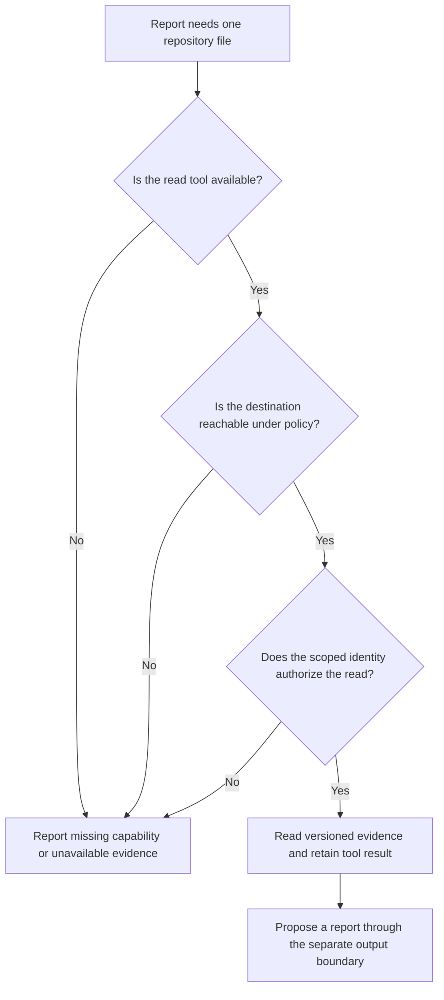

# 0044 · Agent engines, authentication, tools, and network boundaries

!!! note "Authored reference lesson"
    This lab evaluates a declared capability policy against synthetic requests. No credential is loaded and no service is contacted. Passing it does not establish GitHub authorization or model behavior.

## Prerequisites and observable goals

Read [0043 · Source and execution stages](0043-agentic-markdown-and-compiled-workflows.md). Recall [0031 · Token and event trust](0031-github-token-forks-and-trust-boundaries.md) and [0033 · Hosted identity and approvals](0033-oidc-environments-and-hosted-policy.md): identity, scope, and approval are separate contracts.

Map each report requirement to a capability and identity. Predict whether requests fail at the tool, network, permission, credential-role, or operation boundary. Reject an overbroad configuration without attempting a remote write. Success is a minimal capability inventory plus the decisions produced by `labs/0044/`. Run all commands from the repository root with the installed environment.

## Separate identities before choosing an engine

An **engine** is the coding-agent implementation performing the task. Its inference authentication is separate from the identity reading repository files or publishing an output. A working developer `gh` login does not establish that a future runner can authenticate an engine.

The current [authentication reference](https://github.github.com/gh-aw/reference/auth/) distinguishes Copilot organization billing through `copilot-requests: write` from the personal-repository `COPILOT_GITHUB_TOKEN` path. The Module 8 source selects `copilot` but configures neither new credentials nor organization inference permission. That remains a hosted prerequisite. Other engines have their own supported routes; verify the selected route and installed version before a hosted experiment.

Separate four responsibilities:

| Identity or policy | Purpose | Evidence still needed |
| --- | --- | --- |
| Compiler's reference resolution | Read required action/import references | Local compile and resolution diagnostics |
| Engine authentication | Reach selected inference service | Authentication result and service usage |
| Repository-read identity | Retrieve intended source/evidence | Tool result, revision, and access scope |
| Output-handler identity | Apply configured output operations | Handler permissions, preview, and policy result |

Do not supply an administrator credential simply because a file read fails. First determine whether the file exists, is in the intended repository/ref, and is supported by the available tool. A missing capability and a denied request have different repairs.



## Capabilities intersect

`tools.github.toolsets: [repos]` selects an API group; `allowed: [get_file_contents]` narrows available operations. The [GitHub tools reference](https://github.github.com/gh-aw/reference/github-tools/) describes toolsets, allowlists, and separate tool authentication. Selection does not mint a token or guarantee success. Imported configuration can contribute tools, so review the resolved configuration.

```yaml title="Reporting-source excerpt; compilation remains unverified"
permissions:
  contents: read # (1)!
tools:
  bash: [] # (2)!
  github:
    toolsets: [repos]
    allowed: [get_file_contents]
network: defaults # (3)!
```

1. Contents read supports the observation. Inspect every generated job for its own authority.
2. An empty Bash allowlist disables commands under the current [tools contract](https://github.github.com/gh-aw/reference/tools/). Omitting a field does not establish that all defaults are disabled.
3. `defaults` is a maintained domain group, not a synonym for offline or unrestricted internet. Review its expansion and engine transport against the installed release.

The [network reference](https://github.github.com/gh-aw/reference/network/) describes firewall controls and their runtime scope. An allowed domain says where traffic may go; it does not authorize every API operation there. Host setup steps, custom tools, and external servers have additional boundaries requiring separate review.

!!! warning "Prompt text is not authorization"
    “Read only” expresses intended behavior. Tool restrictions, scoped credentials, network policy, and output handlers enforce different parts of that intent. If a separate shell tool has a write credential, handler staging cannot guard that route.

## Lab: predict the first failing boundary

`labs/0044/policy.json` is a **normalized teaching model**, not gh-aw frontmatter. Its only data-service destination is `api.github.com`; it does not model inference transport, setup traffic, DNS, or real firewall enforcement. Credential values are role labels, never tokens.

Predict four decisions: read README with a repository-reader role, invoke an unavailable issue-creation tool, upload to `upload.invalid`, and use a model-provider role as a repository credential.

```bash
.venv/bin/python labs/0044/boundary.py labs/0044/policy.json
.venv/bin/python labs/0044/exercise.py
```

The first command exits 0 with:

```text
read-readme: allow
write-issue: tool unavailable
upload-text: network destination denied
PASS: declared capability decisions match; no service contacted
```

The exercise changes one field at a time so earlier checks do not mask later checks. It expects independent denials for tool, destination, permission, credential role, and direct mutation, then detects four excessive grants:

```text
PASS: five independent denials and four overbroad grants detected
```

The evaluation order explains the first reported denial, rather than prescribing GitHub's enforcement order. Several real layers could reject the same request.

??? tip "Worked prediction"
    The file read satisfies the model's requirements. The issue request fails because its tool is absent. The upload has an allowed tool label but the wrong destination. A model-provider role cannot satisfy repository authentication in this design. These decisions read nothing from GitHub.

## Reproduce excess authority and repair the design

```bash
.venv/bin/python labs/0044/boundary.py labs/0044/overbroad.json
```

Expected **exit 1**, with four `REJECT` diagnostics: unexpected tools, destination, repository authority, and credential role. This fixture deliberately grants shell/issue tools, a wildcard destination, write permission, and an administrator role. The audit never attempts those operations.

??? tip "Diagnosis and repair"
    Compare each grant to the requirement: one file read. Restore `policy.json` as the minimal declaration and rerun its audit. If a later report needs an unavailable file, report that limit or review a specific read route. General writes cannot repair missing read evidence. The positive policy passes after excessive grants are removed; hosted authentication remains unverified.

## Transfer and retrieval

A report must summarize tests, but the only tool reads files. Choose between claiming success, reading a revision-bound evidence artifact, or describing unexecuted tests. Explain what a trustworthy artifact must identify.

Answer without reopening the examples:

1. Which identity authenticates inference, and which authorizes repository reads?
2. Can API-group selection guarantee access to every repository?
3. Does an allowed destination make an operation read-only?
4. Why does staged issue creation leave a direct shell write relevant?

??? tip "Worked transfer and retrieval"
    Read an artifact identifying command, revision, result, and observing environment, or state that tests were not executed. Inference and repository credentials serve different consumers. Tool selection cannot guarantee scope or visibility. Network controls permit destinations; API authorization constrains operations. Direct writes need independent controls because they bypass the staged handler.

## Verification boundary

Primary documentation was checked on **2026-10-30**. This exercise verifies the teaching model's decisions. The gh-aw extension is absent, so effective source capabilities have not been compiled or exercised. `docker info` failed to connect to the Podman socket; no container or `act` execution occurred. Inference, GitHub authorization, firewall enforcement, and target runner behavior require a later bounded platform experiment.

| Previous Lesson | All Lessons | Next Lesson |
| --- | --- | --- |
| [0043 · Agentic Markdown sources, frontmatter, lock workflows, and execution stages](0043-agentic-markdown-and-compiled-workflows.md) | [Curriculum](index.md) | [0045 · Strict local compilation and inspection of generated workflows](0045-agentic-local-compilation-and-generated-yaml.md) |
