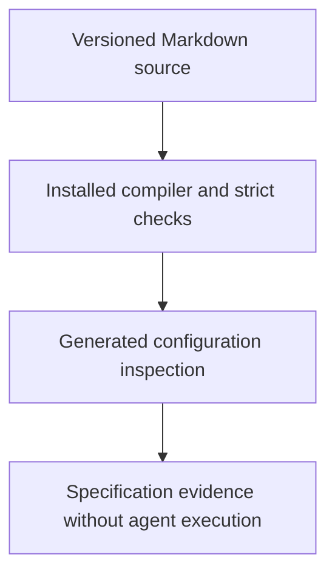

# 0045 · Strict local compilation and inspection of generated workflows

!!! note "Placeholder for a future teaching thread"
    This page is a teaching brief. Expand it into a full interactive lesson in its own thread. The planned exercises and outcomes have not been completed or demonstrated.

**Level:** Advanced.

## Prerequisites

- [0044 · Agent engines, authentication, tools, and network boundaries](0044-agentic-engines-tools-and-authentication.md)
- [0043 · Agentic Markdown sources, frontmatter, lock workflows, and execution stages](0043-agentic-markdown-and-compiled-workflows.md)

## What you will learn to do

- Run a local specification check without dispatching a workflow.
- Review generated permissions, action references, and output handling as executable configuration.

## Explain the Actions behavior

Start from the prerequisite workflow or action behavior and introduce these concepts with focused examples:

1. A local compiler checks configuration and generates executable workflow structure.
2. No-emit validation and generated-output inspection serve different review needs.
3. Installed CLI versions and dependency resolution affect available flags and reproducibility.

Explain the relevant workflow YAML, expressions, and action code in context. Follow the [shared teaching guide](teaching-guide.md) for pacing, expected output, and progression toward independent design.

## Planned local lab

Create an isolated exercise under `labs/0045/` when the lesson is developed. Explain setup and expected output before each command; reuse installed tools rather than reinstalling them on every step.

1. Inspect gh aw version and compile help before using flags.
2. Run the existing no-emit strict check using the project task.
3. Generate a disposable lock workflow outside the active workflow directory and review jobs, permissions, action pins, and agent/tool configuration.

## Break it and diagnose it

Use an unsupported option copied from newer documentation or mistake a network-resolution failure for a task syntax failure.

Ask for a prediction first. Capture the smallest reproducer, the actual result, and the corrected behavior. State which remaining claim requires a real GitHub or external-service check.

## Planning diagram



When expanding this lesson, refine the diagram to show the actual processes, branches, data exchange, and trust boundaries being taught.

## Retrieval questions

1. Which operation is actually performed by this compile command?
2. Why keep generated inspection output outside active workflows while learning?
3. What would make the generated configuration reproducible?

## Evidence to capture in the teaching thread

- A working learner-produced example and an explanation of why it works.
- A reproduced failure, a reasoned repair, and the smallest check that verifies it.
- A short account of remaining limits, unresolved questions, and readiness for the next lesson.

Use [primary references](../references/resources.md) to verify current syntax, runtime support, and tool behavior. Add learning records only for real statements or demonstrated understanding; a placeholder or generated page does not establish mastery.

## Start this lesson in a new thread

```text
/teach 0045

Expand docs/lessons/0045-agentic-local-compilation-and-generated-yaml.md in place using docs/lessons/teaching-guide.md.
Read docs/mission.md, NOTES.md, and the prerequisite lesson pages first.
Begin with a short check of the Actions prerequisites. Explain relevant YAML,
expressions, and action contracts, one concept at a time. Let me predict and
try each exercise before revealing its answer. Keep feedback local where possible.
Finish with retrieval questions and a truthful handoff for the next thread.
```

| Previous Lesson | All Lessons | Next Lesson |
| --- | --- | --- |
| [0044 · Agent engines, authentication, tools, and network boundaries](0044-agentic-engines-tools-and-authentication.md) | [Curriculum](index.md) | [0046 · Safe outputs, staging, write limits, and human review](0046-agentic-safe-outputs-and-human-review.md) |
