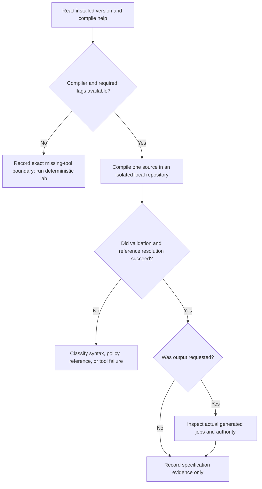

# 0045 · Strict local compilation and inspection of generated workflows

!!! note "Authored reference lesson"
    The compiler is absent in the authoring environment. This lesson includes a guarded optional compile path and a runnable inspection lab. `illustrative.lock.yml` is hand-written teaching material, never a successful compilation receipt.

## Prerequisites and observable goals

Read [0043 · Source and execution stages](0043-agentic-markdown-and-compiled-workflows.md) and [0044 · Capability boundaries](0044-agentic-engines-tools-and-authentication.md). Recall [0008 · Workflow linting](0008-workflow-shell-and-security-linting.md): syntax and expression checks do not execute jobs.

Choose the correct local check, distinguish missing tooling from invalid source, and inspect permissions, dependencies, deadlines, and references in an executable workflow. Success means you can review both a no-emit result and an emitted artifact without upgrading either to runtime evidence. Commands run from the repository root using existing tools.

## Version and help are part of the experiment

Start with read-only discovery:

```bash
gh --version
gh extension list
gh aw version
gh aw compile --help
```

Observed on **2026-10-30**: GitHub CLI **2.96.0**, no installed extensions, and both gh-aw commands exited 1 with:

```text
gh aw is available as an official extension.
To install it, run:
  gh extension install github/gh-aw
```

That message is installation advice from `gh`, not compiler help. This exercise does not install anything. An absent compiler prevents schema/reference validation; it does not make the source invalid and does not justify inventing a generated lock.

The current [compilation reference](https://github.github.com/gh-aw/reference/compilation-process/) documents `--no-emit` for validation without lock output, `--strict` for security validation, and `--output` for an output directory. Compilation can resolve imports and action references over the network. A network-resolution failure is different from parsing/schema failure. Optional scanners add their own requirements; no-emit is not evidence that every scanner ran.



## Validate and inspect as separate operations

The optional wrapper performs only compilation:

```bash
.venv/bin/python labs/0045/compile_local.py
```

In the current environment, expected **exit 2**, ending with:

```text
UNVERIFIED: gh-aw compile help unavailable; compiler not invoked
```

Exit 2 is the wrapper's prerequisite classification. It is not gh-aw's exit-code contract. With a previously installed compatible extension, the wrapper checks help/version, creates a temporary independent Git repository beneath `labs/0045/`, copies the lab source, and invokes the equivalent of:

```bash
# Command form inside the isolated temporary repository; not a dispatch.
gh aw compile .github/workflows/repo-report.md --no-emit --strict
```

The separate Git root prevents compiler repository discovery from reaching the course's active `.github` tree. The temporary source and any auxiliary compiler cache are removed afterward. A 120-second process timeout bounds the local call. Failure preserves the diagnostic on stderr; no agent is invoked.

For a compatible compiler, an explicit emit request instead uses `--strict --output <temporary-output-directory>`:

```bash
.venv/bin/python labs/0045/compile_local.py --emit
```

Only successful actual lock outputs are copied into `labs/0045/generated/`, alongside the compiler version. No generated output exists from this authoring run. Inspect auxiliary generated assets as well before any future adoption; copying a lock for inspection is not a complete deployment package.

!!! tip "Predict"
    A no-emit command returns success. Where is the new lock file? If an emitted workflow uses a mutable action tag, should you hand-edit the generated `uses` line to satisfy review?

??? tip "Worked prediction"
    No-emit intentionally writes no lock. Emit separately to inspect executable bytes. Change supported source/configuration or reference-resolution inputs and regenerate; hand edits can be lost on the next compile and hide a source/artifact mismatch. The [compilation pinning contract](https://github.github.com/gh-aw/reference/compilation-process/#action-pinning) describes generated references and their resolution cache.

## Lab: inspect an honest schematic

`labs/0045/illustrative.lock.yml` is ordinary Actions YAML with four named stages: `prepare`, `agent`, `safe_outputs`, and `conclusion`. Its steps print schematic labels or check a local variable. It contains **no engine, tool gateway, real output handler, remote action, or compiler metadata**. Real generated job names and topology vary with compiler/configuration; these labels are a teaching simplification.

```yaml title="Schematic excerpt, not gh-aw output"
agent:
  needs: prepare # (1)!
  permissions:
    contents: read
  runs-on: ubuntu-latest
  timeout-minutes: 5 # (2)!
  steps:
    - run: printf '%s\n' 'SCHEMATIC agent; no model or tools invoked'
```

1. A job dependency is executable configuration. Trace all dependency edges and conditions, rather than trusting the visual order of jobs in a file.
2. This is an ordinary job deadline in the schematic. It is distinct from the gh-aw source's agent-step timeout.

Predict the results, then run:

```bash
.venv/bin/python labs/0045/inspect_lock.py labs/0045/illustrative.lock.yml
.venv/bin/python labs/0045/exercise.py
.tools/bin/actionlint labs/0045/illustrative.lock.yml
```

Expected: inspector exit 0 with `jobs=prepare,agent,safe_outputs,conclusion`; exercise exit 0 with:

```text
PASS: schematic dependency chain inspected; unsafe authority, pin and deadline rejected
```

Actionlint should return exit 0 with no diagnostics. It checks this inactive recipe, not a compiled agentic workflow. The custom inspector is deliberately stricter than a general workflow linter: it allows manual dispatch only, read/empty permissions, explicit deadlines, and full commit pins for remote references. It does not prove shell safety, authorization, or runtime dependency behavior. Some real compiler jobs need capabilities outside this teaching policy; review their purpose instead of blindly applying its result as a production gate.

## Break authority, then repair the source of the defect

```bash
.venv/bin/python labs/0045/inspect_lock.py labs/0045/fixtures/unsafe.lock.yml
```

Expected **exit 1**, identifying write authority, a missing job deadline, and `example/unknown-action@main`. This file is an intentionally rejected fixture, not a dependency to fetch. Do not include it in the positive actionlint command.

??? tip "Diagnosis and repair"
    Review workflow-level permissions and each job's effective permissions, then the unpinned reference. In the schematic, the corrected file demonstrates the intended read-only/deadline policy. In real compiler output, repair the corresponding source or supported configuration and regenerate. If compilation fails resolving a legitimate reference, capture that failure separately; broadening runtime permissions or weakening strict checks is not a reference-resolution repair.

For an actual generated artifact, also inspect engine/model settings, tool defaults/imports, prompt loading, sandbox/network configuration, secret transport, output staging, conditions after failure/cancellation, and every generated job's timeout. Diff source and lock together at the reviewed revision. Static YAML shape alone cannot establish these runtime contracts.

## Transfer and retrieval

A teammate copied a flag from newer docs, got an unknown-option error, then reported “source schema invalid.” Explain the evidence needed to repair that diagnosis. Next, design a review of a source whose body changed while its lock stayed identical.

1. How do no-emit validation and emission answer different questions?
2. Why isolate both the output directory and compiler working repository?
3. What should be recorded when a resolver cannot reach GitHub?
4. Which claim remains unverified after the schematic passes actionlint?

??? tip "Worked transfer and retrieval"
    Compare installed version/help with the command before judging source. Read the body diff because runtime instructions can change independently. No-emit checks a specification; emission exposes generated configuration. Isolating working state also contains auxiliary files. Record the resolver diagnostic and exact unresolved reference, leaving compile unverified. The schematic proves neither real compilation nor engine execution; actionlint only supports its syntax/expression review.

## Verification boundary

The host inspection lab remains useful with gh-aw absent. No emitted lock, reference resolution, engine run, handler execution, GitHub authorization, service behavior, cancellation, or OS parity has been verified. Primary documentation was checked on **2026-10-30**; the installed-help gap is intentional and visible. Continue to output policy with [0046](0046-agentic-safe-outputs-and-human-review.md).

| Previous Lesson | All Lessons | Next Lesson |
| --- | --- | --- |
| [0044 · Agent engines, authentication, tools, and network boundaries](0044-agentic-engines-tools-and-authentication.md) | [Curriculum](index.md) | [0046 · Safe outputs, staging, write limits, and human review](0046-agentic-safe-outputs-and-human-review.md) |
