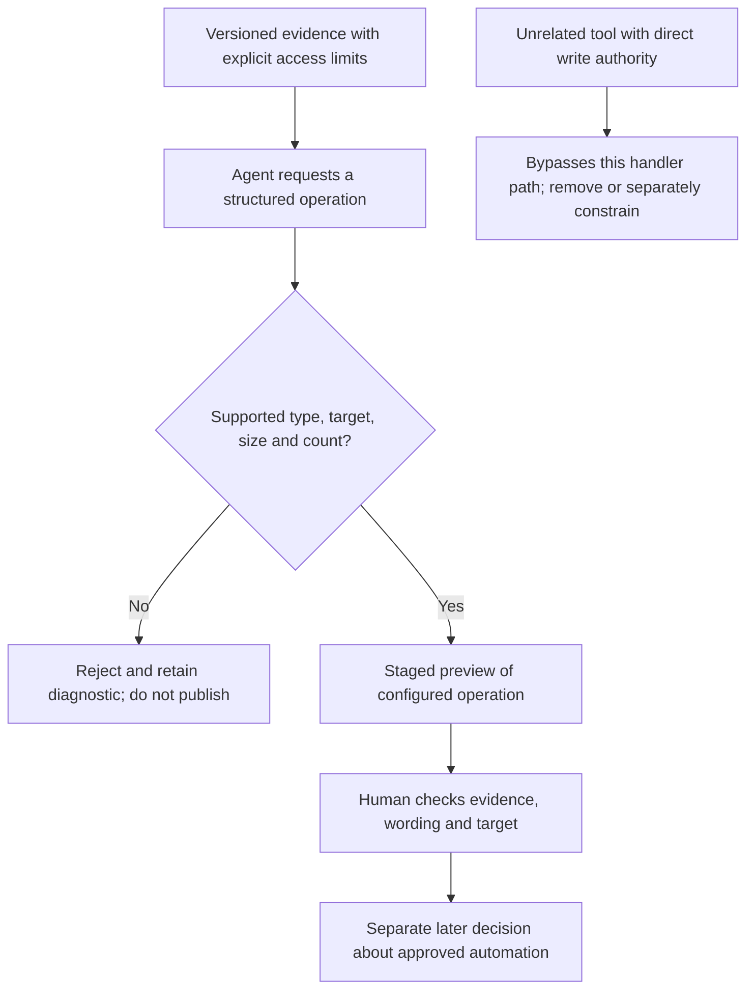

# 0046 · Safe outputs, staging, write limits, and human review

!!! note "Authored reference lesson"
    The lab previews local JSON proposals and rejects unsafe batches. It has no publisher or HTTP client. It does not execute gh-aw handlers or prove their hosted behavior.

## Prerequisites and observable goals

Read [0045 · Compile and inspect](0045-agentic-local-compilation-and-generated-yaml.md), [0044 · Capabilities](0044-agentic-engines-tools-and-authentication.md), and [0032 · Untrusted inputs](0032-script-injection-artifacts-and-privileged-events.md). Recall that a value proposed by an untrusted producer must be validated before a privileged consumer uses it.

Trace one proposed issue through policy, preview, and a separate human decision. Reject unsupported operations, excessive counts, oversized bodies, invalid citations, and a direct-write bypass. Success means all six deliberate failures produce no partial preview and you can explain why a valid preview still needs evidence review. Run commands from the repository root.

## A proposal does not own publication authority

A **safe output** is a configured operation requested through structured data, then processed by separate permission-controlled machinery. The [safe outputs reference](https://github.github.com/gh-aw/reference/safe-outputs/) describes this separation and per-operation limits. An agent requesting an issue does not need general repository-write authority in its analysis job. Inspect the actual generated handler jobs and permissions before adopting the workflow.

For this course's report, the intended operation is small:

```yaml title="labs/0043/repo-report.md — output policy"
safe-outputs:
  staged: true # (1)!
  create-issue:
    title-prefix: "[learning] "
    max: 1 # (2)!
```

1. The configured built-in operation is previewed in the Actions summary. It is not published by this handler path while staged.
2. The limit bounds issue operations for the configured run. It is not a budget for all network requests, workflow runs, or separately authorized tools.

A title prefix makes provenance easier to recognize; it does not validate the report's truth. A maximum count limits repetition; one false issue is still false. Review both authorization and content.



The [staged-mode guide](https://github.github.com/gh-aw/reference/staged-mode/) explicitly scopes staging to handlers. Hosted agent analysis still executes. Custom jobs, external tool servers, persistent memory, diagnostics, and credentials have separate effects. Review those paths even when every configured issue operation is staged.

!!! tip "Predict"
    A batch contains two good proposals under `max: 1`. Should the local review print the first before rejecting the second? If staging is enabled but a shell tool can call a write API, what prevents that call?

??? tip "Worked prediction"
    This lab rejects the complete batch before producing a preview, so partial validation cannot look like approval. The actual handler's behavior must be inspected and verified separately. Staging does not govern an unrelated shell API call; remove that capability and its credential or apply independent controls. Prompt wording is insufficient.

## Lab: validate an explicit teaching envelope

`labs/0046/valid.json` contains a local `policy` and `proposals` list. **This envelope is a teaching format, not gh-aw's tool-call or artifact schema.** Its type is spelled `create_issue`; the source configuration key is `create-issue`. Do not feed this JSON directly to a hosted output handler.

The policy requires staging, one operation, a 1,024-byte UTF-8 body limit, no direct-write tools, and citations from `known_paths`. The proposal cites the intentionally broken action metadata used in 0047. The size bound is a course policy chosen for a small review, rather than a claim about GitHub's issue-body limit.

```json title="Proposal excerpt"
{
  "type": "create_issue",
  "title": "Restore composite output mapping",
  "body": "Static evidence: broken/action.yml declares a greeting without a value mapping. No runner test was executed.",
  "citations": ["broken/action.yml"]
}
```

Run:

```bash
.venv/bin/python labs/0046/review.py labs/0046/valid.json
```

Expected exit 0:

```text
STAGED PREVIEW: [learning] Restore composite output mapping
Static evidence: broken/action.yml declares a greeting without a value mapping. No runner test was executed.
ACCEPT: 1 staged proposal(s); publications=0
```

`ACCEPT` means that the envelope satisfied this local structural policy. The checker does not open the cited file or establish that its content supports the finding. That evidence-quality boundary is the next lesson. Keeping structural and semantic claims separate makes both results easier to interpret.

## Break the operation contract

First predict the outcome for an unsupported merge operation:

```bash
.venv/bin/python labs/0046/review.py labs/0046/unsupported.json
```

Expected **exit 1**, stderr `REJECT: unsupported operation`, with no preview on stdout. There is no fallback publisher.

Now run all six controlled failures:

```bash
.venv/bin/python labs/0046/exercise.py
```

Expected six `expected rejection` lines and:

```text
PASS: six output-policy failures rejected; publications=0
```

The exercise creates temporary envelope copies, invokes the real review program as a process, and requires exit 1 plus empty stdout for each case. It tests two proposals, an unsupported type, oversized multibyte text, `../` traversal in a citation, a direct-write capability, and disabled staging. The maintained positive fixture remains unchanged.

??? tip "Diagnosis and repair"
    Two proposals exceed the declared count: combine only related findings into one reviewed issue or leave additional findings in a report. An unsupported operation needs a different approved policy, not a renamed JSON field. `é` uses two UTF-8 bytes, so 513 characters exceed this 1,024-byte body budget. Shorten content without discarding evidence. Restore citations from the supplied inventory; remove the direct-write tool; restore staging. Rerun the positive fixture and the failure exercise so the repair preserves rejection behavior.

The subprocess test's exit 0 means its intentionally failing child processes behaved correctly. It is not a claim that those bad proposals passed review. Reading stderr alongside the process status preserves the distinction.

## Put human review at an explicit decision point

A useful review reads the source revision, proposed target, full title/body, evidence, unexecuted checks, policy result, and any handler errors. It checks whether a finding is a defect or a suggestion and whether it duplicates existing work. Avoid including confidential input in public reports or diagnostic previews.

Staging itself is not a durable approval queue. Removing `staged: true` changes behavior for subsequent execution; it does not automatically publish a previously approved immutable preview. A later run can produce a different proposal. If publication requires human approval, bind that decision to the exact content and target, or enforce an appropriate protected handler environment and inspect its actual wiring. [0033](0033-oidc-environments-and-hosted-policy.md) explains why platform approvals require real configuration evidence. This lesson leaves publication disabled.

## Transfer and retrieval

A maintenance bot should propose one documentation correction but must never merge code. Design its read tools, permitted output, preview, and review evidence. Then consider a valid-looking report that cites a nonexistent path: which part of this local checker detects it, and what additional semantic check remains?

1. Which component applies a configured safe output?
2. Why does `max: 1` not make a false finding acceptable?
3. Which direct capability could bypass staging?
4. Does a local preview prove the hosted summary or human approval ran?

??? tip "Worked transfer and retrieval"
    Allow only the necessary evidence reads and a staged documentation proposal; omit merge authority and direct-write tools. Record the exact proposal and evidence for review. This checker rejects paths outside its declared inventory, but a dishonest inventory could still contain a nonexistent path, and a real path could support a false conclusion. The handler performs configured operations; content correctness requires evidence review. A local preview observes none of the hosted presentation or approval machinery.

## Verification boundary

Primary output and staging references were checked on **2026-10-30**. The exercise tests real local parsing, limits, errors, exit status, and absence of partial previews. No gh-aw compiler, actual handler, GitHub permission, model call, approval, issue creation, or publication was executed. Continue to [0047](0047-agentic-fixtures-adversarial-input-and-evaluation.md) for grounded report evaluation.

| Previous Lesson | All Lessons | Next Lesson |
| --- | --- | --- |
| [0045 · Strict local compilation and inspection of generated workflows](0045-agentic-local-compilation-and-generated-yaml.md) | [Curriculum](index.md) | [0047 · Agentic fixtures, adversarial repository text, and quality evaluation](0047-agentic-fixtures-adversarial-input-and-evaluation.md) |
