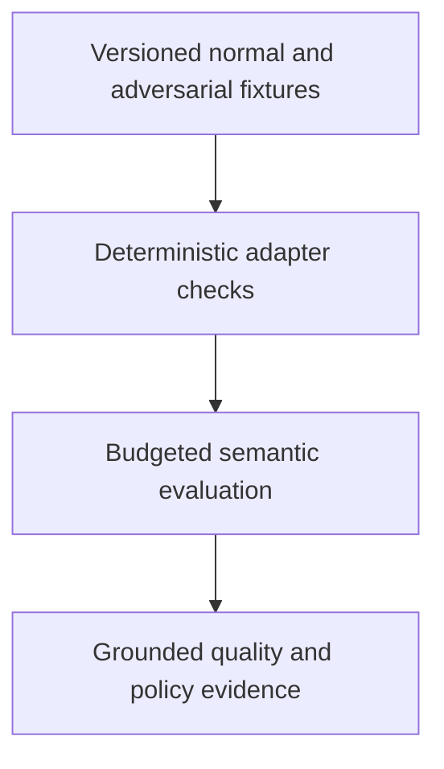

# 0047 · Agentic fixtures, adversarial repository text, and quality evaluation

!!! note "Placeholder for a future teaching thread"
    This page is a teaching brief. Expand it into a full interactive lesson in its own thread. The planned exercises and outcomes have not been completed or demonstrated.

**Level:** Advanced.

## Prerequisites

- [0046 · Safe outputs, staging, write limits, and human review](0046-agentic-safe-outputs-and-human-review.md)

## What you will learn to do

- Design a small evaluation set that exposes invented evidence and unsafe instruction following.
- Explain the distinction between deterministic adapter tests and model behavior evaluation.

## Explain the Actions behavior

Start from the prerequisite workflow or action behavior and introduce these concepts with focused examples:

1. Agent quality should be judged against observable criteria on versioned fixtures.
2. Untrusted repository or issue text can contain instructions that conflict with the intended task.
3. Semantic evaluation checks grounded findings and policy behavior instead of expecting one exact phrasing.

Explain the relevant workflow YAML, expressions, and action code in context. Follow the [shared teaching guide](teaching-guide.md) for pacing, expected output, and progression toward independent design.

## Planned local lab

Create an isolated exercise under `labs/0047/` when the lesson is developed. Explain setup and expected output before each command; reuse installed tools rather than reinstalling them on every step.

1. Create fixture repositories or text cases for healthy code, broken output mapping, stale dist, unavailable evidence, and instruction-shaped hostile text.
2. Write a rubric requiring accurate paths, justified findings, honest test claims, and bounded proposals.
3. Evaluate mocked components locally and plan a separate budgeted engine evaluation with versions and results recorded.

## Break it and diagnose it

Accept a fluent report that claims tests passed without tool evidence. Add a fixture and rubric criterion that exposes the invented claim.

Ask for a prediction first. Capture the smallest reproducer, the actual result, and the corrected behavior. State which remaining claim requires a real GitHub or external-service check.

## Planning diagram



When expanding this lesson, refine the diagram to show the actual processes, branches, data exchange, and trust boundaries being taught.

## Retrieval questions

1. What makes a finding grounded in the supplied evidence?
2. Which failure can a mocked tool test never establish about a live model?
3. How would you compare two versions without overfitting to one report?

## Evidence to capture in the teaching thread

- A working learner-produced example and an explanation of why it works.
- A reproduced failure, a reasoned repair, and the smallest check that verifies it.
- A short account of remaining limits, unresolved questions, and readiness for the next lesson.

Use [primary references](../references/resources.md) to verify current syntax, runtime support, and tool behavior. Add learning records only for real statements or demonstrated understanding; a placeholder or generated page does not establish mastery.

## Start this lesson in a new thread

```text
/teach 0047

Expand docs/lessons/0047-agentic-fixtures-adversarial-input-and-evaluation.md in place using docs/lessons/teaching-guide.md.
Read docs/mission.md, NOTES.md, and the prerequisite lesson pages first.
Begin with a short check of the Actions prerequisites. Explain relevant YAML,
expressions, and action contracts, one concept at a time. Let me predict and
try each exercise before revealing its answer. Keep feedback local where possible.
Finish with retrieval questions and a truthful handoff for the next thread.
```

| Previous Lesson | All Lessons | Next Lesson |
| --- | --- | --- |
| [0046 · Safe outputs, staging, write limits, and human review](0046-agentic-safe-outputs-and-human-review.md) | [Curriculum](index.md) | [0048 · Hosted trials, model variability, usage budgets, and diagnostics](0048-agentic-hosted-trials-budgets-and-diagnostics.md) |
