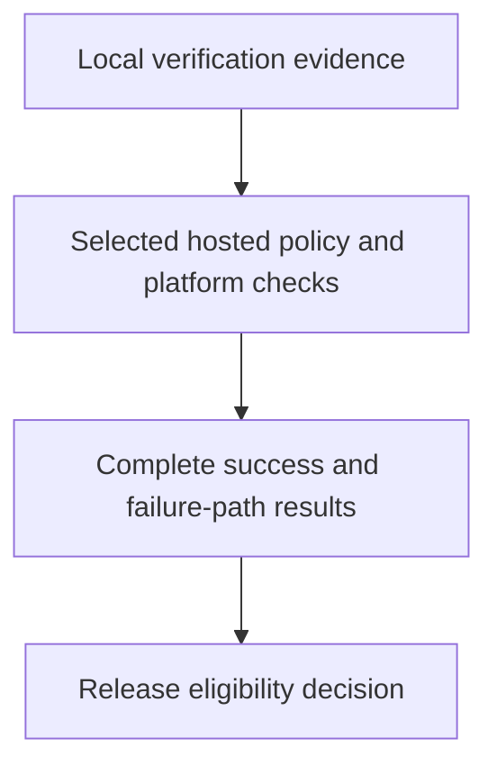

# 0047 · Exercise local checks and the hosted integration gate

!!! note "Placeholder for a future teaching thread"
    This page is a teaching brief. Expand it into a full interactive lesson in its own thread. The planned exercises and outcomes have not been completed or demonstrated.

**Level:** Professional practice.

## Prerequisites

- [0046 · Add an evidence-backed agentic report with bounded proposals](0046-capstone-bounded-agentic-reporting.md)
- [0012 · Define the local/hosted coverage boundary and usage budget](0012-local-hosted-coverage-and-usage-budget.md)
- [0033 · OIDC, deployment environments, approval, and real platform verification](0033-oidc-environments-and-hosted-policy.md)
- [0045 · Compose shared setup and reusable workflow orchestration](0045-capstone-reusable-workflow-fanout-and-fanin.md)

## What you will learn to do

- Produce a complete local evidence pack and a short hosted verification plan.
- Demonstrate failure-path behavior before considering a release candidate eligible.

## Explain the Actions behavior

Start from the prerequisite workflow or action behavior and introduce these concepts with focused examples:

1. Release confidence is a collection of evidence from appropriate environments.
2. Platform-dependent authorization, scheduling, environments, and target OS behavior need real integration checks.
3. A gate should fail closed on missing required evidence and remain diagnosable.

Explain the relevant workflow YAML, expressions, and action code in context. Follow the [shared teaching guide](teaching-guide.md) for pacing, expected output, and progression toward independent design.

## Planned local lab

Create an isolated exercise under `labs/0047/` when the lesson is developed. Explain setup and expected output before each command; reuse installed tools rather than reinstalling them on every step.

1. Run the shared Task commands and collect direct, static, packaging, and selected workflow evidence.
2. Define and execute only the reviewed hosted checks needed for the intended runner matrix, permissions, OIDC, and environment policy.
3. Inject a controlled failed or missing worker result and confirm the release gate rejects it with an actionable message.

## Break it and diagnose it

Treat a skipped integration check or absent artifact as successful evidence. Repair the gate logic and add a negative case.

Ask for a prediction first. Capture the smallest reproducer, the actual result, and the corrected behavior. State which remaining claim requires a real GitHub or external-service check.

## Planning diagram



When expanding this lesson, refine the diagram to show the actual processes, branches, data exchange, and trust boundaries being taught.

## Retrieval questions

1. Which acceptance claim does each check establish?
2. What evidence is required from the actual GitHub platform?
3. How would a new operator explain why a release was blocked?

## Evidence to capture in the teaching thread

- A working learner-produced example and an explanation of why it works.
- A reproduced failure, a reasoned repair, and the smallest check that verifies it.
- A short account of remaining limits, unresolved questions, and readiness for the next lesson.

Use [primary references](../references/resources.md) to verify current syntax, runtime support, and tool behavior. Add learning records only for real statements or demonstrated understanding; a placeholder or generated page does not establish mastery.

## Start this lesson in a new thread

```text
/teach 0047

Expand docs/lessons/0047-capstone-local-and-hosted-integration-gates.md in place using docs/lessons/teaching-guide.md.
Read docs/mission.md, NOTES.md, and the prerequisite lesson pages first.
Begin with a short check of the Actions prerequisites. Explain relevant YAML,
expressions, and action contracts, one concept at a time. Let me predict and
try each exercise before revealing its answer. Keep feedback local where possible.
Finish with retrieval questions and a truthful handoff for the next thread.
```

| Previous | All lessons | Next |
| --- | --- | --- |
| [0046 · Add an evidence-backed agentic report with bounded proposals](0046-capstone-bounded-agentic-reporting.md) | [Curriculum](index.md) | [0048 · Release the action suite, deploy the site, and write the operating playbook](0048-capstone-release-deployment-and-operating-playbook.md) |
