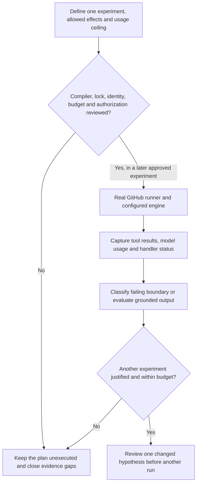

# 0048 · Hosted trials, model variability, usage budgets, and diagnostics

Prepare a trial plan and classify synthetic failures. The lab does not execute a trial, dispatch a workflow, call a model, or change repository credentials.

## A trial changes where work runs

The current [CLI testing reference](https://github.github.com/gh-aw/setup/cli/#trial) describes `trial` as execution in a temporary private repository by default, or in a selected host repository. Its logical repository context is distinct from its execution repository. `run` dispatches through GitHub Actions. These commands can involve repository changes, authentication, runner use, and inference usage. They are outside this local lab.

Review current installed help before any later experiment. In this environment the extension is absent, so no installed trial/run flag contract is available. Do not copy a command from a newer web page and assume the installed version supports it. This lesson deliberately provides no ready-to-execute dispatch command.

A **hosted smoke experiment** answers whether the configured runtime can authenticate, read the intended evidence, and produce an expected staged result. A **model quality evaluation** compares outcomes over a versioned corpus and repeated samples. One smoke success does not evaluate all five cases from 0047 or establish consistent model behavior.



## Separate limits from observations

`labs/0048/plan.json` is a declaration with all actual usage counters set to zero. It names unresolved compiler, lock-review, authentication, provider-budget, and execution-authorization states. Its repository/model fields are visibly unselected or unrecorded. These are open prerequisites, not generated receipts.

The planning budget allows two runs and separately models five job deadlines:

```json title="plan.json, deadline and budget excerpt"
{
  "planned_job_deadlines_minutes": {
    "activation": 2,
    "agent": 7,
    "detection": 3,
    "safe_outputs": 3,
    "conclusion": 1
  },
  "budget": {
    "planned_runs": 2,
    "max_runs": 2,
    "max_runner_minutes": 32,
    "max_model_requests": 8,
    "max_external_writes": 0,
    "actual_runs": 0,
    "actual_model_requests": 0,
    "actual_external_writes": 0
  }
}
```

These job labels and timeouts are planning values. They do not come from compiler output or configure a runner. The sum is 16 job-minutes per run; two runs give 32 job-minutes. Parallel execution can reduce wall time while consuming aggregate job time. Queueing, setup, billing granularity, runner rates, retries, and additional generated jobs require separate accounting; this arithmetic is not a price quote.

The source's five-minute agent-step timeout and `max-turns: 4` do not automatically enforce this complete budget. The [cost-management reference](https://github.github.com/gh-aw/reference/cost-management/) documents turn and usage controls, which must be checked against engine behavior. A turn is not a guaranteed unit of billable requests, tokens, or money. Before running the plan, identify how to measure requests and enforce the eight-request limit. The saved plan marks that enforcement as unverified.

!!! tip "Predict"
    The plan audit exits 0 while all readiness booleans are false. Did it authorize a run? Would reducing wall time with parallel jobs also halve aggregate runner use?

??? tip "Worked prediction"
    Exit 0 means the declarations are consistent. The program has no dispatch capability and does not establish readiness or authorization. Parallel execution overlaps job durations; summing job time still counts each job. The planned ceiling must include the actual generated graph and retry policy before a real experiment.

## Lab: audit the unexecuted plan

Run commands from the repository root with the installed host tools.

```bash
.venv/bin/python labs/0048/plan.py labs/0048/plan.json
```

Expected exit 0:

```text
planned execution ceiling=32 job-minutes; not a billing quote
PLAN CONSISTENT: hosted runs=0, model requests=0, writes=0 in this saved declaration
Readiness remains unverified; this program cannot dispatch
```

Now ask the stricter question:

```bash
.venv/bin/python labs/0048/plan.py labs/0048/plan.json --require-ready
```

Expected **exit 1**, with five `BLOCKED: not ready` lines for:

- Compiler verification.
- Generated workflow review.
- Authentication verification.
- Provider-budget enforcement.
- Execution authorization.

The booleans are assertions a reviewer must substantiate; setting them to true is not evidence. Keep the command, revision, run reference, usage observation, and review result that justify each actual claim. The audit checks arithmetic and consistency, rather than contacting services to verify declarations.

## Diagnose the boundary before budgeting another attempt

`labs/0048/events.json` contains normalized synthetic signals, not raw gh-aw logs. Run:

```bash
.venv/bin/python labs/0048/diagnose.py
.venv/bin/python labs/0048/exercise.py
```

The first command prints eight boundary classifications and ends with:

```text
SYNTHETIC DIAGNOSTICS ONLY: no logs downloaded and no reruns requested
```

The exercise expects five unresolved readiness prerequisites and rejects runner-budget exhaustion, a third run, excessive model requests, and any external write. Its final line is:

```text
PASS: budget overruns blocked; eight boundaries plus unknown classified; hosted runs=0
```

All failure fixtures are evaluated locally. The synthetic auth-denied signal does not prove an actual token was rejected.

| Symptom | Boundary to inspect | Useful next evidence |
| --- | --- | --- |
| Compiler missing | Local toolchain | Installed extensions/version/help |
| Reference resolution denied | Compiler dependency access | Exact reference and resolver diagnostic |
| Model authentication denied | Inference identity | Configured route, engine version, redacted authentication result |
| Destination blocked | Runtime network policy | Required host and firewall decision |
| Tool unavailable | Capability configuration | Effective tool list and missing observation |
| Unsupported test claim | Report quality | Transcript, rubric failure, subject revision |
| Handler count rejected | Output policy | Proposed operation count and configured limit |
| Cancellation after proposal | Partial execution | Individual handler outcomes and existing effects before retry |

The [debugging guide](https://github.github.com/gh-aw/troubleshooting/debugging/) describes runtime diagnostics. A green engine step does not imply the output handler completed. A red workflow does not prove nothing happened. Preserve stage-level status and inspect any partial effects before retrying; automatic reruns can duplicate operations or spend usage without addressing the cause.

??? tip "Diagnosis and repair"
    For repeated authentication denial, stop rather than buying more model attempts. Review the configured identity through an authorized credential-management process without printing values. For a missing read tool, report the limit or redesign the required observation. If the agent reads the files but makes unsupported claims, add that failure to the rubric. Change one prompt instruction and test whether it fixes the claim. For handler rejection, repair the proposal or intended policy instead of widening the agent's write credentials. None of these repairs is performed by this synthetic classifier.

## Design the next smallest hosted experiment

A future experiment should identify its disposable execution repository, trusted trigger/ref, source/body/lock digests, installed compiler and engine versions, model identifier, actual tool/network policy, staged output, per-job deadlines, and service budget. Record who owns the stop decision and what evidence must exist before another run. Confirm that diagnostics and previews are appropriate for the repository's visibility.

Capture run ID, event/ref, job statuses, relevant redacted tool results, source/evidence revisions, staged output and handler result, runner duration, and model usage as distinct observations. Unknown or unavailable usage stays unknown. Do not replace missing consumption data with a zero.

For a later quality comparison, five cases times two repetitions times two variants means 20 evaluated samples if each case gets its own run. That is a new evaluation plan beyond this two-run smoke allowance. Count samples and infrastructure calls according to the real arrangement, and stop on fabrication, unexpected writes, or unmeasurable usage. No price estimate is implied here.

## Transfer and retrieval

You see a cancelled run with a valid report artifact but unknown handler status. Write the next observation required before any rerun. Then explain how you would compare a revised prompt without silently increasing the smoke budget to cover a full corpus evaluation.

1. Where does a hosted trial execute?
2. Which controls limit inference separately from runner time?
3. Why does a staged result still consume possible model usage?
4. What makes a second attempt a useful experiment?

??? tip "Worked transfer and retrieval"
    Inspect individual handler status and existing effects at that run before repeating anything. Keep a new corpus/repetition budget separate from smoke testing. A trial uses GitHub infrastructure; inference limits and accounting belong to the engine/service configuration as well as workflow controls. Staging changes output-handler publication, while analysis still runs. A second attempt needs a diagnosed boundary, a specific hypothesis or justified additional sample, available allowance, and a reviewed decision.

## Verification boundary

Primary CLI, usage, and diagnostic references were checked on **2026-10-30**. Local checks establish plan consistency and classifier behavior. No live trial, repository provisioning, model evaluation, hosted cancellation, service authorization, billing, or output publication was verified. The absent compiler and unavailable container socket remain explicit local gaps. Module 9 begins with [0049 · Reuse, compose, or create](0049-reuse-compose-or-create-an-action.md).

| Previous lesson | All lessons | Next lesson |
| --- | --- | --- |
| [0047 · Agentic fixtures, adversarial repository text, and quality evaluation](0047-agentic-fixtures-adversarial-input-and-evaluation.md) | [Curriculum](index.md) | [0049 · Decide when to reuse, compose, or create your own action](0049-reuse-compose-or-create-an-action.md) |
