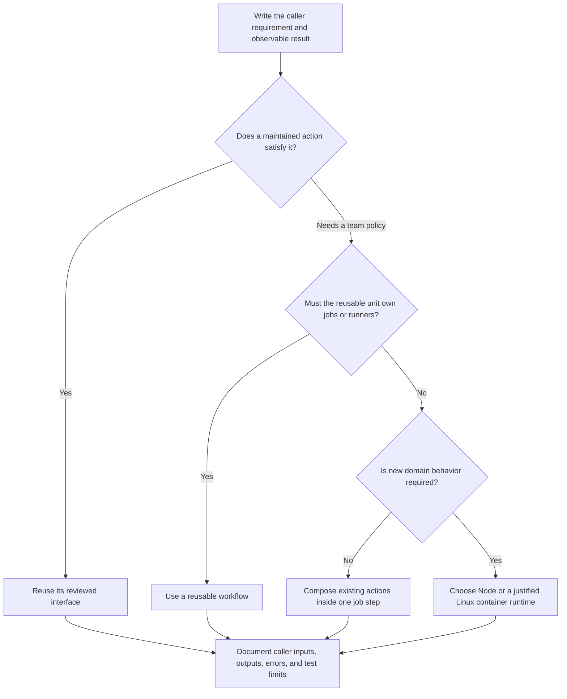

# 0049 · Decide when to reuse, compose, or create your own action

Start Module 9 with the caller's requirement. Choose an implementation only after you can state what the caller needs to observe.

## Begin with a caller requirement

An **action** is a reusable unit invoked by a job step. Callers depend on its input names, defaults, outputs, failure behavior, and runtime files. Creating an action means maintaining those promises. A short script that only one workflow uses can remain an explicit project command. Wrapping it becomes useful when several callers need a stable policy or reusable behavior.

Before implementing anything, write one sentence describing the caller's need. For example: "Every repository should select Node 24, restore npm's download cache using its lockfile, and receive the installed version." Runtime installation is already maintained by `actions/setup-node`; our own contribution can be the narrower team interface. GitHub's [building-block guide](https://docs.github.com/en/actions/how-tos/write-workflows/choose-what-workflows-do/find-and-customize-actions) explains how callers reference actions.

The [dated catalog](../references/prebuilt-actions.md) is a discovery aid. Check task fit and upstream input/output metadata before choosing a component. Popularity is dated evidence, and a verified creator badge identifies the publisher; neither establishes that the code meets your contract. This module reuses the existing reviewed full commit references instead of silently updating them.



!!! tip "Prediction"
    A team asks for checkout, setup, build, and test on Ubuntu plus a separate Windows job. Can one composite action choose both runners? What would its caller have to own?

??? tip "Worked prediction"
    Each composite invocation runs inside one existing job. The caller can invoke it separately in an OS matrix, or a reusable workflow can own the jobs and matrix. A composite's metadata cannot create an independent Windows job. Choose a reusable workflow when the reusable contract includes that orchestration.

## Choose the boundary deliberately

| Need | First useful choice | Responsibility you still own |
| --- | --- | --- |
| Install Node and cache npm downloads | Maintained `actions/setup-node` | Reviewed inputs, lockfile, dependency installation, and tests |
| Standardize setup inputs across repositories | Composite around setup-node | Public defaults and mappings; dependency updates |
| Validate a repeated component/channel naming policy | Small Node action | Domain validation, process adapter, packaged JavaScript |
| Ship a specific Linux scanner and runtime together | Docker action | Base image, tool versions, image startup, mount and process tests |
| Reuse runner selection, job dependencies, and evidence joins | Reusable workflow | Job-level inputs, permissions, outputs, and orchestration |

A **composite** packages steps in the caller's job. A **reusable workflow** is called at the job level and can contain multiple jobs. GitHub's [comparison in the composite tutorial](https://docs.github.com/en/actions/tutorials/create-actions/create-a-composite-action#composite-actions-and-reusable-workflows) describes these distinct scopes. An action does not declare its own trigger or job-level token permissions.

A **Node action** executes JavaScript selected by metadata. You can write the implementation in TypeScript. The consumer runs its generated JavaScript. A **Docker action** packages a Linux process in an image; the runner still supplies arguments, workspace mounts, output files, and status handling. Python existing on the host is not by itself a reason to introduce a container. Use one when consistent Linux tooling or dependencies justify its cost.

## Inspect the existing examples before adding code

Run commands from the repository root with the [existing host tools](../cheatsheet/local-testing.md).

Open `examples/project-setup-action/action.yml`. Its useful team interface is two inputs, `node-version` and `cache-dependency-path`, and the `node-version` output. Internally, it calls setup-node. The caller still owns checkout and project commands:

```yaml title="Existing caller excerpt; complete recipe: examples/own-action-consumer.yml"
- uses: ./examples/project-setup-action # (1)!
  id: project
  with:
    node-version: '24'
    cache-dependency-path: package-lock.json
- run: npm ci # (2)!
- run: npm test
```

1. This path resolves from the checked-out workspace. The complete recipe runs checkout first; the excerpt is not a complete workflow.
2. Restoring npm download data does not install `node_modules` or execute the project's dependency installation. Keeping this command in the caller makes project behavior visible.

Now run the existing four-adapter comparison:

```bash
uv run python scripts/test_actions.py
```

Expected: four test methods report `ok`, followed by `OK`. Their subcases exercise the JavaScript, bundled TypeScript, Python entrypoint, and composite script directly. They verify equivalent greeting output, invalid inputs, append behavior, and missing-output errors. They do not invoke setup-node or execute Docker metadata.

If all four implementations produce `greeting=Hello, Ada!`, does that justify maintaining all four? Explain your choice before opening the answer.

??? tip "Worked interpretation"
    Equivalent results expose packaging choices, not a requirement for four implementations. Choose the cheapest maintainable boundary that satisfies actual runtime and portability needs. The Node function is enough for this tiny transformation; the other examples teach interfaces and test layers.

## Lab: write the decision record

Use `labs/0049/decision-record.md`. Its five requests cover reuse, composition, domain policy, Linux tooling, and jobs. Write your decisions before opening its collapsed answer. Then define this proposed action:

> Given a component such as `docs` and a channel such as `preview`, compute `release-key=docs-preview`. Do not upload or publish anything.

Record input names and accepted strings, defaults, invalid cases, output name, exit behavior, caller files, runner assumptions, and required token permissions. Explain whether this is shared policy or merely one caller's command. Later lessons implement that small policy so the public contract can be tested independently of release operations.

??? tip "Worked contract"
    Use `component=docs` and `channel=preview` as defaults. Accept a lowercase ASCII component starting with a letter, at most 32 characters, with remaining characters limited to letters, digits, and hyphens. Accept only `preview` or `stable` for channel. Publish `release-key` after all validation succeeds. Reject empty strings, whitespace, newlines, unknown channels, and malformed labels with nonzero status and no success output. The action needs no token and no caller files. A consumer using a local path needs checkout. A Node implementation can be tested with pure cases plus a real process and temporary output file.

## Break the design, then repair its responsibility

Propose a custom installer that downloads "latest Node," extracts it into a hardcoded system directory, and assumes every runner has the same architecture. Do not run it. Identify who now maintains integrity checks, platform selection, PATH updates, caching, and new releases.

The proposed installer takes on work that setup-node already maintains. It cannot meet the cross-repository setup contract until you also implement and maintain those parts. A successful download on your laptop would not resolve the other cases.

??? tip "Diagnosis and repair"
    Trace the requirement to the existing action's metadata, rather than debugging an installer implementation. Replace installation logic with a reviewed setup-node call. Add a composite only if the narrower team defaults and output mapping are valuable. In 0051, the actual failure becomes a missing caller lockfile; adding an installer fallback would conceal that error instead of fixing the file boundary.

## Transfer and retrieval

A release pipeline needs a Linux scanner, a Windows compatibility check, and a final job that rejects missing evidence. Choose the workflow-level unit and the possible action-level units inside it. State one reason each unit should remain separate.

Answer without reopening the table:

1. What missing requirement justifies a new implementation?
2. When is a composite too small a boundary?
3. Which behavior must remain stable if you replace a Node implementation with Docker?
4. What did the four-adapter host check leave untested?

??? tip "Worked transfer and retrieval"
    A reusable workflow can own runner selection, both jobs, dependencies, and the final gate. The Linux scanner can be a Docker action when its toolchain requires packaging; the Windows check may reuse a maintained action and explicit project commands. A naming policy can remain a small Node action. New code is justified by unmet domain behavior or runtime needs. Public input/output names, accepted values, defaults, failures, and documented platforms remain the compatibility contract. Host tests do not evaluate action metadata, remote downloads, GitHub scheduling, or token policy.

## Verification limits and next lesson

The decision record is a design artifact. The adapter tests give actual process evidence for existing examples; neither establishes that a chosen remote action executed successfully. A reviewed, bounded GitHub consumer remains necessary for platform services and intended runner compatibility. The recorded checks include no hosted execution or model calls.

Primary references were checked on **2026-10-30**; exact URLs and executed checks are recorded in `labs/module-9-handoff.md`. Continue to [0050](0050-own-action-metadata-and-contracts.md) to turn the chosen boundary into metadata and executable assertions.

| Previous lesson | All lessons | Next lesson |
| --- | --- | --- |
| [0048 · Hosted trials, model variability, usage budgets, and diagnostics](0048-agentic-hosted-trials-budgets-and-diagnostics.md) | [Curriculum](index.md) | [0050 · Design action.yml inputs, outputs, runtimes, and failure contracts](0050-own-action-metadata-and-contracts.md) |
