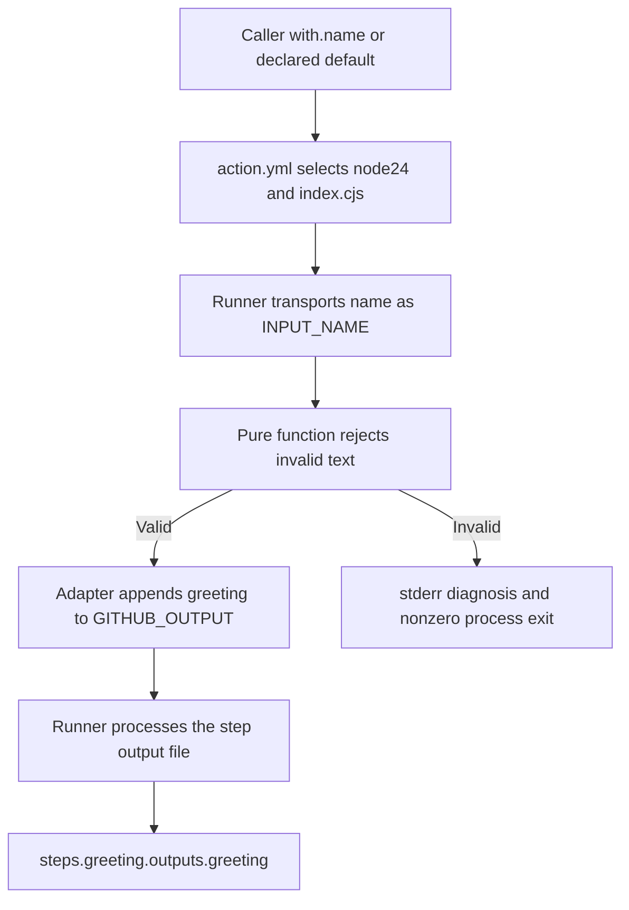

# 0050 · Design action.yml inputs, outputs, runtimes, and failure contracts

Read the metadata, run its adapter, and trace the output to an inactive consumer. Predict each success and failure case before running its probe.

## Metadata describes the action boundary

**Action metadata** is the `action.yml` or `action.yaml` file in an action's directory. It documents the interface and selects how the runner executes it. A workflow has `on` and `jobs`; an action has `inputs`, `outputs`, and `runs`. An action's display `name` is not the caller step's `id`.

The lab copies the existing JavaScript greeting into `labs/0050/action/` so you can inspect and edit an isolated package. Its complete metadata is:

```yaml title="labs/0050/action/action.yml"
name: Module 9 greeting contract
description: Demonstrate metadata declarations and runtime validation separately.
inputs:
  name:
    description: Nonempty single-line recipient; surrounding whitespace is trimmed.
    required: true # (1)!
    default: World
outputs:
  greeting:
    description: Validated single-line greeting.
runs:
  using: node24 # (2)!
  main: index.cjs
```

1. This declares the input requirement. It does not make the runner reject missing or invalid values automatically. The default is still a valid omission policy.
2. This selects the runner's action runtime. `main` names a file inside the action package. Installing another Node version for the caller's commands does not rewrite this metadata.

The metadata reference defines [input declarations](https://docs.github.com/en/actions/reference/workflows-and-actions/metadata-syntax#inputs) and [Node execution fields](https://docs.github.com/en/actions/reference/workflows-and-actions/metadata-syntax#runs-for-javascript-actions). Defaults and descriptions tell callers what to send; validation must enforce the real policy.



## Specify observable behavior before writing another field

For this package, the contract is:

| Case | Adapter result | Named success output |
| --- | --- | --- |
| Runner supplies default `World` | Exit 0 | `greeting=Hello, World!` |
| `Ada` | Exit 0 | `greeting=Hello, Ada!` |
| `  Ada  ` | Exit 0 after trimming | `greeting=Hello, Ada!` |
| Explicit empty or whitespace-only process input | Exit 1 with diagnosis | None |
| Input contains CR or LF | Exit 1 with diagnosis | None |
| Missing or unwritable output path | Exit 1 | None from a completed success write |

A workflow omission allows the metadata default. A direct `node index.cjs` invocation does not evaluate metadata. The copied adapter applies its own fallback with `process.env.INPUT_NAME ?? 'World'`. The `??` fallback handles an absent environment property, not an empty string. These are two different defaulting mechanisms that happen to agree here.

For a runner-style missing required input without a default, the implementation must still reject the empty/missing value it receives. Adding `required: true` alone is insufficient. Do not infer nonempty data from a declaration.

!!! tip "Prediction"
    The metadata says `required: true` and `default: World`. If the probe passes `INPUT_NAME=''`, should the function produce a greeting or fail? Would removing the metadata default change a directly launched Node process?

??? tip "Worked prediction"
    The actual function rejects the empty string before publishing output. The direct process does not read `action.yml`, so changing its metadata default cannot change that process's fallback. A runner consumer is needed to verify metadata default injection itself.

## Read the validation and transport separately

The copied `greet.cjs` owns the domain rule:

```javascript title="labs/0050/action/greet.cjs, function excerpt"
function greet(name) {
  if (typeof name !== 'string' || /[\r\n]/u.test(name) || !name.trim()) {
    throw new Error('name must be a nonempty, single-line string');
  }
  return `Hello, ${name.trim()}!`;
}
```

This rule deliberately keeps results single-line. Without it, a value such as `Ada\nother=injected` could introduce an extra record in a naive `name=value` output format. General multiline results need the delimiter protocol or a maintained toolkit helper; revisit [0005](0005-environment-files-and-output-contracts.md#multiline-empty-missing-and-invalid-values) before accepting them.

The copied `index.cjs` owns the **adapter**, the code translating the runner interface into a function call. It reads `INPUT_NAME`, validates it, checks `GITHUB_OUTPUT`, appends the output record, logs a diagnostic, and sets a failed exit code on errors. It appends rather than truncating the file. A human log does not create `steps.greeting.outputs.greeting`; the [runner output protocol](https://docs.github.com/en/actions/reference/workflows-and-actions/workflow-commands#setting-an-output-parameter) does.

## Lab: exercise the real process contract

Run commands from the repository root. The lab uses the installed Node 24 and temporary files.

Run:

```bash
node labs/0050/probe.cjs
```

Expected:

```text
PASS: runner-supplied default; exit=0
PASS: explicit recipient; exit=0
PASS: explicit empty process input; exit=1
PASS: whitespace process input; exit=1
PASS: output-record injection; exit=1
```

The probe creates a real output file whose path contains spaces, seeds `existing=value`, and launches the actual adapter for each case. It asserts the exit code and exact file contents, including preservation of the earlier record. The first case supplies `World` directly. It checks the value a runner would pass after applying the default, without testing how the runner applies that default. The probe itself exits zero because the invalid child cases fail as intended.

Before adding a new input, write its valid, invalid, omitted, explicitly empty, missing-output, and failed-I/O cases. Do not silently make empty mean "default" unless that is the intended public policy.

### Break validation without editing the working package

```bash
node labs/0050/probe.cjs --broken
```

Expected: the first two cases pass, then the probe exits **1** with a message beginning:

```text
FAIL: explicit empty process input; exit=0;
```

The diagnostic also displays the unexpected output records. The probe generates a temporary broken adapter that accepts every value. The original package and its metadata remain available for repair comparison.

??? tip "Diagnosis and repair"
    The empty child process exited zero and wrote `greeting=Hello, !`, so the required-input policy was never enforced. The failure is inside the adapter/domain contract; changing `permissions`, adding checkout, or making `required` true again does not validate the string. Use the working `greet` function before any output write and rerun the probe without `--broken`.

## Follow the consumer and compare runtime formats

`labs/0050/consumer.yml` is a complete manual-dispatch recipe. It checks out this repository, invokes `./labs/0050/action` without `with.name`, and asserts the public output. Its important part is:

```yaml title="Inactive consumer excerpt"
- id: greeting
  uses: ./labs/0050/action
- name: Assert metadata default and named output
  env:
    GREETING: ${{ steps.greeting.outputs.greeting }}
  shell: bash
  run: test "$GREETING" = 'Hello, World!'
```

The caller's step `id` supplies the `steps.greeting` reference. A direct process test cannot evaluate that expression. The local `uses` path starts at the checked-out workspace; `main` starts at the action package. Confusing these roots produces "metadata not found" or "entrypoint not found" symptoms at different boundaries.

Different action kinds transport the same logical interface differently:

| Kind | Implementation input | Output publication | Metadata execution selector |
| --- | --- | --- | --- |
| Node | Runner's `INPUT_*` environment values | Write runner output file | `using: node24`, `main` |
| Composite | Explicit `${{ inputs.name }}` mappings | Internal step output mapped by public `value` | `using: composite`, `steps` |
| Docker in this module | Metadata `args` passed as process arguments | Write the supplied mounted output file | `using: docker`, `image` |

Composite inputs do not automatically become `INPUT_*` variables. A composite shell step must name its shell; a `uses` step delegates execution to another action. Docker arguments are explicit in our metadata; do not assume `sys.argv[1]` appears merely because `inputs.file` exists.

## Transfer exercise and retrieval

Add a proposed `style` input to your contract worksheet with accepted values `formal` and `casual`, default `formal`, and rejection of explicit empty data. Describe the metadata change, validation change, and tests before implementing it in your owned lab copy. If you choose to implement it, update the public output expectation as a compatibility decision.

1. Which file and runtime does `runs.main` select?
2. Why are descriptions and required flags insufficient validation?
3. Where does a composite map its public output?
4. What does the caller see when validation fails normally?

??? tip "Worked transfer and retrieval"
    Add a string input declaration and default, transport the style into the domain function, and validate the two accepted values before writing output. Test both styles, omission, empty data, unknown data, and unchanged prior records on failure. The declared runtime executes the action-package file named by `main`. Composite outputs map an internal step's result through `outputs.<name>.value`. Normally, a failed process fails the action step and later steps that require success skip. The process should emit no success output. A caller can explicitly alter failure handling, so that policy also needs review.

## Verification limits

The probe checks real environment transport, output-file writes, and status. Static workflow analysis checks structure and some local action interfaces. Neither runs metadata defaults or GitHub's output-expression processing. The inactive consumer is the next integration check; invoking it on GitHub is a deliberate future exercise, with a five-minute timeout and read-only checkout permission.

Primary sources were checked on **2026-10-30**; see the [source library](../references/resources.md) and `labs/module-9-handoff.md`. Continue to [0051](0051-own-composite-action-from-prebuilt-actions.md).

| Previous lesson | All lessons | Next lesson |
| --- | --- | --- |
| [0049 · Decide when to reuse, compose, or create your own action](0049-reuse-compose-or-create-an-action.md) | [Curriculum](index.md) | [0051 · Create a composite action by composing pre-built actions](0051-own-composite-action-from-prebuilt-actions.md) |
